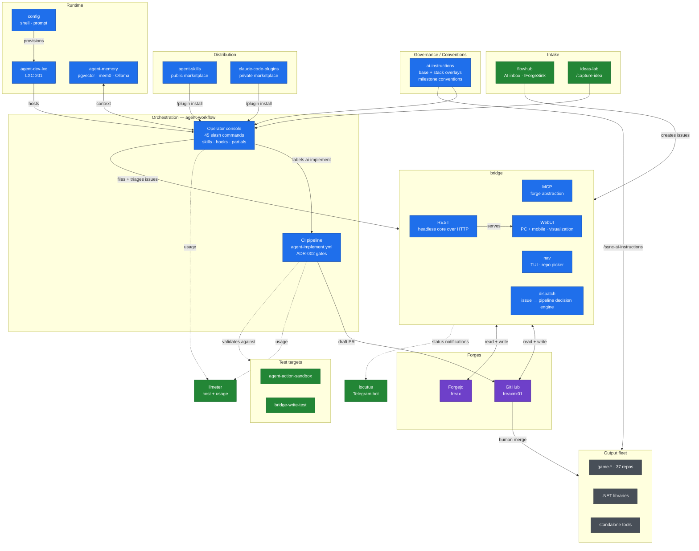

# Software Factory knowledge bundle

> Generated by `scripts/build-knowledge-bundle.sh` from `docs/knowledge-bundle.txt`
> in freaxnx01/agent-workflow. Do not edit; change the list or the source docs.
>
> This is a snapshot of documentation. Live state (issues, PRs, runs, the queue)
> comes from the bridge MCP, not from this file.
>
> Each section starts with `# FILE: <repo>/<path> (@<sha>)`: the source file and
> the last commit that touched it.

# FILE: agent-workflow/README.md (@fdd4ef0)

# agent-workflow

The personal Issue→PR pipeline, end to end: the **CI side** that runs Claude Code
in GitHub Actions, and the **operator console** — the user-level slash commands you
drive it with.

Two halves, one repo (see [ADR-005](docs/DECISIONS.md)):

| Half | Lives in | What it is |
|---|---|---|
| **CI pipeline** | `.github/workflows/`, `.github/actions/`, `scripts/`, `gate-tests/` | Reusable workflows a consumer repo calls with a ~15-line stub, plus the quality gates and their self-tests |
| **Operator console** | `commands/`, `skills/`, `hooks/`, `setup/` | 45 forge-agnostic slash commands, the user-level skills, and the `handoff-resume` hook — installed once into `~/.claude/` and available in every repo |

Design notes: [`docs/DESIGN.md`](docs/DESIGN.md) · decisions: [`docs/DECISIONS.md`](docs/DECISIONS.md) · consumer onboarding: [`docs/CONSUMER-SETUP.md`](docs/CONSUMER-SETUP.md) · glossary: [`docs/glossary.md`](docs/glossary.md) · unattended enrich lane + kill switch: [`docs/AUTOPILOT.md`](docs/AUTOPILOT.md)

---

## Diagram

Source of truth: [`docs/FACTORY-MAP.md`](docs/FACTORY-MAP.md). Use the pan/zoom
controls in the top-right corner of the diagram to view it fullscreen, or open the
[standalone fullscreen page](http://github.freaxnx01.ch/agent-workflow/) (diagram only, press F11).



Blue = core · green = supporting · purple = forges · grey = output.
Dotted edges are observation/validation rather than data flow.

---

## Slash commands — where they come from and how they get there

Claude Code resolves `/commands` from **four independent sources**. Nothing merges
them; they simply coexist, and the union is what `/` autocomplete shows. Knowing
which source a command came from tells you where to edit it and how to refresh it.

| # | Source of truth (repo) | Installed to | Mechanism | Scope |
|---|---|---|---|---|
| 1 | `freaxnx01/agent-workflow` → `commands/**` | `~/.claude/commands/**` | **copied** by [`setup/link-commands.sh`](setup/link-commands.sh) | **Every repo** on the machine |
| 2 | `freaxnx01/agent-skills` (marketplace `freax-agent-skills`) | `~/.claude/plugins/cache/freax-agent-skills/` | `/plugin install` | **Every repo** |
| 3 | `freaxnx01/ai-instructions` → `.ai/skills/**` | target project's `.claude/commands/**` | written by `/sync-ai-instructions` | The synced repo only |
| 4 | Any project's own `.claude/commands/**` | — (read in place) | committed to that repo | **That repo only** |

### 1 — This repo: the user-level console

`commands/` is the source of truth for the global commands. Subfolders become `:`
namespaces, so `commands/work.md` is invoked as `/work`.

```text
commands/
  gh/    → /gh:assign  /gh:implement  /gh:implementation-contract  /gh:review
  wt/    → /wt:status  /wt:finish
  *.md   → /handoff  /pickup  /todo  /wrap-up  /loose-ends  /clear-check
           /issues  /prs  /triage  /queue  /route  /work  /milestone  /new  /enrich
           /enrich-phased  /parked  /roadmap  /done  (forge-agnostic)
           /capture-idea  /commands  /update-commands  /factory-advisor
           /release-package
```

`setup/link-commands.sh` installs them into `~/.claude/commands/`, preserving the
subfolder layout. **The default is `cp`, not `ln -s`** — deliberate, so the installed
console doesn't silently follow whatever branch this checkout happens to be on (it
would vanish entirely on a branch predating the console). The trade-off: **`git pull`
here does not update your commands — re-run the installer.**

| Flag | Effect |
|---|---|
| *(none)* | Copy — the default |
| `--link` | Symlink into this working tree; use while actively editing commands |
| `--copy` | No-op, accepted for compatibility |
| `--no-sync` | Skip the clone/pull, install from the current tree as-is |

Because they live under `$HOME`, these commands are **not** copied into individual
repos and don't need to be. `/work` works in a non-coding repo (`org`) exactly as it
does in a code repo — Claude Code reads `~/.claude/commands/` regardless of the working
directory.

Hooks follow the same pattern: [`setup/link-hooks.sh`](setup/link-hooks.sh) copies
`hooks/handoff-resume.sh` to `~/.claude/hooks/` **and** wires it into
`~/.claude/settings.json` (backing the file up first). The copy under `$HOME` is what
executes, not the file in this repo.

`partials/` follows the same pattern for CLAUDE.md content: `@`-imported
fragments, installed by [`setup/link-partials.sh`](setup/link-partials.sh) into
`~/.claude/CLAUDE.md`, so they apply to every project on the machine. New `*.md`
files dropped into `partials/` are picked up automatically on the next install.

| File | Good for |
|---|---|
| [`task-checklist.md`](partials/task-checklist.md) | Getting action items back as `- [ ]` Markdown checkboxes instead of prose, so they're easy to tick off and reference by number. |
| [`skill-authoring.md`](partials/skill-authoring.md) | Making self-authored skills self-improving — each one is told to fix its own blockers and write the fix back into `SKILL.md` for next time. |
| [`subagent-driven-default.md`](partials/subagent-driven-default.md) | Defaulting implementation-plan execution to `superpowers:subagent-driven-development` instead of inline work, without having to ask for it each time — except issue-based plans in agent-workflow-enabled repos, which dispatch via `/gh:implement` instead. |
| [`scope-boundary.md`](partials/scope-boundary.md) | Avoiding scope creep — state scope up front, treat incidental findings as discoveries to capture (not auto-tasks), and ask before a fix chain drifts into a different project. |

See [`partials/README.md`](partials/README.md) for setup and verification steps —
that file isn't itself imported, it documents the directory for humans.

New machine, one line:

```bash
curl -fsSL https://raw.githubusercontent.com/freaxnx01/agent-workflow/main/setup/bootstrap.sh | bash
```

Full command list: [`commands/README.md`](commands/README.md).

### 2 — Plugin skills from `agent-skills`

`/sync-ai-instructions` and `/propose-ai-instructions` are **not** in this repo. They
are plugin skills published from a separate repo:

```text
upstream:     github.com/freaxnx01/agent-skills
marketplace:  freax-agent-skills
installed at: ~/.claude/plugins/cache/freax-agent-skills/
```

```text
/plugin marketplace add freaxnx01/agent-skills
/plugin install sync-ai-instructions@freax-agent-skills
/reload-plugins
```

Plugin-provided commands are global like the user-level ones, but they update through
`/plugin` — **not** through `/update-commands`.

### 3 — Commands delivered by `/sync-ai-instructions`

`ai-instructions` keeps shared skills under `.ai/skills/`: `commit` and `push`.
Running `/sync-ai-instructions <stack>` in a target project writes them into that
project's `.claude/commands/`, alongside the assembled `CLAUDE.md`. Once written they
behave as source 4 — project-scoped, committed to the consuming repo.

> The **four-phase UI workflow** (`/ui:brainstorm` → `/ui:flow` → `/ui:build` →
> `/ui:review`) used to ship here via sync. It now lives in the console as the `ui/`
> namespace (source 1) — global, installed once into `~/.claude/commands/`, so it
> works in every repo without a per-project sync. See
> [`commands/README.md`](commands/README.md) for the gated-sequence details.

### 4 — Project-scoped commands

A repo may ship its own `.claude/commands/`, active only inside that repo — whether
written by hand or delivered by source 3. They are read in place: nothing installs or
copies them, and they do not follow you to other repos.

This repo ships `/commit` and `/push` in
[`.claude/commands/`](.claude/commands/); `ai-instructions` ships the same pair plus
`/release-notes`. (The `ui-*` phases moved to the global console — see source 1.)

When a name collides with a user-level command, the project-scoped one wins.

### Refreshing

```bash
# partials + commands + hooks + skills — one idempotent installer, one repo
bash ~/repos/github/freaxnx01/public/agent-workflow/setup/bootstrap.sh
```

`/update-commands` is a thin wrapper around exactly that, and reports what changed.
This repo is now the one-URL machine bootstrap: it owns the partials, the commands,
the hooks and the skills, so nothing else is cloned.

| To refresh | Run |
|---|---|
| User-level commands + skills + hooks (source 1) | `/update-commands` |
| Plugin skills (source 2) | `/plugin` update, then `/reload-plugins` |
| A project's synced files (source 3) | `/sync-ai-instructions <stack>` in that project |

---

## Skills

`skills/` holds **user-level agent skills** — a directory per skill containing
`SKILL.md`, installed to `~/.claude/skills/` by
[`setup/link-skills.sh`](setup/link-skills.sh) with the same copy-by-default
mechanics as the commands, plus one difference: **it prunes.**

A stale slash command lies dormant until you type it. A stale `SKILL.md` keeps
matching on its description and firing forever, with no upstream file left to edit —
so the installer removes skills it previously wrote once they disappear upstream, and
refreshes each skill directory from scratch so retired `references/` files don't
linger. It tracks what it installed in `~/.claude/skills/.agent-workflow-skills` and
will only ever remove names listed there; a hand-written skill is never touched.

```text
skills/
  processing-test-feedback/SKILL.md   → /processing-test-feedback
  retitle/SKILL.md                    → /retitle
```

These are **not** the plugin skills from `agent-skills` (source 2 above). The split is
ownership: the marketplace publishes *sharable, non-personal* skills, while a skill
that calls `/new` and this repo's `area:*` label conventions is only
meaningful alongside the console — so it ships with the console.

**Skill or command?** A command is a prompt you invoke by name and nothing else. A skill
is invocable *and* self-triggering — Claude matches its `description` against what you're
actually doing, so `processing-test-feedback` engages when you paste a batch of tester
notes without you naming it. Work with a defined procedure worth following unprompted
belongs in `skills/`; a short, explicit action belongs in `commands/`.

---

## Knowledge bundle

`docs/generated/software-factory-knowledge.md` is one generated file holding the
docs the "Software Factory" Claude Project needs from agent-workflow, bridge and
ai-instructions. Add this repo to the Project once through its GitHub
integration and the Project stays current; nothing is uploaded by hand.

- **Change the set:** edit `docs/knowledge-bundle.txt` (one `<repo>/<path>` per
  line, `#` comments allowed). That is the only place.
- **Regeneration:** the `knowledge-bundle` workflow runs nightly, on pushes to
  `main` touching `README.md` or `docs/`, and on demand. It opens (or updates) a
  `chore/knowledge-bundle` PR that auto-merges; an unchanged bundle makes no PR.
  Do not edit the generated file.
- **Headers:** each section starts `# FILE: <repo>/<path> (@<sha>)`, the last
  commit that touched that file. There is no timestamp.
- **Locally:** `scripts/build-knowledge-bundle.sh --root ~/repos/github/freaxnx01/public --out /tmp/bundle.md`
  (sibling checkouts with full history; a missing source fails, naming it).
- **Live state** (issues, PRs, runs) is not in the bundle; use the bridge MCP.

---

## Related repos

| Repo | Role |
|---|---|
| [`agent-workflow`](https://github.com/freaxnx01/agent-workflow) | **This repo** — CI pipeline + user-level command console |
| [`agent-skills`](https://github.com/freaxnx01/agent-skills) | Plugin marketplace: `sync-ai-instructions`, `propose-ai-instructions` |
| [`ai-instructions`](https://github.com/freaxnx01/ai-instructions) | Agent instruction content: `base-instructions.md` + per-stack overlays |
| [`config`](https://github.com/freaxnx01/config) | Machine setup: shell, oh-my-posh prompt, Windows tooling. No Claude content |

# FILE: agent-workflow/docs/FACTORY-MAP.md (@5cd2a41)

# Software Factory — Repo Map

**Status:** living document · **Last scanned:** 2026-07-30 · **Scan method:** `bridge mcp serve` (`list_repos` across both forges)

The authoritative answer to "which repos make up the factory, what does each own, and what is the boundary between them."

Everything here was derived from a live cross-forge scan. When it goes stale, re-scan rather than trusting this file — see [Re-scanning](#re-scanning).

---

## Scope

A repo is **in the factory** if it produces or governs the pipeline that builds other software. A repo that is *built by* the pipeline is **output**, not factory.

Explicitly out of scope, though adjacent:

| Repo | Why it's out |
|---|---|
| `org` (Forgejo) | Personal planning repo. Not a pipeline component. |
| `obsidian-it`, `obsidian-homelab`, `obsidian-me` | Knowledge vaults. Inputs to thinking, not to the build. |

---

## Diagram


Blue = core · green = supporting · purple = forges · grey = output.
Dotted edges are observation/validation rather than data flow.

[Standalone fullscreen page](http://github.freaxnx01.ch/agent-workflow/) — diagram
only, no other page chrome; press F11 for browser fullscreen.

Two properties worth noting, both visible here and not in the tables below:

- **`bridge` sits between nearly everything and the forges.** Console, flowhub
  and chat sessions all route through it. Useful as a chokepoint, but it also
  makes `bridge` a single point of failure for the whole read/write path — and
  it is why the multi-client blast radius in freaxnx01/bridge#223 matters.
- **The CI path is GitHub-only.** Most Forgejo repos have no runner, so
  `ai-implement` does nothing there; `bridge` and humans are the only writers
  on that side.

## Core (7)

| Repo | Forge | Layer | Owns |
|---|---|---|---|
| **agent-workflow** | GH public | Orchestration | The whole Issue-to-PR pipeline. Two halves in one repo (ADR-005): the **CI side** (`.github/workflows/`, `.github/actions/`, `scripts/`, `gate-tests/`) and the **operator console** (`commands/` — 45 forge-agnostic slash commands, `skills/`, `hooks/`, `partials/`, `setup/`). Also the one-URL machine bootstrap. |
| **agent-memory** *(rename pending — see ADR-F001)* | GH public | Memory | Semantic memory stack: pgvector + mem0 + Ollama, exposed as an MCP server. Session Stop hook. Runs on `agent-dev` LXC 201. |
| **agent-skills** | GH public | Distribution | Public plugin marketplace `freax-agent-skills`. Sharable, non-personal skills (`sync-ai-instructions`, `propose-ai-instructions`). |
| **ai-instructions** | GH public | Convention SoT | `base-instructions.md` + per-stack overlays, `.ai/skills/` (`commit`, `push`, `release-notes`), milestone and issue-title conventions. |
| **bridge** | GH public | Cockpit + forge abstraction | Repo picker and agent-session launcher: fzf/TUI navigation, tmux slots, worktrees, presence and sync. `bridge dispatch` is the issue-to-pipeline decision engine. Surfaces: `nav` (TUI), REST, WebUI, `locutus` (Telegram), and `bridge mcp serve` — the last being the cross-forge tool layer this map was scanned with, and only one surface of several. |
| **agent-dev-lxc** | FJ private | Infrastructure | Proxmox LXC provisioning + setup for the agent container. |
| **claude-code-plugins** | GH private | Distribution | Personal (non-public) plugin marketplace. Counterpart to `agent-skills`. |
| **config** | GH public | Machine setup | Shell, oh-my-posh prompt, Windows tooling. **No Claude content** — that all lives in `agent-workflow`. |

### Factory repos are implemented by Claude

Every repo in the table above runs `agent: claude` in its `agent.yml`, not the
cheap fleet default. These are the tooling every other repo's pipeline runs on,
so a bad implementation here propagates to every consumer rather than staying in
one product. The measurement behind the fleet default (#294 — `glm-5.2` shipped
15 of 18 runs at $4.25, against 59% for `claude-opus-4-7` at $181.70) still holds
for **product** repos; it just isn't the trade to make on the factory itself.

Two traps when setting this on a consumer:

- **`agent:` defaults to `opencode`** in the reusable workflow. Setting only
  `default-model: claude-sonnet-5` without `agent: claude` asks for a Claude
  model from the opencode runner.
- **Omitting `OPENROUTER_API_KEY` looks like it works.** `classify-agent.sh`'s
  credential guard falls back to Claude when the key is absent, so a repo can
  run Claude by accident and flip to the fleet default the moment that secret is
  added for any reason. Declare `agent: claude` explicitly rather than relying on
  a missing credential.

Selecting `claude` also re-enables `classify-task.sh`'s keyword escalation, which
is Claude-only — under `opencode` every run is pinned to the default model with no
per-task triage.

> **Note on the `bridge` row.** An earlier revision of this map described
> `bridge` as "a Go MCP server". That was wrong, and it was wrong for a
> reproducible reason: an assistant holding `bridge mcp serve`'s tools in
> context inferred the whole repo from the one surface it could see, and
> then flagged the repo's *accurate* GitHub description as stale. If you are
> an agent reading this file, note that the scan method line above names a
> subcommand, not the product.

## Supporting (5)

| Repo | Role |
|---|---|
| **flowhub** | .NET 10 / Blazor / pgvector AI inbox. Capture-to-route front door; `IForgeSink` makes it a *producer* of work into the factory. |
| **llmeter** | Unified LLM cost & usage across Anthropic, OpenRouter, Mistral via local LiteLLM. The observability leg. |
| **agent-action-sandbox** (private) | Throwaway consumer repo for testing reusable workflows end-to-end. |
| **ideas-lab** (private) | Idea intake. Backs `/capture-idea`. |
| **bridge-write-test** (FJ, private) | Smoke-test target for `bridge` write operations. |

## Undecided

| Repo | Status |
|---|---|
| **build-ci** | **Revisit — see ADR-F002.** Not empty, as an earlier revision of this map claimed. It builds an Alpine base image and pushes it to `ghcr.io/freaxnx01/build-ci/build-ci:latest`. Whether it stays depends on whether anything still pulls that image. |

## Output fleet

Built *by* the factory, not part of it. Useful as a consumer fleet to validate the pipeline against.

- ~37 `game-*` repos (browser games, plus `civil-war-battlefield` in Godot)
- .NET libraries: `common`, `CommonLibrary`, `Extensions`, `PersonalLibrary`, `dotnet-scripts`, `CodeConverterSingleFile`, `SampleWebNano`, `StringKing`
- Tools: `quicktask-vikunja`, `screenpresso-localsend`, `signal-chat-to-telegram`, `mgrabber-nextgen`, `MusicGrabber`, `SaveOutlookCalendar`, `Digital-Signage`
- Homelab config: `mydocker-compose`, `mailcow-config`, `debian-install`, `linux-scripts`, `powershell`, `traefik-example`
- Web: `quotes`, `freaxnx01.github.io`, `github-pages-example`

---

## Decisions

### ADR-F001 — `agent-os` to `agent-memory`

**Status:** accepted, confirmed by `list_tree`, not yet executed

**Context.** `agent-os` declared five phases. Four had been overtaken by other repos while only Phase 1 was ever built:

| Phase | Declared status | Actually owned by |
|---|---|---|
| 1. Semantic memory | in progress | **`agent-os` — genuinely unique** |
| 2. Skill registry | planned | `agent-skills` + `agent-workflow/skills/` |
| 3. Tool registry | planned | `bridge` + the MCP proxy (LXC 130) |
| 4. Observability | planned | `llmeter` |
| 5. Orchestrator pipeline | planned | `agent-workflow` |

Zero open issues, so no tracked work sat behind phases 2–5. The "OS" name claimed a scope the repo did not have and put it in notional competition with `agent-workflow`.

**Confirmed 2026-08-11.** A recursive `list_tree` shows the repo contains exactly
one substantive tree: `memory/` (docker-compose, `mem0-mcp/` server, Ollama and
Postgres service definitions, `hooks/post-session.sh`). There is no `skills/`,
`tools/`, `observability/` or `pipeline/` directory. The phase table was
aspiration, never scaffolding.

**Decision.** Rename to `agent-memory`. Scope to the memory stack. Delete the phase table.

**Execution notes.**

- `gh repo rename` — `bridge` has no `update_repo` tool yet (freaxnx01/bridge#219), so this is manual either way.
- Once renamed, `agent-memory/memory/` is a redundant prefix. Promote the contents to the repo root, or accept the nesting deliberately.
- `memory/init/01-extensions.sql` and `memory/services/postgres/init/01-extensions.sql` are the same blob (identical sha `0aa0fc22`). Leftover from a restructure; one is dead. Delete whichever the compose files do not reference.
- Update the `agent-workflow` "Related repos" table and the Forgejo mirror after the rename.

**Consequence.** Memory is the one capability nothing else covers — this narrows the repo without demoting it. If the factory is to accumulate context across sessions rather than restart cold, this is load-bearing.

### ADR-F002 — `build-ci` — superseded, needs a new decision

**Status:** **the original decision was based on a false premise. Do not act on it.**

**Original decision (2026-07-30).** Archive `build-ci` as an empty shell.

**Why it was wrong.** The "empty" finding came from five guessed `read_file`
calls that happened to miss the two files that mattered. At the time `bridge`
had no directory listing, and the guesses were treated as conclusive rather
than as a gap. A recursive `list_tree` on 2026-08-11 shows the repo actually
contains:

| Path | What it is |
|---|---|
| `Dockerfile` | `FROM alpine` + `bash`, `curl`, `unzip` |
| `.github/workflows/docker-image.yml` | Builds and pushes `ghcr.io/freaxnx01/build-ci/build-ci:latest` on every push to `main` |
| `.github/workflows/agent.yml` | Consumer stub — already correctly named, so this repo is *not* affected by the `claude.yml` trap below |
| `README.md` | One line, which is what made the repo look abandoned |

So it is a small CI base-image builder, not a placeholder.

**The actual open question.** Does anything still pull that image? The repo is
otherwise untouched — `actions/checkout@v2` has been deprecated for years,
which suggests nothing has needed it in a long time.

- **If something pulls it:** it is live infrastructure. Keep it, and give it a
  README that says what the image is for. It belongs in Supporting, not here.
- **If nothing pulls it:** archive — but for *unused*, not for *empty*. The
  distinction matters because "empty" implied deleting cost nothing.

**Lesson recorded.** Absence of evidence from guessed paths is not evidence of
absence. This is the concrete case behind the "read before you assert" rule in
[`ADVISOR-PROMPT.md`](ADVISOR-PROMPT.md).

### ADR-F003 — One CI home

**Status:** accepted

`claude-pipeline` to `agent-pipeline` to `agent-workflow`. There is no separate pipeline repo. Any reference to `claude-pipeline` or `agent-pipeline` is stale and should be corrected — see [Rename cleanup](#rename-cleanup).

### ADR-F004 — This map lives in git, not in a chat

**Status:** accepted

Chat sessions with `bridge` access are an excellent *workbench* — live cross-forge state, no pasting, eight repos cross-referenced in a turn. They are a poor *filing cabinet*: context fills (a single `list_repos` is ~85 repos of JSON), and assistant memory across sessions is a lossy summary, not a record.

Because `bridge` can re-scan on demand, conversation history is not the continuity mechanism — **the repos are.** Therefore: decisions get written here and committed; sessions stay short and topic-scoped; the next session starts by reading this file, not by re-deriving it.

The companion to this decision is [`ADVISOR-PROMPT.md`](ADVISOR-PROMPT.md), which
holds the working rules for those sessions — including the failure modes that
made "read before you assert" a written rule rather than an assumption.

---

## Rename cleanup

Known remnants of the pre-rename naming. Not exhaustive — found by reading `docs/CONSUMER-SETUP.md` by hand, because `bridge` has no code search (freaxnx01/bridge#221).

**Run this first to get the real list:**

```bash
cd ~/repos/github/freaxnx01/public/agent-workflow
grep -rn 'claude-pipeline\|agent-pipeline\|claude\.yml\|claude-implement' . --exclude-dir=.git
```

| Remnant | Verdict |
|---|---|
| `agent-action-sandbox` repo description names `freaxnx01/claude-pipeline` | **Fix.** Pure stale text. Blocked on freaxnx01/bridge#219, or use `gh repo edit`. |
| `claude-implement.yml` | **Keep.** Deliberate forwarding shim to `agent-implement.yml`, same inputs/secrets/outputs. Removed at v2. |
| `claude.yml` consumer stub | **Fix in consumers.** Live trap: retry-on-rate-limit and chain-dispatch both redispatch `agent.yml`, so a consumer still on `claude.yml` gets silent 404s on retry and chaining (initial run still works). Retry's target is *not* consumer-overridable, so renaming the stub is the only complete fix. |
| `.claude-auto-merge-blocklist` | **Defer.** Renaming is a breaking change for every consumer that has one. Do it at v2 with the shim removal. |
| `name: Claude` / `jobs: claude:` in stub examples | **Fix.** Cosmetic, but it's what every new consumer copy-pastes. |
| Truncated sentence in `CONSUMER-SETUP.md` §1 | **Fix.** `> **Rename in progress:** the agent-workflow references below are the` stops mid-clause. Half-finished edit. |

**Sequencing.** Do the docs/description fixes now; batch the two breaking renames (`.claude-auto-merge-blocklist`, shim removal) into v2 so consumers absorb one migration, not three.

---

## Open work

| Item | Where |
|---|---|
| `update_repo` — repo metadata writes | freaxnx01/bridge#219 |
| `search_code` — cross-repo grep (forge parity problem; design decision needed) | freaxnx01/bridge#221 |
| Non-breaking rename sweep | freaxnx01/agent-workflow#205 |
| Stub-name warning | freaxnx01/agent-workflow#206 |
| v2 breaking renames (tracking) | freaxnx01/agent-workflow#207 |
| Overview snapshot contains no issues (blocks the WebUI overview) | freaxnx01/bridge#324 |
| Mobile-first cross-repo Overview page in the WebUI | freaxnx01/bridge#325 |
| Execute ADR-F001 rename (+ the two cleanup items in its execution notes) | — |
| Decide `build-ci`: check whether anything pulls its ghcr image (ADR-F002) | — |

**Shipped since this map was first written:**

- `put_file` — gated direct-to-default writes within a path allowlist
  (freaxnx01/bridge#223, closed by PR #228; follow-ups in #229). This file
  is now editable directly from an MCP session.
- `list_tree` — directory listing (freaxnx01/bridge#220).

**Unreconciled:** freaxnx01/bridge#217 (attachments + generic repo file writes)
overlaps #223. Close one as duplicate or split the scope explicitly.

Every open issue title across the factory (except `ideas-lab`'s raw
`Game idea: ...` capture titles, kept as-is by design) now follows
Conventional Commits (`ai-instructions`' new Issue Title Conventions
section).

### Known `bridge` quirks

- `create_issue` / `create_repo` return Go zero-value timestamps
- Label creation is silent on typos
- `cross_forge_status` TODO.md parser drops some multi-line items
- `cross_forge_status` returns no issues (`Ranked` / `NeedsWeighting` stay
  empty): the overview path resolves forge clients from env only and skips
  failures silently — freaxnx01/bridge#324. Until fixed, use `list_issues`
  per repo.
- `forge` parameter is case-sensitive
- `list_issues` returns titles, labels, milestone and dates — **not bodies**
  (corrected 2026-10-01; an earlier revision said "titles only"). Enough to
  filter; read the issue before judging scope or spotting a duplicate
- `list_git_forges` reports a per-forge capability list that is **not** a
  complete tool inventory; do not use it to conclude a tool is missing
- The MCP server has hung and dropped tools mid-session. If a call hangs,
  stop writing — a timed-out `put_file` leaves commit state unknown.

---

## Re-scanning

This file is a snapshot. To refresh it in a new session:

```text
Read docs/ADVISOR-PROMPT.md and docs/FACTORY-MAP.md in freaxnx01/agent-workflow,
then follow it. Today: re-scan and report drift.
```

`ADVISOR-PROMPT.md` carries the working rules; this file carries the state.
One `list_repos` call re-derives the ground truth. Update the map, commit,
move on.

# FILE: agent-workflow/docs/DECISIONS.md (@778422c)

# Architecture Decisions

This file records architecturally-significant decisions for `agent-pipeline`.
Each entry is dated and immutable — supersession is captured by a follow-on
entry, never by editing prior history.

Format: lightweight ADR (Context / Decision / Consequences) per Michael
Nygard's pattern, kept terse.

---

## ADR-001 — Agent abstraction layer (2026-05-23)

**Status:** Accepted
**Tracking:** [#5](https://github.com/freaxnx01/agent-pipeline/issues/5) under epic [#2](https://github.com/freaxnx01/agent-pipeline/issues/2)

### Context

The reusable workflow `agent-implement.yml` is hard-coded to invoke
`anthropics/claude-code-base-action` and to address Claude model IDs
(`claude-opus-5`, `claude-sonnet-5`, `claude-haiku-4-5`). Epic
[#2](https://github.com/freaxnx01/agent-pipeline/issues/2) adds OpenCode

+ OpenRouter (Mistral first) as a second executor without forcing a
redesign on every downstream script (`classify-failure.sh`,
`post-run-report.sh`, `retry-dispatch.sh`).

The pre-existing classify/report/retry pipeline already operates on a
single JSON file: `${RUNNER_TEMP}/claude-result.json`. That file is the
natural isolation seam between "agent runs the task" and "pipeline acts
on the result." If both agents emit the same JSON shape, every downstream
script keeps working.

### Decision

Introduce an **agent abstraction layer** with five elements:

#### 1. Selector surface — input + label

+ New `agent` workflow input (string, default `claude`, validated to one
  of `claude | opencode`).
+ Per-issue override via `agent:claude` / `agent:opencode` label, parallel
  to the existing `model:*` override convention.
+ **Three-tier precedence: label > workflow input > script default.** This
  *extends* the two-tier pattern in `classify-task.sh` (label > default),
  which has no workflow-input tier today.
+ A new script `scripts/classify-agent.sh` performs the decision and
  emits `agent=...` and `reason=...` to `$GITHUB_OUTPUT`.

#### 2. Result-shape contract

Every agent step normalizes its output to the existing
`${RUNNER_TEMP}/claude-result.json` shape consumed by
`classify-failure.sh` and `post-run-report.sh`.

**Required keys (read by downstream scripts):**

| Key                                  | Type    | Notes                                                                                                |
|--------------------------------------|---------|------------------------------------------------------------------------------------------------------|
| `subtype`                            | string  | `"success"` or an error tag (`"error_during_execution"`, `"error_max_turns"`, ...). Read by `classify-failure.sh`. |
| `is_error`                           | bool    | `false` on success. Read by `classify-failure.sh` and `post-run-report.sh`.                          |
| `duration_ms`                        | number  | wall time of the agent run. Read by `post-run-report.sh`.                                            |
| `num_turns`                          | number  | conversation turns. Read by `post-run-report.sh`.                                                    |
| `total_cost_usd`                     | number  | best-effort; `0` if the agent doesn't surface cost (document per-agent). Read by `post-run-report.sh`. |
| `result`                             | string  | **Load-bearing on failure**: `classify-failure.sh` pattern-matches this to bucket the failure (`rate_limit` / `api_auth` / `transient` / `task_failure` / `bug`). An empty / missing `result` on `is_error: true` falls through to `bug`. On success, surfaced in the run-report comment. New-agent adapters MUST populate this on errors so the regex hits its OpenRouter-flavored cases (added in #10) or its existing Claude-flavored ones. |
| `usage.input_tokens`                 | number  | totals across the run. Read by `post-run-report.sh`.                                                 |
| `usage.output_tokens`                | number  | totals across the run.                                                                               |
| `usage.cache_creation_input_tokens`  | number  | `0` for agents without prompt caching.                                                               |
| `usage.cache_read_input_tokens`      | number  | `0` for agents without prompt caching.                                                               |

**Informational keys (written by current adapters but not read by any pipeline script):**

| Key          | Type   | Notes |
|--------------|--------|-------|
| `type`       | string | Only meaningful in event-stream output filtered by the standard `Adapt execution_file -> result.json` step (it filters on `select(.type == "result")` to pick the final SDK message from a stream). Adapters that write `claude-result.json` directly (like the workflow's `Stub Claude run` step) may omit it. |
| `session_id` | string | Agent's own session id (or a synthesized placeholder). Useful for traceability when reading the workflow log; not consumed by any script. New adapters MAY emit it. |

New agents add an adapter step (e.g. `scripts/adapt-opencode-result.sh`)
that translates their native output into this shape. The pipeline does
not branch on agent identity past the adapter.

#### 3. Mutex execution

Exactly one agent step runs per job. Steps are gated via
`if: steps.classify_agent.outputs.agent == '<name>'`. There is no parallel
agent execution and no fallback chain.

#### 4. Auth model

Each agent declares its own secret at the `workflow_call.secrets`
boundary:

+ `CLAUDE_CODE_OAUTH_TOKEN` — currently `required: true`; becomes
  `required: false` after the OpenCode path lands so consumers can pick
  one.
+ `OPENROUTER_API_KEY` — added as `required: false`.

Consumers that want both agents available declare both secrets;
consumers that want only one declare only one. The workflow does **not**
validate that the correct secret is set for the chosen agent — the agent
step will fail loudly, and `classify-failure.sh` already buckets that as
`api_auth`.

#### 5. Why this does not create lock-in

The contract is small: one selector script, one result-shape JSON, one
secret per agent. Adding a third agent later (Aider, Goose, a future
first-party Anthropic non-CLI runner) is:

+ Add `agent: <name>` to the input enum and `agent:<name>` to the label
  vocabulary.
+ Add one runner step and one adapter script.
+ Add fixtures for the new agent's success / rate-limit / task-failure
  shapes.

No downstream script changes. The Phase-4 retry/classify infrastructure
(`classify-failure.sh`, `retry-dispatch.sh`) already pattern-matches on
the normalized JSON, not on agent identity.

### Consequences

+ The Claude path becomes one branch of an `if:` ladder rather than the
  unconditional path. Defaults stay the same so existing consumers see
  no behavior change.
+ `classify-failure.sh`'s error-string regex must learn OpenRouter-
  flavored rate-limit / auth / 5xx messages alongside the Claude-flavored
  ones. Tracked in
  [#10](https://github.com/freaxnx01/agent-pipeline/issues/10).
+ Agents that do not surface per-run cost (current OpenCode behavior)
  report `total_cost_usd: 0`. Documented in `CONSUMER-SETUP.md` so the
  run-report comment is not mistaken for "free."
+ The result-shape table above is now load-bearing. Any change to it is a
  breaking change to consumers' assumptions about the run-report. Such
  changes require a new ADR and a major-version bump.

---

## ADR-002 — Auto-review and auto-merge safety envelope (2026-05-23)

**Superseded in part (2026-09-03):** the names `auto-review` /
`ai-auto-review` / `auto_review` are replaced by `ai-review-ai-merge` per
ADR-009. The decision itself — the review and the merge safety envelope —
is unchanged.

**Status:** Accepted — supersedes constraint #4 ("Draft PRs only") in
`docs/DESIGN.md`.
**Tracking:** [#12](https://github.com/freaxnx01/agent-pipeline/issues/12) under epic [#3](https://github.com/freaxnx01/agent-pipeline/issues/3)

### Context

`docs/DESIGN.md` "Critical constraints — non-negotiable" item 4
(April 2026) made it a non-negotiable rule that
the pipeline only opens **draft** PRs and never promotes them. That rule
was the right default when there was no review step between
"agent finished" and "PR exists" — every diff needed human eyes before
merge.

Epic [#3](https://github.com/freaxnx01/agent-pipeline/issues/3) introduces
an agent-driven review step that runs on the just-opened draft PR
([#14](https://github.com/freaxnx01/agent-pipeline/issues/14)). With a
review verdict in hand, there is a defensible path to promoting the draft
to ready and enabling auto-merge — but only if a tight safety envelope is
enforced. This ADR defines that envelope.

### Decision

#### 1. What the policy reversal allows

When all hard-gates in §2 are satisfied, the pipeline may:

+ `gh pr ready <PR>` — promote the draft to ready-for-review.
+ `gh pr merge --auto --squash <PR>` — enable GitHub's native auto-merge,
  which fires once all required status checks pass.

Without all gates satisfied, the PR stays draft and a human is expected
to take over. There is no partial-promotion (e.g. "ready but not
auto-merge") because the only reason to promote in this flow is to enable
auto-merge.

#### 2. Hard-gates — ALL must be true

Auto-merge is enabled iff every one of these holds at the moment the
auto-review job runs:

1. **Pipeline-authored PR.** `pr.user.login` must be in the configured
   allowlist. Default: the single-element list `["github-actions[bot]"]`
   — the identity GitHub assigns to PRs opened via `GITHUB_TOKEN` (which
   is how the workflow opens PRs in consumer repos today). Consumers
   using a GitHub App or PAT have a different `pr.user.login` and MUST
   either (a) pass the additional identity via a new
   `pipeline-author-allowlist` workflow input (added in
   [#15](https://github.com/freaxnx01/agent-pipeline/issues/15)), or
   (b) leave `auto-review: false` until the allowlist is wired. Refuse
   to promote a human-authored or third-party-bot PR even if the gating
   labels are present.

   *Why this is independent of gates 2 + 3:* defense in depth against
   label injection. A human could open a PR by hand and then apply the
   `ai-auto-review` label to its originating issue; gate 1 prevents the
   auto-merge step from acting on any PR the pipeline itself did not
   open.

   *Interim behavior before #15 lands the allowlist input:* the gate
   check MUST hard-fail (not silently default to "allowed") with a
   clear error message naming this ADR and #15. Silent default to the
   pinned `github-actions[bot]` value is acceptable; silent default to
   "any author allowed" is not.
2. **Per-issue opt-in.** The originating issue carries the
   `ai-auto-review` label.
3. **Per-repo opt-in.** The reusable workflow was called with
   `auto-review: true`.
4. **Review verdict = approve.** `scripts/review-pr.sh`
   ([#14](https://github.com/freaxnx01/agent-pipeline/issues/14)) emits
   `verdict=approve`. `request_changes` and `block` both leave the PR
   draft.

   The review prompt
   ([#14](https://github.com/freaxnx01/agent-pipeline/issues/14)) MUST
   flag the following as automatic `block` regardless of other findings:
   + **Any net deletion of test files** — i.e. test-file lines removed
     strictly exceeds test-file lines added (N=0; any net deletion
     blocks). Same rule for whole-file deletions in `tests/**`.
   + Test files renamed-to-skip or marked `@Ignore` / `xit(` /
     `@pytest.mark.skip` / `[Fact(Skip = …)]` / `t.Skip(…)` and
     equivalents.
   + Changes to test fixtures that align expected outputs with newly-
     broken implementation behavior (heuristic; the reviewer flags
     suspect, human resolves).

   These are explicitly called out because gates 1, 2, 3, 5, 6, 7 do
   not catch them and gate 5 ("all required checks green") can be
   satisfied by deleting the failing checks.
5. **All required status checks green.** Auto-merge will defer until
   they are; if any required check is failing at the time of decision,
   refuse to promote (don't bet on a flaky check turning green after the
   fact).
6. **Diff is inside the safety envelope.** The PR must not touch:
   + Anything under `.github/` (workflows, actions, CODEOWNERS, branch
     protection config). Touching CI from within an auto-merged change
     is a self-modifying-pipeline footgun.
   + Encrypted-secret naming conventions: `*.sops.yaml`, `*.enc.*`,
     `*.age`, `*.gpg`, `*.pem`, `*.key`, `*.kbx`, `*.p12`, `*.pfx`,
     `secrets.*`. **Non-exhaustive.** Repos with their own conventions
     extend coverage via the `.claude-auto-merge-blocklist` file below.
   + Paths listed in a repo-local `.claude-auto-merge-blocklist` file
     (one glob per line, comments with `#`). Optional; absent file =
     empty blocklist. Consumers customize per-repo without needing a
     workflow change.

   **Supply-chain risk** (PRs that add malicious dependencies via
   `package.json`, `requirements.txt`, `pyproject.toml`, `Dockerfile`,
   `Cargo.toml`, `*.csproj`, `pubspec.yaml`, `go.mod`, etc.) is NOT
   handled by an in-envelope blocklist on manifest files — blocking
   every dependency change would make auto-merge useless. Instead it is
   delegated to gate 5: consumers MUST wire a dependency-vulnerability-
   scanning check (e.g. `npm audit`, `pip-audit`, `dotnet list package
   --vulnerable`, Dependabot's review action) as a **required status
   check** on the target branch. Without one, supply-chain attacks pass.
   `docs/CONSUMER-SETUP.md` MUST document this requirement before
   `auto-review: true` is recommended.
7. **Branch protection compatibility.** The target branch must have
   squash-merge enabled. CODEOWNERS, if defined, must be satisfied by
   the diff (we don't bypass review requirements — `gh pr merge --auto`
   honors them, but we check first so we can post a clear reason in the
   PR comment when we don't promote).

If any gate fails, the auto-review job:

+ Posts a single PR review comment naming the failed gate(s).
+ Leaves the PR draft.
+ Applies the `ai:review-blocked` label to the originating issue (label
  itself is out of scope for this ADR; created when needed).
+ Exits the job successfully — gate failure is a *decision*, not an
  error.

#### 3. Merge strategy

**Squash only.** Rationale:

+ The pipeline produces multiple commits per branch (implementation,
  test, fixup-from-review). The commit-by-commit history is uninteresting
  to consumers; the PR-title-as-commit-subject squash gives a clean
  `main` history.
+ Squash-merge plays well with Conventional Commits — the PR title is
  already conventional (the pipeline enforces this when creating the PR),
  so the squash commit is too.
+ Rebase-merge fans out N agent commits into `main`; merge-commit
  pollutes `main` with merge bubbles. Both lose the "one decision per
  merge" story that auto-merge needs to make sense in `git log`.

#### 4. Failure modes & rollback

+ **Required check fails after promotion.** GitHub's auto-merge cancels
  itself and notifies via PR. The pipeline does not retry. A human
  takes over.
+ **Squash-merge succeeds, then a follow-up CI run (e.g. nightly) finds
  a regression.** Revert is a normal `git revert` — no pipeline-specific
  rollback. Worth a future ADR if reverts ever become common, but
  out-of-scope today.
+ **Review verdict was wrong (approved a bad change).** Same as above —
  revert in `main`, and post-mortem the review prompt
  ([#14](https://github.com/freaxnx01/agent-pipeline/issues/14)) before
  re-enabling `auto-review: true` for the issue category that produced
  it.
+ **Gate-envelope bug** (e.g. a `.github/` file slipped through).
  Disable feature via either kill switch:
  + **Per-repo:** flip `auto-review: false` at the call site. No code
    change to `agent-pipeline` needed.
  + **Per-issue:** remove the `ai-auto-review` label from the
    originating issue. Symmetric with the two-tier opt-in in §2 (gates
    2 + 3).

  Then add a fixture covering the missed path, then re-enable.

  **Propagation latency.** Both kill switches only take effect on the
  NEXT workflow run. In-flight runs that have already passed gate 6 and
  called `gh pr merge --auto` will still land their PRs once required
  checks pass — there is no mechanism to revoke an armed auto-merge
  short of `gh pr merge --disable-auto`. If the gate-envelope bug is
  active enough to require immediate stopping, do that manually on
  affected PRs.

+ **Indefinite auto-merge.** GitHub's `gh pr merge --auto` waits
  forever for required checks to go green. A flaky or hung required
  check leaves the PR in armed-but-not-merged state indefinitely. This
  is acceptable today (the PR remains visible, draft-promoted, and a
  human can take over by running `gh pr merge --disable-auto` or by
  fixing the check). A future janitor job that cancels armed
  auto-merges older than N hours is **out of scope** for this ADR and
  should be revisited if it becomes a real operational problem.

#### 5. Update to `docs/DESIGN.md`

Constraint #4 in the "Critical constraints — non-negotiable" section is
**amended in this PR**, not deleted. The amendment preserves the
default-draft posture and adds the conditions under which promotion is
allowed:

> 4. **Draft PRs by default; promotion allowed only inside ADR-002's
>    safety envelope.** The pipeline opens drafts. Promotion to ready +
>    auto-merge requires every gate in ADR-002 to be true; otherwise the
>    PR stays draft.

`CLAUDE.md` is not amended — the project's `CLAUDE.md` is the AI base
instructions + CI-automation stack overlay and does not carry this
specific rule. (The original issue
[#12](https://github.com/freaxnx01/agent-pipeline/issues/12) body cited
`CLAUDE.md`; the rule is actually in `docs/DESIGN.md` under the
"Critical constraints — non-negotiable" section, item 4. Corrected
here.)

### Consequences

+ The `auto-review-enabled` workflow output added in
  [#13](https://github.com/freaxnx01/agent-pipeline/issues/13) becomes
  the first gate consulted by
  [#15](https://github.com/freaxnx01/agent-pipeline/issues/15). It is
  necessary but not sufficient — gates 1, 4, 5, 6, 7 above are all
  evaluated after it.
+ The safety envelope is the **single source of truth** for "is this PR
  auto-mergeable."
  [#15](https://github.com/freaxnx01/agent-pipeline/issues/15)'s
  `scripts/check-merge-envelope.sh` (to be written there) implements
  exactly these checks — no extra, no fewer. Any divergence is a bug in
  one place or the other, not a policy disagreement.
+ Issue [#17](https://github.com/freaxnx01/agent-pipeline/issues/17)
  (chaining ADR) inherits the assumption that auto-merge is the only
  trigger for chain-dispatch. If a human merges a chained issue's PR
  manually, the chain does NOT auto-advance — this is intentional
  (manual merge implies the human is steering).
+ **`ai:review-blocked` label provenance.** §2 names this label as a
  side effect of a failed gate, but the in-tree `ensure-issue-labels.sh`
  does not create it today. **Whichever of #14 or #15 lands first MUST
  extend `scripts/ensure-issue-labels.sh`** with `ai:review-blocked`
  (red, description: "Auto-review left the PR draft; human action
  required") AND add a `tests/run-script-tests.sh` assertion that the
  label appears in the mock log — so the missing-label state fails CI
  and the obligation cannot be silently dropped. The other issue
  rebases over the change.
+ **Posture asymmetry with ADR-001 is principled, not accidental.**
  ADR-001 trusts the agent step to fail loudly on bad auth and lets
  `classify-failure.sh` bucket the error — blast radius is low (one
  failed run, retriable). ADR-002 validates seven gates pre-merge
  because the blast radius of a bad auto-merge is a bad commit on
  `main` — much more expensive to recover from. Different consequence
  asymmetry justifies different posture. Future ADR readers should not
  try to "harmonize" the two; the asymmetry is the point.
+ **Gate 6 trade-off cost.** The blanket `.github/` exclusion blocks
  routine docs-only PRs to `.github/ISSUE_TEMPLATE/`,
  `.github/PULL_REQUEST_TEMPLATE/`, `CODEOWNERS`, `dependabot.yml`,
  etc. This is accepted as a conservative default. If it becomes
  painful, a future ADR can carve out a `.github/` allowlist (purely-
  declarative subpaths that cannot affect workflow execution) without
  needing to revisit ADR-002's core decision.
+ **Self-modification / dogfooding.** `agent-pipeline` itself MUST NOT
  enable `auto-review: true` until a follow-up ADR addresses the
  self-modification risk surface that other consumer repos don't have:
  the pipeline's own `scripts/`, `tests/`, `docs/DECISIONS.md`, and
  `.github/` ARE the pipeline. A PR in this repo that changes any of
  them could change the gates applied to itself.

  To prevent accidental violation, #15 MUST implement a workflow-level
  guard: refuse to promote (post a clear comment naming this ADR, leave
  PR draft) when `github.repository == 'freaxnx01/agent-pipeline'`
  regardless of input or label state. Hardcoding the repo string in the
  guard is acceptable for this single-known-instance carve-out; if the
  pipeline ever forks, the fork's first task is to update the guard.
  Prose alone is insufficient — the guard MUST exist in code.

### Addendum — find-pipeline-pr.sh search-index race (2026-08-12)

**Tracking:** [#249](https://github.com/freaxnx01/agent-workflow/issues/249)

`find-pipeline-pr.sh` locates the pipeline-opened draft PR via `gh pr list
--search "closes #N in:body"` — GitHub's full-text search index, which is
eventually consistent. On a fast `implement` run, the `auto_review`/
`pre_preview` job's `find_pr` step can query before the index catches up,
get zero results, and report `found=false` for a PR that genuinely exists
and matches every criterion (open, draft, correct `Closes #N`, allowlisted
author).

Observed on `game-geography-quiz#13` (2026-08-11): a 39s/18-turn `implement`
run — the fastest of four issues dispatched in the same batch — opened a
correct draft PR, but `find_pr` reported `found=false` immediately after.
`post-auto-review-block.sh` stamped the issue `ai:review-blocked`, which
reads identically to "an agent reviewed this and found real problems" even
though no review ever ran. The other three issues in the same batch (1m/2m/
11m durations) all found their PR correctly — the correlation with the
*shortest* run pointed at index-propagation lag rather than a logic bug.

**Fix:** `find-pipeline-pr.sh` now retries the search on an empty result
(default 3 attempts, ~2s/4s backoff across 2 sleeps) before reporting `found=false`. This
is a distinct retry condition from `scripts/lib/gh-retry.sh`'s
`with_backoff`, which retries a *failed* `gh` call (non-zero exit matching a
transient-error signature) — here the call *succeeds* with a *stale-empty*
result, so a separate loop was added rather than reusing `with_backoff`
directly. Both known call sites (`verify-or-recover-pr.sh`'s recovery check,
and the `auto_review`/`pre_preview` jobs) share this script, so the fix
covers both without workflow YAML changes.

**Consequences:**

+ A genuinely nonexistent PR still reports `found=false`, just after the
  retry budget (~6s worst case, 2 sleeps of 2s + 4s across 3 attempts) instead of immediately — negligible given
  the multi-minute scale of the surrounding job.
+ `verify-or-recover-pr.sh`'s "already exists" fallback comment (`# PR
  already existed — the search index lagged`) documents the same underlying
  race from the recovery-attempt angle; the retry reduces how often that
  fallback path is needed, though it remains as a second line of defense.

### Addendum — Self-fix + pending-checks interaction (2026-08-04)

**Tracking:** [#193](https://github.com/freaxnx01/agent-workflow/issues/193)

Issue #193's Phase 2 generalizes the self-fix pass (see ADR-004's addendum)
to `auto_review`, not just pre-preview. That surfaces an interaction with
gate 5 above: when a self-fix iteration pushes a fresh commit and the
re-review approves it, the "Check merge envelope" step runs right after —
almost certainly before CI on that new commit has finished. §2.5 treats a
pending required check the same as a failing one, so a self-fix-approved
PR commonly still lands in `ai:review-blocked` today rather than merging,
even though the underlying fix was good.

This is a known, accepted limitation for now — not a regression, and not
blocking Phase 2's merge. A fix (e.g. a brief poll/wait for required-check
completion before the envelope check, scoped to the self-fix-approved
path specifically) is tracked as a follow-up: [#238](https://github.com/freaxnx01/agent-workflow/issues/238).

**Resolved (2026-08-04):** A bounded wait — `gh pr checks --required --watch`, capped at 3 minutes via `continue-on-error: true` + the step's own `timeout-minutes` — now runs after a self-fix approve and before this envelope re-check, giving required checks on the fresh commit a real chance to finish. Gate 5's semantics are unchanged (pending still fails); the wait just buys the pending state more time to resolve before the decision is made. On timeout, execution falls through to the same envelope re-check and block path described above, unchanged. Scoped to the post-self-fix approve path only — the plain (non-self-fix) approve path is untouched.

---

## ADR-003 — Issue-chain dispatch on auto-merge (2026-05-24)

**Status:** Accepted
**Tracking:** [#17](https://github.com/freaxnx01/agent-pipeline/issues/17) under epic [#4](https://github.com/freaxnx01/agent-pipeline/issues/4)

### Context

ADR-002 lands a draft → ready → auto-merge flow for individual issues.
The natural compounding move: when an auto-merge fires and closes its
originating issue, look for an opted-in issue whose `Blocked by:` list
just emptied, and dispatch the pipeline on it automatically. A
maintainer files a small dependency-graph of issues once and the
pipeline walks it.

This ADR defines the conventions and safeguards; implementation
follows in [#18](https://github.com/freaxnx01/agent-pipeline/issues/18)
(workflow wiring) and [#19](https://github.com/freaxnx01/agent-pipeline/issues/19)
(chain-depth cap, cooldown, kill switch).

Manual merges are intentionally NOT triggers. ADR-002 already
established that auto-merge is the only "machine decided this is
ready" signal in the system; manual merges mean a human is steering
and should pick the next issue themselves.

### Decision

#### 1. Body markers

Issues declare dependencies using GitHub's native convention in the
issue **body** (not comments, not titles):

+ `Blocks: #N, #M`     — this issue's completion unblocks #N and #M.
+ `Blocked by: #N, #M` — this issue cannot start until #N and #M close.

Rules:

+ Case-sensitive (matches GitHub's own rendering: `Blocks` / `Blocked by`).
+ Comma-separated lists allowed: `Blocks: #42, #43`.
+ Multiple lines OK: a `Blocks:` line and a `Blocked by:` line, or
  even multiple `Blocks:` lines — the parser unions them into a set.
+ Cross-references to other repos (`Blocks: org/repo#42`) are
  **explicitly out of scope** (see §6); the parser ignores them
  rather than erroring.

The `Blocked by` semantic IS the dependency edge — a successor with
no `Blocked by` entries pointing at unresolved issues becomes eligible
the moment its last blocker closes. The `Blocks` direction is
optional and informational; the parser uses `Blocked by` as the
load-bearing relation.

#### 2. Parser

`scripts/parse-chain.sh` (added in [#18](https://github.com/freaxnx01/agent-pipeline/issues/18)):

+ Reads the issue body via `gh issue view <N> --json body`.
+ Applies a single-line regex per marker
  (`^Blocks:\s*(.+)$` and `^Blocked by:\s*(.+)$`, multi-line mode).
+ Extracts `#N` references, ignores `org/repo#N`.
+ Returns two sets: `blocks=[...]` and `blocked_by=[...]`.

Comments, titles, and PR bodies are NOT parsed. A human can
reorganize the chain by editing the issue body and any change takes
effect on the next auto-merge tick. Editing comments is a no-op.

#### 3. `ai-chain` opt-in label

The chain-dispatch flow is **per-issue opt-in** via the `ai-chain`
label. An issue WITHOUT `ai-chain` is never auto-dispatched even if
all its blockers close. Rationale: the dependency markers are general-
purpose GitHub conventions; consumers may use them for human-tracked
work too. The `ai-chain` label is the explicit "this is meant for the
pipeline" signal.

`ai-implement` and `ai-chain` are independent labels with different
semantics:

| Label combo on a successor issue | What happens when the blocker closes |
|---|---|
| `ai-implement` + `ai-chain` | Successor auto-dispatched on the pipeline. |
| `ai-implement` only | Nothing; maintainer dispatches manually. |
| `ai-chain` only | Successor labeled `ai-implement` and dispatched. (See note.) |
| neither | Ignored. |

**Note on `ai-chain` without `ai-implement`:** the chain dispatcher
adds `ai-implement` itself before triggering. This lets a maintainer
file an entire chain up front with just `ai-chain` and let the
pipeline label-and-dispatch each issue as its turn arrives. The
maintainer never has to touch follow-on issues.

#### 4. Repo kill switch

Two layers, both checked at chain-dispatch time:

1. **Per-issue:** the original `ai-chain` label can be removed from a
   successor at any time; the pipeline checks it before dispatch.
2. **Repo-wide:** an open issue **titled exactly `ai:chain-paused`**
   halts ALL chain dispatch on the repo until closed.

The "open issue titled X" mechanism is chosen over a repo topic
because:

+ It is greppable from any pipeline run via `gh issue list --state
  open --search "ai:chain-paused in:title"`.
+ It needs no special permission (`gh repo edit --add-topic` requires
  admin; opening an issue requires write).
+ The issue body is the natural place to record *why* the kill switch
  is on, who set it, and the lift-off criterion.
+ Closing the issue is the lift-off action — atomic and obvious.

A maintainer opens an issue with the exact title `ai:chain-paused`
when chain-dispatch needs to stop. Re-opens or close-and-reopens are
unambiguous. **Title must match exactly** — the matcher is `==`, not
`contains`, to avoid an issue titled `Add ai:chain-paused to docs`
accidentally tripping the switch.

Propagation latency is the same as ADR-002's kill switches: takes
effect on the next chain-dispatch tick. A chain step that has already
started its CI run will complete; the NEXT step won't fire.

#### 5. Cycle handling

The dispatcher must not get stuck in a cycle (`#A` blocks `#B` blocks
`#A`) or a runaway (`#A` → #B → #C → … → #∞).

Two complementary defenses:

1. **`MAX_CHAIN_DEPTH`** — a workflow input (default `10` per ADR-002-
   adjacent precedent of conservative defaults). The dispatcher
   tracks the chain via the `Closes #N` reference from each merged
   PR; if the depth from the original maintainer-initiated dispatch
   exceeds `MAX_CHAIN_DEPTH`, refuse and post a comment on the new
   successor naming the cap.
2. **Visited-set** — within a single chain (one originating
   maintainer dispatch), the dispatcher remembers issues it has
   already dispatched. If a successor lookup would target an
   already-visited issue, refuse and post a comment.

The visited-set lives in a chain-state issue body, also titled
`ai:chain-state:<originating-issue-N>`, opened and updated by the
dispatcher itself. The body holds a checkbox list:

```text
- [x] #42 (originating)
- [x] #43
- [ ] #44 (dispatched, in-progress)
```

This is observable to the maintainer and survives across workflow
runs without a separate datastore. The dispatcher closes the chain-
state issue when there are no more eligible successors. Both #18 and #19
reference this format.

#### 6. Cross-repo dependencies

Out of scope for this ADR. `Blocks: org/other-repo#42` references are
parsed but ignored when computing successor eligibility. A future ADR
may add cross-repo chain support; until then, every chain edge is
intra-repo.

Rationale: cross-repo dispatch requires either a GitHub App with
access to all involved repos (operational complexity beyond personal-
use scope) or a PAT (auth-surface concentration that ADR-001 / ADR-002
have studiously avoided). Single-repo is enough to walk a typical
"refactor in N steps" chain.

### Worked example

Maintainer files three issues with both `ai-implement` and `ai-chain`
labels:

+ **#100** — "Refactor auth middleware: extract token validator"
  body: `Blocks: #101`
+ **#101** — "Refactor auth middleware: extract session loader"
  body: `Blocked by: #100`, `Blocks: #102`
+ **#102** — "Refactor auth middleware: wire validator + loader into handler"
  body: `Blocked by: #101`

Maintainer dispatches `#100` (label `ai-implement`). The pipeline:

1. Implements #100, opens a draft PR with `Closes #100` in the body.
2. Auto-review + envelope pass → ready → squash-merge.
3. Squash-merge closes #100 and triggers the chain dispatcher.
4. Dispatcher walks `Blocks: #101` from #100's body. Checks #101:
   + `ai-chain` present? ✓
   + All `Blocked by:` entries closed? ✓ (only #100, now closed)
   + `ai:chain-paused` issue open? ✗
   + Depth from origin? 1 < `MAX_CHAIN_DEPTH=10`. ✓
   + Already visited in this chain? ✗
   + **Eligible** → adds `ai-implement` if missing, dispatches.
5. #101 implements + auto-merges → chain dispatcher fires again →
   #102 eligible (its only blocker #101 just closed) → dispatched.
6. #102 implements + auto-merges → dispatcher walks #102's `Blocks:`
   markers (none) → no further dispatch → chain ends.
7. The chain-state issue `ai:chain-state:#100` is closed by the
   dispatcher.

If at step 5 the maintainer had opened an issue titled
`ai:chain-paused`, the dispatcher would have refused at step 5 with a
comment on #102 naming ADR-003 §4 and pointing at the
`ai:chain-paused` issue. The maintainer closes the kill-switch issue
when ready to resume; the dispatcher does NOT auto-retry — the
maintainer must manually re-dispatch the next issue in the chain.

### Consequences

+ **Single source of truth for the dependency graph.** The issue
  body. Editing the body changes the chain on the next tick. No
  separate config file, no project board to keep in sync.
+ **The chain only walks `ai-chain`-opted issues.** A maintainer
  who tags only the first issue with `ai-chain` gets a single-step
  chain that stops after that issue. Useful for partial automation.
+ **Manual merges break the chain by design.** ADR-002 already
  established auto-merge as the only "machine ready" signal;
  inheriting that here means a maintainer who steps in to fix
  something mid-chain naturally takes over the rest.
+ **The chain-state issue is observable, not magical.** A
  maintainer who wants to know "where is the pipeline in my chain"
  reads the chain-state issue. No special tool needed.
+ **Cycle and depth defenses are belt-and-suspenders.** The visited
  set covers true cycles; `MAX_CHAIN_DEPTH` covers chains-too-deep-
  for-comfort and serves as a final brake. Both fail closed — the
  dispatcher refuses on either trigger.
+ **The kill switch is operationally cheap.** Opening an issue is a
  one-keystroke action; no admin permissions, no workflow edit, no
  re-deploy. Lift-off is closing the issue.

---

## ADR-004 — Pre-preview mode (agent self-review → human merge) (2026-06-04)

**Superseded in part (2026-09-03):** the names `pre-preview` /
`ai-pre-preview` / `pre_preview` are replaced by `ai-review-human-merge`
per ADR-009. The decision itself — agent review, human merge, no envelope —
is unchanged.

**Status:** Accepted
**Tracking:** [#77](https://github.com/freaxnx01/agent-pipeline/issues/77)

### Context

The pipeline has two end-states after it opens a draft PR: flow #1 leaves a
*raw* draft for a human (no agent review), and flow #2 (ADR-002) runs an agent
review and, inside a safety envelope, **auto-merges**. There is no middle
ground for a repo that wants the agent's review rigor but keeps the merge
decision with a human.

### Decision

Add a third flow, **pre-preview**, as a `pre_preview` job parallel to
`auto_review`:

+ **Opt-in:** per-repo input `pre-preview: true` AND per-issue label
  `ai-pre-preview` (sibling of `auto-review` / `ai-auto-review`), computed by
  `scripts/check-preview-gate.sh`.
+ **Behavior:** reuse `find-pipeline-pr.sh` + `review-pr.sh`. On `approve`,
  `gh pr ready` only — **no merge envelope, no `gh pr merge`**; a human merges.
  Non-approve / missing PR leaves the PR draft and stamps `ai:review-blocked`
  via `post-auto-review-block.sh` (with `MODE=pre-preview` wording).
+ **No self-modification guard.** Promote-to-ready performs no merge, so
  (unlike auto_review) it is safe on `freaxnx01/agent-pipeline` itself — this
  repo can dogfood pre-preview.
+ **Precedence:** if an issue carries both gating labels, **pre-preview wins**
  — the `auto_review` job gate gains `&& pre-preview-enabled != 'true'`. This
  fail-safes toward human control: ambiguous intent must not auto-merge.
+ **Self-fix deferred.** The agent fixing its own findings is out of scope;
  tracked as a follow-up.

### Consequences

+ Two near-duplicate jobs (`auto_review`, `pre_preview`) share scaffolding by
  copy, not abstraction. Accepted for isolation — the ADR-002 auto-merge job's
  internals stay byte-for-byte. If a fourth flow appears, extract the shared
  "checkout + find PR + review" into a composite action (brainstorming
  approach C).
+ The reusable workflow gains `pre-preview` / `stub-pre-preview-enabled` inputs
  and `pre-preview-{merge,ready}-attempted` outputs.

### Addendum — Self-fix pass delivered (2026-07-31)

**Tracking:** [#81](https://github.com/freaxnx01/agent-workflow/issues/81)

The self-fix pass deferred above is delivered. On a `request_changes`
verdict, opt-in `self-fix: true` runs up to `self-fix-max-iterations`
(default 2) fix → re-review cycles via `scripts/self-fix-loop.sh` /
`scripts/self-fix-pr.sh` before falling back to the block path. `block` and
missing-PR verdicts are unaffected — self-fix only ever runs after
`request_changes`. Still no merge envelope and no auto-merge; self-fix
only changes what the human reviewer eventually sees. Cap-exhausted blocks
get distinct wording in `post-auto-review-block.sh` ("self-fix exhausted
after N/M iterations") via new `SELF_FIX_ITERATIONS` / `SELF_FIX_MAX` env,
byte-identical to the original wording when self-fix didn't run.

### Addendum — Self-fix generalized to auto_review + agent routing (2026-08-04)

**Tracking:** [#193](https://github.com/freaxnx01/agent-workflow/issues/193)

The self-fix pass above generalizes further, closing two gaps: it only ran
inside `pre_preview`, and it always dispatched a hardcoded Claude fix
wrapper regardless of which agent actually implemented the issue.

+ `auto_review` (ADR-002) gains the identical embedded self-fix step
  `pre_preview` already had — same shape, not a shared job. On `approve`
  (first-pass or post-self-fix), the merge envelope is evaluated
  against the final HEAD before auto-merge, same as any other approve path.
  See ADR-002's own addendum (2026-08-04) for a known limitation on this
  path: a self-fix-approved PR commonly still lands in `ai:review-blocked`
  today, because the envelope's required-checks gate runs before CI on the
  freshly-pushed fix commit has finished.
+ The fix call now routes to `needs.implement.outputs.agent` (`claude` |
  `opencode`) and `needs.implement.outputs.model` — the agent that actually
  implemented the issue — instead of a hardcoded Claude wrapper and the
  *review* model. The review step's own agent identity (`AGENT: claude`,
  `review-model`) is unchanged; only the fix call's agent/model became
  dynamic. `scripts/self-fix-pr.sh` resolves the wrapper via a new `AGENT`
  env; `scripts/lib/agent-cmd-opencode-fix.sh` mirrors the existing Claude
  wrapper for the OpenCode case.

## ADR-005 — Operator console lives here; user-level vs project-scoped commands (2026-07-12)

### Context

The issue-workflow slash commands (forge routers, `gh:*`, `fj:*`, `enrich`,
`route`, `work`, `capture-idea`) previously lived in `freaxnx01/config`, a repo
scoped to "Claude Code configuration." In practice they are the human-facing
front-end of *this* pipeline — they feed and drive it — so their home was wrong.
`agent-pipeline` is also intended to become forge-agnostic (GitHub Actions now,
Forgejo Actions later), which makes the `fj:*` half native to this repo, not
foreign.

### Decision

1. **`agent-pipeline` = the pipeline end-to-end** — the CI side **plus** the
   operator console. The console lives in a **new top-level `commands/`** directory.
2. **Two command surfaces, deliberately distinct:**
   + `commands/` — **user-level**. Symlinked into `~/.claude/commands/` by
     `setup/link-commands.sh`; active from **any** repo. This is the console.
   + `.claude/commands/` — **project-scoped** (`commit`, `push`, `ui-*`); active
     only inside agent-pipeline. Unchanged.
   Do not conflate them. A command that should work everywhere goes in `commands/`;
   one that only makes sense inside this repo goes in `.claude/commands/`.
3. **`config` stays the single one-URL bootstrap.** Its `setup/01-claude-commands.sh`
   links the retained generic commands, then clones this repo (if absent) and calls
   `setup/link-commands.sh`. This repo exposes the link step but does **not** grow a
   competing machine bootstrap.
4. Files were **copied** here and `git rm`'d from config (per-file history remains
   in config's log); no cross-repo history graft.

### Consequences

+ `agent-pipeline` now has a user-level surface it didn't before — documented in
  `commands/README.md` and here so contributors don't confuse the two dirs.
+ The "one curl sets up a machine" promise survives, now spanning two repos; config's
  bootstrap clones this repo idempotently and surfaces (not swallows) clone failure.
+ Building the Forgejo Actions CI side later has a natural home; the `fj:*` console
  is already here waiting.
+ **Hazard — the console is coupled to this repo's checked-out branch.** The symlinks
  point into the *working tree* (`commands/…`), not at a fixed revision, so the
  user-level console silently becomes whatever the agent-pipeline checkout currently
  has: editing a command on a feature branch changes it globally, and checking out any
  branch that predates this ADR makes all 34 commands **dangling symlinks in every
  repo**. Observed on 2026-07-20: a checkout parked on a pre-move feature branch left
  33 broken links until `main` was restored and the link step re-run. **Resolved the
  same day: `setup/link-commands.sh` now defaults to `--copy`**, so the console is
  pinned at install time and survives any checkout; `--link` opts back into symlinks
  while actively editing commands. Trade-off accepted: `git pull` here no longer
  updates the installed commands — re-run the link step. `config`'s command surface
  was never exposed to this — that repo is effectively always on `main`.

---

## ADR-006 — Rename `agent-pipeline` to `agent-workflow` (2026-07-20)

### Context

ADR-005 reframed this repo as "CI + operator console" but kept the name
`agent-pipeline`. `docs/superpowers/specs/2026-07-20-consolidate-command-surface-design.md`
proposes moving the remaining 11 commands here from `freaxnx01/config` —
`/wt:status`, `/wt:finish`, `/handoff`, `/pickup`, `/wrap-up`, `/loose-ends`
and friends, which are session-hygiene and git-worktree helpers, in no sense
a "pipeline." Landing them here would make `agent-pipeline` describe a
shrinking fraction of its own contents — the same naming failure that spec
diagnoses in `config` ("Claude Code configuration plus other personal
config"). This ADR answers that spec's open decision §1 and supersedes
ADR-005's naming consequence.

### Decision

Rename `freaxnx01/agent-pipeline` to `freaxnx01/agent-workflow`.
`agent-workflow` covers both halves without strain: the CI that implements
labeled issues, and the operator console that feeds it.

### Consequences

+ GitHub's rename redirect keeps consumer CI working, but it is
  **transitional only** — it dies silently the moment any repo claims the
  name `freaxnx01/agent-pipeline`. Every consumer must still be updated
  explicitly; the redirect buys time, not correctness.
+ Six consumer repos depend on this one across 10 workflow files: flowhub,
  FlowHub-CAS-AISE, quotes, quicktask-vikunja, bridge,
  agent-action-sandbox.
+ `.github/actions/dotnet-quality` is a **second public entry point** — a
  composite action consumed by flowhub and FlowHub-CAS-AISE — that
  `docs/CONSUMER-SETUP.md` has never documented. The rename must cover it
  too, not just the reusable workflows.
+ Three consumers pin `@main` (flowhub, FlowHub-CAS-AISE,
  agent-action-sandbox), contrary to this repo's own CI stack overlay; they
  follow whatever lands on the branch and are the most exposed to the
  rename.
+ Per-file git history is unaffected by a GitHub rename — unlike the
  copy + `git rm` approach ADR-005 §4 used for the console move, no history
  graft is needed here.
+ Renaming the repo moves the local clone directory, which invalidates the
  gitdir pointer of any worktree under it — the mechanism that orphaned
  `.worktrees/misc`, removed under this exact failure on 2026-07-20.

---

## ADR-007 — agent-workflow owns Claude content and its provisioning (2026-07-21)

### Context

ADR-005 moved the operator console here but left `config` as the bootstrap
orchestrator; #128 moved the remaining commands and the `handoff-resume` hook.
What stayed behind was the awkward part: `config` held the three CLAUDE.md
partials and all five setup scripts, so it owned the provisioning contract for a
surface that lives entirely here. Three of its five scripts existed only to clone
this repo and call its link steps.

Moving `setup/` alone would not remove that cross-repo clone — it would
**invert** it: `00-claude-partials.sh` `@`-imports config's own `claude/*.md`, so
a relocated bootstrap would have to clone `config` to find them. Only moving the
partials and the bootstrap together eliminates the dependency.

### Decision

1. **`partials/` is a new top-level surface here**, alongside `commands/` and
   `hooks/`. `setup/link-partials.sh` installs it.
2. **`setup/bootstrap.sh` moves here** and becomes the one-URL machine entry
   point. It clones nothing but this repo, and chains four link steps —
   partials, commands, hooks, skills. The skills content already lived here
   (`setup/link-skills.sh`, shipped earlier under #132); config's
   `03-claude-skills.sh` shim merely cloned this repo to run it, so folding it
   into the unified bootstrap removes the last cross-repo skills clone.
3. **`config/setup/01-claude-commands.sh`, `02-claude-hooks.sh` and
   `03-claude-skills.sh` are deleted** — pure shims once `bootstrap.sh` sits
   beside the link steps they delegated to.
4. **The old bootstrap URL keeps working** via a deprecation stub in `config` that
   forwards arguments and prints the new URL. Old notes and muscle memory do not
   break.
5. **Files are copied, not history-grafted** — per-file history stays in `config`'s
   log, as in ADR-005 §4.

### Consequences

+ `config` becomes an honest machine-setup repo: shell, prompt, Windows tooling.
  Its README no longer has to describe two unrelated jobs.
+ **Sequencing is load-bearing.** The `agent-workflow` PR must land before the
  `config` PR; reversing it leaves a window where no bootstrap works.
+ **Migration is silent if botched.** `link-partials.sh` sweeps the legacy marker
  block and stray `config/claude` `@`-lines, because the installer only strips
  markers it matches exactly — and the `config` clone stays on disk, so a
  surviving old block loads a second, duplicate set of instructions with no error
  and no missing file. Covered by a migration test; the sweep can be removed once
  every machine has run the new installer at least once.
+ `setup/` gains its **first test coverage** (24 assertions in
  `tests/run-script-tests.sh`). It was entirely untested before.
+ **`BASH_SOURCE` is unset under `curl … | bash`.** `link-partials.sh` therefore
  resolves its source dir relative to `BASH_SOURCE` *with a fallback* to the
  canonical path. `link-hooks.sh` uses the relative form alone and advertises a
  `curl` usage in its header — a latent bug, left unfixed here to keep this change
  scoped; worth a follow-up.
+ **`link-commands.sh` still derives its source dir from `$HOME`**, so it cannot
  run against a scratch `$HOME`; the bootstrap test symlinks the real checkout in.
  Also left for a follow-up.

## ADR-008 — Advisor Tool not yet wired into ai-implement (2026-07-24)

### Context

Issue #160 asked whether the "advisor strategy"
(<https://claude.com/blog/the-advisor-strategy>) can be used with the `ai-implement`
pipeline's headless Claude runs. The pattern lets a cheap executor model
(Sonnet/Haiku) call a stronger "advisor" model (Opus) mid-task, within the same
request, only at decision points it can't resolve on its own — near-Opus judgement
at near-Sonnet cost. The `implement` job in `agent-implement.yml` runs Claude Code
headlessly via `anthropics/claude-code-base-action` with a fixed `allowed_tools`
allowlist (`Edit,Write,Read,Glob,Grep,MultiEdit,TodoWrite,Bash`) and one model per
run picked up front by `classify-task.sh`. If the advisor tool is reachable from
that headless run, it's a natural fit for hard mid-implementation calls.

### Decision

**Do not wire the advisor tool into `agent-implement.yml` in this pass.** Static
research (this session's local `claude --help` on CLI v2.1.218 — the exact version
`claude-code-base-action`'s `action.yml` pins at SHA
`2d6abe4aa8adacaa322e24a040787cf155cf1d09` — the public `anthropics/claude-code`
`CHANGELOG.md`, and the blog post) found:

+ **Confirmed:** the advisor tool is a real, shipped Anthropic feature. At the API
  level it's a beta tool (`anthropic-beta: advisor-tool-2026-03-01` header, `"type":
  "advisor_20260301"` tool block, per the blog post). The Claude Code CLI has its
  own integration, first appearing in the public changelog at v2.1.117 ("Advisor
  Tool (experimental)..."), still labeled experimental through v2.1.214+ — present
  in the v2.1.218 binary the pipeline installs. The action exposes a `claude_args`
  passthrough input, not currently used by `agent-implement.yml`, that in principle
  could carry flags beyond `allowed_tools`.
+ **Not confirmed:** no changelog entry, `--help` output, or reachable docs page
  describes a headless (`-p`/`--print`) or `settings.json` path to enable/configure
  the advisor tool. Every changelog mention describes interactive-session UI
  ("`/advisor` dialog", "advisor picker", "startup notification when enabled") — a
  human picking an advisor model. The blog post documents the raw Messages API
  usage only and does not mention the Claude Code CLI, headless execution, or
  GitHub Actions.

Headless reachability is therefore an open question that only a live test can
answer; a live pipeline run was out of scope for this evaluation (issue #160).

### Consequences

+ The existing `auto-review` / `pre-preview` jobs (`review-pr.sh`) remain the
  pipeline's only second-opinion mechanism — a separate Claude invocation
  reviewing the *finished* PR diff after the fact. If the advisor tool ever lands
  headlessly, it would be complementary rather than a replacement: fine-grained,
  mid-task, same-context consultation vs. a post-hoc whole-PR gate.
+ Revisit trigger: the next `anthropics/claude-code` `CHANGELOG.md` entry that
  mentions non-interactive/headless advisor support, or `claude-code-base-action`
  documenting how to pass advisor-enabling flags through `claude_args`.
+ Follow-up: [#171](https://github.com/freaxnx01/agent-workflow/issues/171)
  — a scoped sandbox-repo spike to test headless reachability directly, filed
  rather than executed here.

---

## ADR-009 — Actor-pair naming for the review flows (2026-09-03)

**Status:** Accepted
**Tracking:** [#280](https://github.com/freaxnx01/agent-workflow/issues/280)
**Supersedes naming in:** ADR-002, ADR-004

### Context

The pipeline has three end-states after it opens a draft PR: a raw draft, an
agent review that auto-merges (ADR-002), and an agent review that promotes
the draft to ready for a human to merge (ADR-004).

Neither of the two review flows was named for what distinguishes it.
`pre-preview` names a *stage* — and a doubled one, a thing before a preview
— when the actual differentiator is **who merges**. `auto-review` has the
mirror problem: it names the review half and stays silent on the automatic
merge, the half that carries all the risk. Reading a list of issue labels,
nothing told a maintainer which flow ends with a machine pushing to `main`.

### Decision

Name each flow by its actor pair — who reviews, who merges. Both flows are
AI-reviewed, so the names differ in the second half, which is the axis that
matters.

| Surface | was | is |
|---|---|---|
| Input / label | `auto-review` / `ai-auto-review` | `ai-review-ai-merge` |
| Input / label | `pre-preview` / `ai-pre-preview` | `ai-review-human-merge` |
| Job id | `auto_review` / `pre_preview` | `ai_review_ai_merge` / `ai_review_human_merge` |
| Gate script | `check-auto-review-gate.sh` / `check-preview-gate.sh` | `check-ai-merge-gate.sh` / `check-human-merge-gate.sh` |
| Gate env var | `INPUT_AUTO_REVIEW` / `INPUT_PRE_PREVIEW` | `INPUT_AI_REVIEW_AI_MERGE` / `INPUT_AI_REVIEW_HUMAN_MERGE` |
| `post-auto-review-block.sh` `MODE=` | `auto-review` / `pre-preview` | `ai-merge` / `human-merge` |
| `onboard-consumer.sh` flag | `--auto-review` / `--pre-preview` | `--ai-review-ai-merge` / `--ai-review-human-merge` |

Precedence is unchanged: an issue enabling both runs `ai_review_human_merge`
and suppresses `ai_review_ai_merge`. Under the new names that reads as a
sentence rather than needing the comment that used to explain it.

### Consequences

+ **Deprecated, removed in v3:** the inputs `auto-review` / `pre-preview`,
  the labels `ai-auto-review` / `ai-pre-preview`, and the output
  `auto-review-enabled`. Each gate script honours the old spelling and emits
  a `::warning::` annotation naming the replacement. Test-only stub inputs
  and assertion outputs were renamed outright — their only consumer is this
  repo's own act suite.
+ `ensure-issue-labels.sh` creates only the new labels. Old labels already
  present are never deleted (the gates still honour them) and the pipeline
  never mutates labels on an issue — `docs/CONSUMER-SETUP.md` documents the
  bulk relabel for a maintainer to run.
+ Design history under `docs/superpowers/`, released `CHANGELOG.md` entries,
  and the bodies of ADR-002 and ADR-004 keep the old names. Supersession is
  a follow-on entry, never an edit. **A grep for `pre-preview` still returns
  hits after this lands, by design.**
+ ADR-006 lists six consumer repos; flowhub, FlowHub-CAS-AISE and
  agent-action-sandbox pin `@main` and pick this up on merge with no action
  from them. That is why the inputs and labels are aliased rather than cut.
+ `claude-implement.yml`, the v1 compatibility shim, keeps its public input
  and output **keys** v1-spelled — that is its purpose — and only moves its
  values to the renamed downstream outputs.

---

## ADR-010 — Milestone selection in `/new`; roadmap/parked carry no milestone (2026-09-09)

**Status:** Accepted
**Tracking:** none — direct change, no issue

> **Amended 2026-10-04:** "midday UTC" below no longer holds. GitHub keeps only the
> date of a milestone's `due_on` and stores any time as `T00:00:00Z` — a midday write
> to `agent-workflow` milestone #5 read back as midnight. `/new` and `/milestone`
> now send `T00:00:00Z`, so the read-back matches the request.

### Context

`/new` set a milestone only when the notes named one, and otherwise neither set
one nor asked. Every issue therefore arrived un-milestoned and had to be picked up
later by `/milestone triage`. The ask was for a *proposed* milestone at filing
time, pre-selected but overridable.

Two ways to derive a default were considered and rejected. Inferring
`general-<month>-<year>` from today's date hardcodes this org's milestone naming
into a public, general-purpose command set, where it silently never matches. A
per-repo config file (`defaultMilestone`) is portable and explicit but introduces
a config mechanism agent-workflow does not have, an onboarding step to write it,
and a monthly edit to roll it forward.

Sorting by nearest due date was also considered and is **provably wrong**: in
August 2026 the open milestones were `finnova-tellco-august-2026` (due 08-10),
`baloise-august-2026` (08-23) and `general-august-2026` (08-30), so it would have
proposed a customer milestone for general work for three weeks.

### Decision

+ **No stored and no inferred default. The ordering *is* the proposal.** `/new`
  lists the open milestones sorted soonest-due-first, plus `none`, and the first
  entry is pre-selected. Nothing to configure, nothing to go stale next month, and
  identical on both forges.
+ **`none` is always offered and is a legitimate answer.** `roadmap` and
  `🧊 parked` issues are *defined* by having no milestone, so the option to
  decline a milestone can never be removed.
+ **Pre-selecting does not violate `/milestone triage`'s "No default milestone, no
  inferring".** That rule forbids assigning *without an explicit answer*. `/new`
  still requires one — silence is never an assignment — so triage's rule needed no
  edit. This is written into `/new` so a future reader does not "fix" the apparent
  contradiction.
+ **Sort milestones locally, never with the API's `sort=due_on`.** GitHub's
  `sort=due_on&direction=asc` returns **undated** milestones **first**, which would
  put an undated milestone in the pre-selected slot ahead of a dated one. Use
  `sort_by(.due_on // "9999")` — the sentinel idiom the Forgejo sections already
  used. Folded into **every GitHub call site**: `/milestone list`,
  `/milestone triage` Phase 2, `/roadmap promote`'s failure list, `/issues pick` and
  `/triage pick`. All five are lists a human reads to choose a milestone, so one
  milestone set is never displayed in two different orders. The Forgejo sides of all
  five already used the sentinel — the GitHub calls were the outliers.
+ **Zero open milestones → offer to create `general-<month>-<year>`**, due the
  **30th clamped to the month length** (matching `general-july-2026` /
  `-august-2026` / `-september-2026`, two of which are deliberately not month-end),
  midday UTC. **Confirm first** — this keeps the existing "never create a milestone
  silently" rule intact instead of carving an exception into it. Declining files the
  issue with no milestone and never aborts issue creation. The month name is
  locale-pinned (`LC_ALL=C date +%B | tr 'A-Z' 'a-z'`); bare `date +%B` returns
  `September` capitalized even on an English-ish setup and a translated name
  elsewhere, either of which forks the naming permanently on first use. Note this
  makes the convention a **creation template only, never a matcher** — the thing
  rejected above.
+ **Exactly one open milestone → assign it silently**, but the read-back must report
  it. A silent assignment is always visible, never implicit.
+ **A roadmap or parked issue carries no milestone**, enforced *downstream* rather
  than guessed at filing time: `/roadmap defer` and `/parked repark` strip it. `/new`
  does not attempt to detect that intent from raw notes.
+ **`/parked repark` records what it stripped**, as a `milestone-was: <name>` second
  line in its own reason comment, and `/parked unpark` reads it and **offers** the
  milestone back — asking first, never restoring silently, and never recreating a
  milestone that has since been closed or deleted. The second line is deliberate:
  every reason read-back in `/parked` takes `split("\n")[0]`, so the bookkeeping
  line stays invisible to `/parked list`. `/roadmap defer` does **not** record
  anything, because `/roadmap promote` already requires the target milestone to be
  named explicitly — nothing is lost there.

### Consequences

+ **The roadmap/parked invariant is only partially enforced.** Nothing in the
  command set *adds* those labels — they are applied by hand in the web UI, so
  there is no chokepoint. `defer` and `repark` are the only hooks; an issue labelled
  by hand keeps its milestone. A reporting check in `/roadmap list` and
  `/parked list` would close the gap and is deliberately not part of this change.
+ **`/milestone triage` structurally cannot surface a violation** — it filters
  `roadmap` and `🧊 parked` out of the un-milestoned gap before looking, so an
  issue that wrongly *has* a milestone is invisible to it.
+ Picker UIs cap at four options, so above three open milestones `/new` falls back
  to a numbered plain-text list naming the first entry as the proposal.
+ `gh issue edit --remove-milestone` on an issue with no milestone is a no-op that
  exits 0 (verified 2026-09-09), so `defer`/`repark` run it unconditionally.
+ **`/parked unpark` is only a partial inverse of `repark`.** It offers the recorded
  milestone back, but a park → unpark round trip across a milestone's closure ends
  un-milestoned by design: the recorded name is reported and skipped rather than
  recreated.
+ A closed `general-<month>-<year>` makes "zero open milestones" true while the
  create returns `422 already_exists`. `/milestone new`'s rule applies verbatim —
  report the existing milestone and stop, no variant name, no reopen path.
+ The `tea` milestone-removal form is taken from tea's source, not a live run —
  the same epistemic status every other `tea` flag in these commands carries.
+ A milestone stripped by hand in the web UI, or by `/roadmap defer`, is not
  recoverable through `unpark` — only `repark` writes the `milestone-was:` line.

---

## ADR-011 — The handoff overview is a derived index, in two places (2026-09-09)

**Status:** Accepted
**Tracking:** none — direct change, no issue

### Context

`/handoff` writes one committed `.claude/handoff-<branch-slug>.md` per branch. That
scales to a board of parallel sessions — several worktrees of one repo, plus several
repos, each with its own agent — but it gives no way to *see* the board: you have to
know a branch's name before you can find its handoff, and nothing tells you which
other branches are parked. The ask was a central overview carrying the worktree /
branch name and the resume prompt, plus a way to hand off and pick up every open
session at once when the sessions are Herdr panes.

A live check of the Herdr session at the time showed agents in four different
repositories, so "all open sessions" is not a per-repo concept.

### Decision

+ **The overview is derived, never authored.** Every `/handoff` and `/pickup`
  regenerates it from the per-branch files on disk via
  `scripts/lib/handoff-index.sh`. The committed per-branch files remain the source
  of truth; the index is a view. An append-a-row index cannot survive the Herdr
  fan-out — N sessions writing at the same moment would lose each other's rows —
  whereas regeneration is idempotent by construction.
+ **Two locations, both generated by the same run.** `.claude/handoffs.md` covers
  one repo across all its worktrees; `~/.claude/handoffs.md` covers the machine,
  one marker-delimited section per repo. Only the calling repo's section is
  rewritten, so a repo regenerating its own section cannot corrupt another's.
  Sections are ordered by repo path so the file is byte-stable regardless of which
  repo regenerated last.
+ **Neither index is committed.** `.claude/handoffs.md` is gitignored. A tracked
  central file would reintroduce exactly the fixed-shared-path failure the
  branch-slugged naming exists to avoid: N worktrees, N divergent copies, and
  cross-contamination on every rebase.
+ **Rows are keyed by branch**, with the worktree as a convenience column — the
  branch travels with a clone, `.worktrees/<name>` does not. A handoff whose branch
  is checked out nowhere still gets a row, marked *not checked out*.
+ **Herdr fan-out acts only on `idle`/`done` agents.** `working` is mid-turn and a
  handoff would freeze a half-finished phase; `blocked` is parked on a dialog only
  the user can answer; `unknown` is not evidence of anything. All three are skipped
  and reported, and the fan-out never waits for one to settle.
+ **`/pickup all` reuses live panes only.** It never splits a pane or starts an
  agent; orphaned handoffs are printed with a copy-paste resume line. A pane the
  session did not open belongs to the user.
+ **A handoff is never committed to `main`.** Step 5 of `/handoff` commits and
  pushes without asking, which across a fan-out could put a child on the default
  branch — so on `main` the file stays uncommitted and the report says so, rather
  than pushing past branch protection.

### Consequences

+ The index makes stale handoffs visible for the first time — the first real run
  surfaced two committed handoff files for branches merged weeks earlier, plus the
  pre-slug legacy `.claude/handoff.md`. Listing them is the intended behaviour;
  cleaning them up is a separate pass.
+ `hooks/handoff-resume.sh` still reads the legacy unslugged `.claude/handoff.md`,
  so the `SessionStart(clear)` injection is already blind to branch-slugged
  handoffs. This change does not fix it — deliberately parked, tracked in `TODO.md`.
+ The machine-wide file is machine-local by nature: it names absolute paths and is
  never committed, so it does not travel to another clone. The per-branch handoffs
  still do.
+ Row content is lifted out of the handoff's `## Resume:` heading and its
  `**Next step:**` paragraph. A handoff written without them still gets a row —
  title falls back to the first non-empty line, next step to "read the file" — but
  the index is only as useful as those two lines.
+ Layer-1 coverage is `tests/run-handoff-index-tests.sh` (34 assertions over
  throwaway git repos: dedup across worktrees, orphan branches, the legacy name,
  section upsert, idempotency, empty-repo removal, and the lock on the
  machine-wide file — held-lock timeout, stale-lock reclaim, release on exit).
  The lock's retry count and sleep are env-tunable
  (`HANDOFF_INDEX_LOCK_ATTEMPTS` / `HANDOFF_INDEX_LOCK_SLEEP`) for the sole
  reason that testing the timeout otherwise costs ten seconds of sleeps, which
  would blow the suite's sub-five-second budget. No `herdr` mock is needed —
  the script touches only git and the filesystem; the fan-out itself is prompt-level
  policy in the two command docs.

---

## ADR-012 — Azure DevOps as a third forge: work items, iterations, PRs (2026-09-09)

**Status:** Accepted
**Tracking:** none — direct change, no issue

### Context

The issue commands were consolidated out of `gh:`/`fj:` namespaces into
forge-agnostic files with one section per forge (#198/#199). Supporting Azure
DevOps is therefore a third `## Azure DevOps` section in the 12 issue-related
commands, not an `ado:` namespace — the question is only what the ADO objects
*map to*, since three of them have no clean counterpart.

**Work items are project-scoped.** A repo does not own them, so "the current
repo's issues" — which both existing forges read straight off the git remote —
has no direct translation and must be *chosen*.

**Milestones have three candidate mappings**, and two are on the wrong axis.
`docs/glossary.md` defines a milestone as the *when does this ship* axis carrying
a due date, distinct from an epic (*what work, what scope*) and a label (*a filter
tag*). Area Path is a what-component axis, i.e. label/epic territory; a parent
Feature or Epic work item is the epic axis the glossary explicitly excludes.

**State and type names are not fixed.** They come from the project's process
template: Basic uses `To Do / Doing / Done`, Agile `New / Active / Resolved /
Closed`, Scrum `New / Approved / Committed / Done / Removed`. Any hardcoded
"closed states" list is therefore wrong on some templates, and
`az boards work-item create --type` is a required argument with no portable default.

### Decision

+ **Detect ADO from the hostname alone, before any auth probe.** `dev.azure.com`,
  `ssh.dev.azure.com` and `*.visualstudio.com` collide with nothing, so there is no
  ambiguity for a login check to resolve, and an unauthenticated machine still
  routes to the ADO section — which is where a missing PAT gets reported, instead
  of falling through to "unknown host" and naming the wrong CLI. Precedent: the
  existing `github.com` fallback already detects without auth.
+ **`detect_forge` keeps its two-field `"<forge> <host>"` contract** and gains only
  `azdo <host>`. Org/project/repo come from a separate `resolve_azdo_context`,
  because widening the return value would break the 12 commands that parse it.
+ **`resolve_azdo_context` returns variables (`AZDO_ORG`/`AZDO_PROJECT`/`AZDO_REPO`),
  not a line to split.** An ADO project name may contain spaces, arriving as `%20`
  in the remote URL; the space-separated echo idiom would split such a name in half
  at every call site.
+ **Scope by Area Path matching the repo name**, with an explicit guard and no
  automatic fallback. When the query returns nothing, the command checks whether a
  matching area exists and says so, then *asks* before widening. Silently widening
  to project-wide would present other repos' work as this repo's, which in a
  multi-repo project — the common ADO layout — is worse than an empty list.
+ **Milestone maps to Iteration Path.** It is the only candidate on the right axis,
  it carries dates, and a work item has exactly one — preserving "at most one
  milestone per issue".
+ **Derive closed states and valid types from project metadata**, via
  `az devops invoke --area wit --resource workitemtypes`, using each state's
  `category` (`Completed`/`Removed` mean not-open). Categories are
  template-independent where state names are not, and the same single call also
  answers the work-item-type question `/new` faces.
+ **PRs map to Azure Repos PRs, keyed on `active`.** The status vocabulary is
  `active`/`completed`/`abandoned` with no `open`, and WIP means an **active**
  linked PR.
+ **Derive PR↔work-item links from the first-class link API**
  (`az repos pr work-item list`), iterating active PRs rather than work items.
  This *replaces* Forgejo's `closes|fixes|resolves #N` regex scrape with an exact
  lookup — the one place ADO is better than both existing forges.
+ **Out of scope, deliberately: the hybrid host case** — boards in ADO, code on
  GitHub. `detect_forge` keys off the remote, so such a repo detects as `github`
  and never reaches the ADO path. Supporting it means splitting "code host" from
  "work-item backend" as orthogonal axes, reshaping dispatch in all 12 commands.
  Recorded here so the limitation is known rather than rediscovered.

### Consequences

+ `/issues` is the only command carrying an ADO section for now — a deliberate
  seam, taken so a wrong scoping model would surface on one file instead of twelve.
+ **The seam is explicit, not implicit: all 11 other commands carry a stop-guard.**
  Left unguarded, their sections would be `## GitHub` / `## Forgejo` /
  `## Unknown host` with *nothing matching* `azdo` and nothing instructing the
  reader — so the closest section would get picked and `gh` would run against an
  Azure DevOps remote, failing confusingly on a read and aiming at the wrong forge
  entirely on a write. Each therefore has a `## Azure DevOps` section that names the
  forge, refuses the GitHub/Forgejo fallback explicitly, and stops. Unsupported and
  *safe*, rather than unsupported and silently wrong.
+ All 12 `## Unknown host` sections now name `az devops login` alongside
  `gh auth login` / `tea login add`, so an unmatched host no longer points at only
  two of the three forges.
+ **The other 11 commands' "Unknown host" sections still name only
  `gh auth login` / `tea login add`**, so an ADO user is pointed at the wrong CLI.
  `/issues` is updated; the rest are 11 one-line edits, not yet made.
+ **Flags and command names were verified by running `--help` against `az` 2.87.0
  with azure-devops 1.0.4; JSON field names, the `workitemtypes` response shape and
  the WIQL clauses were not, for want of a reachable organization.** That is the
  same epistemic status the `tea` sections carry, and this repo has been bitten by
  it once already (`tea issues create` takes `--description`, not `--body`). The
  ADO section says so inline and carries a self-improving footer.
+ **`/milestone new` will be a two-step operation on this forge.**
  `az boards iteration project create` makes the node, but
  `az boards iteration team add` is what makes it assignable — step one alone
  yields an iteration nothing can be put in, so a naive port would report success
  and leave assignment broken.
+ **`/milestone list` changes shape on this forge: iterations nest, GitHub
  milestones are flat.** Compounding it, `--depth` defaults to **1** on both
  `az boards iteration project list` and `az boards area project list`, so a naive
  listing silently hides every nested sprint and area.
+ Iterations are **project-scoped**, so `/milestone new` mutates a tree shared by
  every repo in the project and likely needs project-admin rights, where the
  GitHub equivalent creates a repo-local object.
+ Iterations carry **two dates** (`--start-date`, `--finish-date`) against
  GitHub's single `due_on`.
+ **Tag writes have no `--tags` flag.** `az boards work-item create` takes tags only
  via `--fields "System.Tags=a;b"`, semicolon-delimited — relevant to `/new` when
  it sets `needs-enrichment`.
+ **Tag filters match the bare word `parked`, not `🧊 parked`**, to keep a
  non-ASCII literal out of a query string crossing `az`, REST and WIQL. A tag
  merely containing "parked" would also be dropped; acceptable under a
  one-parked-tag convention.
+ `/triage`'s "bugs first" ordering keys off a label today. On ADO the natural
  signal is the work item **type** (`Bug` vs `User Story` vs `Task`) and a `bug`
  tag may not exist at all — a semantic decision left for whoever ports `/triage`.
+ A third section makes these command files roughly 1.5× longer, and `/issues` is
  now ~410 lines. Noted as a structural cost of the one-file-per-command,
  one-section-per-forge shape; no restructuring proposed here.

---

## ADR-013 — Moving major tag updated by `release.yml`, forward-only (2026-09-10)

**Status:** Accepted
**Tracking:** [#261](https://github.com/freaxnx01/agent-workflow/issues/261)

### Context

Consumer repos pin the reusable workflow by major tag (`agent-implement.yml@v1`),
the convention `actions/checkout` and friends use — a moving tag that is meant to
track the newest `v1.*.*` release. Nothing moved it. It was updated once by hand
(#261, 2026-08-18: `v1` → `v1.11.1`) and the drift came straight back within a
week: `v1.12.0` and `v1.13.0` both shipped and `v1` followed neither, leaving it
159 commits behind `main`. Staleness is silent by construction — runs stay green,
consumers just execute old code — and it has already cost one consumer real
money: `classify-turns.sh` does not exist at `v1`, so a `@v1` consumer silently
got `max_turns: 30` and burned five dispatches (~$3.50) chasing what looked like
a model/plan problem before anyone suspected the pinned ref.

Two places could own the move: the `justfile`'s `push-release` recipe (the
obvious place), or `release.yml` (the workflow the tag push already triggers).

### Decision

**Extend `release.yml`, not the `justfile`.** A new `update-moving-tag` job runs
`scripts/update-moving-tag.sh` after the `release` job succeeds, force-updating
`refs/tags/v<major>` to the pushed commit.

`push-release` was rejected because it runs `git push origin main "v$v"` —
it assumes the release is cut from `main`. `v1.12.0` and `v1.13.0` were both cut
on the `backport-v1.12.0-claude-timeout` branch, so whatever produced them was
not this recipe; a fix living there would have missed exactly the two releases
that caused the current gap. `release.yml` fires on the tag push itself, from
whatever branch the release was cut on, which is precisely the case the
`justfile` route misses. A local recipe is also opt-in — the failure mode is a
human not running a step, so the fix must not be another step a human has to
run. A scheduled reconciler was also considered and rejected: it repairs drift
after the fact rather than preventing it, leaving a window where consumers run
a stale pipeline, and adds a second source of truth for where `vX` should point.

**Forward-only, by design.** Releases are not always cut in ascending order — a
late hotfix can land on an older line after a newer release already shipped
(exactly what happened with the backport branch). The script therefore moves
`vX` to the pushed tag **only if** that tag is the highest non-prerelease
`vX.*.*` tag that exists, comparing with `sort -V` (semver, not lexical — an
earlier bug class this guards against: `v1.9.0` sorts after `v1.10.0`
lexically). Anything else is a **skip**, and a skip exits `0`: a non-zero exit
would fail the release workflow on a perfectly legitimate hotfix, which is worse
than the drift this ADR fixes. The moving tag may therefore end up pointing at a
commit that is not an ancestor of `main` — that is correct, not a bug: the tag
follows the newest *release*, and a backport release is still a release. "What
is released" is answered by the tags, never by `main`.

### Consequences

+ `@v1` consumers now pick up a new pipeline release on their next dispatch,
  automatically, with no review step and no human action.
+ `v1` and `main` can diverge indefinitely. A consumer (or maintainer) asking
  "what does `v1` run?" must read the tag, not assume it tracks `main`.
+ The one-time catch-up (`v1` `v1.11.1` → `v1.13.0`) is **not** performed by this
  change — it force-updates a tag every consumer follows and stays a deliberate,
  manual maintainer action, tracked on #261.
+ Logging the resolved pipeline ref in run output (so "which version am I
  running?" is answerable from a log) and offering consumers exact-pin +
  Dependabot are both out of scope here and filed separately from #261.

---

## ADR-014 — The PR search is a prefilter; the issue link is verified (2026-09-13)

**Status:** Accepted
**Tracking:** [#343](https://github.com/freaxnx01/agent-workflow/issues/343)

### Context

`find-pipeline-pr.sh` locates the PR a run opened by asking GitHub search for
`closes #N in:body`. That query does not mean what it reads like. Search has no
phrase semantics here: it tokenises the expression and drops the `#`, so `#11`
reduces to `11` and the result set contains **every** open PR whose body
mentions the bare number anywhere — a line number, a cell index, a viewport
width. `select_from_json` then filtered on draft status and author, but never on
whether the candidate had anything to do with the issue, so the first
false positive won.

This is not theoretical. On `game-wipfelkratzer#11` the run finished `success`
with `ai:done` and no branch and no PR — 59 turns and $2.76 of work that died
with the runner. `verify-or-recover-pr.sh` exists to salvage exactly that case
(“run completed but no PR was opened” is the largest measured failure class in
the fleet, 24 of 48), and it stood down because `find-pipeline-pr.sh` told it a
PR already existed. The PR it had found was #28, which closes #13; it matched on
the phrase “chairs at cells 5 and **11** next to the stair opening”.

The existing tiebreaker made this worse rather than better: “highest-numbered
draft wins” picks *among* the false positives instead of excluding them. And
[#249](https://github.com/freaxnx01/agent-workflow/issues/249)'s retry loop
guards only the opposite failure — an empty result from search-index lag — and
stops at the first selection, so a false positive is never reconsidered.

The cost is asymmetric, which decides the design. A false negative is cheap and
self-correcting: salvage runs, and at worst opens a PR that already existed. A
false positive silently discards a run's entire output and reports `success`,
indistinguishable from a real one in both the run report and `/ai-stats`.

### Decision

**The search result is a prefilter, not an answer.** Every candidate is verified
before it counts as “the PR for this issue”. Two signals, either sufficient:

1. `closingIssuesReferences` contains the issue, **scoped to this repository** —
   the same number in another repo does not count.
2. A closing keyword for the issue in the body:
   `\b(close[sd]?|fix(es|ed)?|resolve[sd]?)\s+#N\b`, case-insensitive. The `\b`
   is load-bearing: without it `Closes #420` satisfies issue 42.

Both fields ride along on the `gh pr list` request that was already being made,
so verification costs **no additional API calls**.

### Consequences

+ A candidate satisfying neither signal is discarded even though search returned
  it. For `verify-or-recover-pr.sh` that means salvage runs — the safe direction,
  per the asymmetry above.
+ **Signal 2 is not a mere fallback; on this pipeline it is the only signal that
  ever fires.** GitHub forms no closing-issue reference for a PR authored by the
  github-actions app ([#303](https://github.com/freaxnx01/agent-workflow/issues/303)),
  so a pipeline PR reaches this code with `closingIssuesReferences: []` and is
  matched on its body alone. Removing the body check as redundant would break
  every run. Signal 1 covers PRs opened under other identities and is kept
  because it is the stronger evidence when it is present.
+ The pipeline's PR body **must** contain `Closes #N`. That was already true —
  the search query depended on it — but it is now a correctness requirement
  rather than a search hint, and the agent instructions state it explicitly.
+ Fixtures for this script must carry `body` and `closingIssuesReferences`; one
  without them no longer resembles a real response. This reached beyond the test
  file: the canned `PIPELINE_PRS_JSON` that `agent-implement.yml` emits under
  `stub-review-verdict` had to gain a `Closes #<issue>` body, since the stub is
  now subject to the same predicate as a real response.

## ADR-015 — The unattended lane drives `/enrich` through a nested `claude --print` session (2026-09-21)

**Context.** `/autopilot` (#373) runs from a systemd timer. A timer runs a
process, not a slash command, so the driver is `scripts/autopilot.sh`. The
per-issue enrichment still has to be `/enrich`, because that command is where
the whole spec/plan/issue-body contract lives — reimplementing it in bash would
fork it.

**Decision.** Each issue gets its own nested `claude --print` session, invoked
with the prompt `/enrich <n> --quick --headless` on stdin and the working
directory set to that repo's managed clone. One session per issue, not one per
run: a single long-lived session would share one context across N enrichments,
and a mid-run context exhaustion would lose the whole batch.

**Verified.** On 2026-09-21, `printf '/commands\n' | claude --print` expanded
the custom command and returned a full listing of the 37 user-level and 3
project-level slash commands, confirming this install resolves custom slash
commands rather than treating them as literal prose. `printf '/enrich\n' |
claude --print` also expanded the custom command: the response demonstrated
concrete knowledge of `commands/enrich.md`'s actual content — it named the
`/enrich <issue-number> [--quick]` usage format verbatim and acted on the
command's own instructions by inspecting real repository state (issue #373's
body length, its labels, and the unpushed local commit `3feeb13`) rather than
describing `/enrich` in the abstract. It did not, however, emit the literal
`Issue number is required.` stderr line from the command's argument-parsing
bash block verbatim; instead, given no issue number, it used agentic judgment
to treat #373 as the likely target and reported that issue's state, offering
the same usage string as one of several suggested next steps. The command body
was executed, just not down the exact hard-stop branch the raw bash snippet
specifies — Claude interprets command markdown as a playbook, not as a literal
script interpreter, so it substituted a more helpful path for the missing-argument
case instead of exiting.

**Consequences.** The nested session inherits the wrapper's `--allowedTools`
list rather than an interactive permission prompt, so the tool set the headless
enrich may use is fixed at the wrapper. The driver learns the outcome by
re-reading the issue's labels, not from the session's exit code — see the spec's
"Dispatch" section.

## ADR-016 — The parked label is plain ASCII `parked` (2026-09-24)

**Status:** accepted. Supersedes the tag-filter rationale in **ADR-012**.

**Context.** Azure DevOps rejects emoji in tag names:

```text
az boards work-item update --id 2 --fields "System.Tags=🧊 parked"
→ ERROR: TF401407: The tag name is invalid. It contains invalid characters.
```

Rejected with and without the space. This is not a Unicode restriction — `übung`
stores fine; ADO refuses emoji specifically. So the label as previously spelled
**cannot exist** on that forge, by any client, and the convention did not port.

ADR-012 anticipated the symptom but got the cause wrong. It recorded:

> **Tag filters match the bare word `parked`, not `🧊 parked`**, to keep a
> non-ASCII literal out of a query string that crosses `az`, the REST layer and
> WIQL's own parser.

Two things turned out false when that was finally run against a live
organization (see `docs/ai-notes/2026-09-22-ado-manual-test-run.md`):

+ There is no emoji literal to keep out of the query, because the tag cannot be
  created in that form at all.
+ The stated cost of bare-word matching — that a tag merely *containing*
  "parked" would also be dropped — does not exist. WIQL's `CONTAINS` on
  `System.Tags` matches **whole tags** despite the operator's name: a `parked`
  filter leaves `unparked`, `parkedx` and `parked-later` untouched.

**Decision.** The label is **`parked`** on all three forges. It was the only
emoji-bearing label in the scheme — every other label `ensure-issue-labels.sh`
creates is already ASCII — so one rename buys portability and removes the
inconsistency rather than encoding it.

**Rejected: a per-forge mapping** (`🧊 parked` on GitHub and Forgejo, `parked` on
ADO). It avoids a migration, and a partial seam already existed in
`check-attempt-cap.sh`'s `PARK_LABEL`. Rejected because it makes every
label-touching command consult a mapping forever, to preserve decoration on the
one label in the scheme that carried any.

**Consequences.**

+ Existing repos migrate with `gh label edit '🧊 parked' --name 'parked'`. It must
  be a rename **in place**: delete-and-create would silently unpark every parked
  issue, which is precisely what the label exists to prevent.
+ `PARK_LABEL` keeps its override seam, defaulting to `parked`, so a consumer
  that has not migrated can export the old value.
+ ADR-012's tag-filter bullet stays as written. It records what was believed
  then; this ADR records what a live run showed instead.

## ADR-017 — An enriched ADO work item carries criteria and pointers, not the plan (2026-10-08)

**Status:** accepted

**Context.** `/enrich`'s GitHub path inlines the whole implementation plan into
the issue body, because the pipeline agent reads *only* that body.
`System.Description` on Azure DevOps is an HTML field (`type=html`, read live
from `AndreasImboden0022` on 2026-10-08); there is no Markdown-format field,
and neither `python-markdown` nor `pandoc` is available.

**Decision.** On Azure DevOps the work item gets the original description, the
acceptance criteria, and pointers to the committed spec and plan. The plan is
not inlined, in any form.

**Why this is not a regression.** The "body alone is enough" rule exists for the
pipeline agent. agent-workflow's pipeline is implemented as GitHub Actions
workflows under `.github/workflows/`, with no Azure DevOps equivalent, so there
is no pipeline agent on this forge. The reader here is a human or a local
`/work` session, both with the repository checked out. Inlining a 40 KB plan
into an HTML field would solve a problem Azure DevOps does not have, and render
as an unformatted wall.

**Rejected.** Wrapping the Markdown in `<pre>` — preserves the GitHub contract
but produces an unusable work item. Converting Markdown to HTML — needs a
dependency the guardrails forbid adding unasked, and makes the write lossy.

**Consequence.** `/enrich` reports the paths and stops; it never claims the item
is dispatchable, because nothing dispatches it.

**Amendment (2026-11-02, #573).** A pipeline now runs on this forge: tagging a
work item `ai-implement` dispatches `scripts/azdo-pipeline-run.sh` from an Azure
Pipeline. The "no pipeline agent here" reason above no longer holds, but the
decision stands. The pipeline agent runs inside a checkout of the target
repository and reads the spec and plan the work item points to, exactly as a
local `/work` session does; the PoC's test item was written in that shape and
the agent implemented it from the pointed-to files
(`docs/ai-notes/2026-10-30-azdo-pipeline-poc-run.md`). The plan stays out of
the HTML field. The consequence changes accordingly: an enriched item **is**
dispatchable where the pipeline is installed; `/enrich`'s own wording is not
changed by the PoC.

## ADR-018 — The pause state is an open labelled issue, not a repo variable (2026-10-12)

**Status:** accepted

**Context.** A failure class like `out_of_credits` is repo-wide: the key behind
the agent is empty, so every dispatch fails the same way within minutes (#517 —
five runs, five `bug` verdicts, one dry key, noticed 15 hours later). Stopping
the next dispatch needs state that every job in every consumer repo can both
read and write.

**Decision.** The pause state is an **open issue carrying the
`pipeline-paused` label**. `pipeline-pause.sh` opens it, `check-pipeline-pause.sh`
reads it before the attempt cap and before either agent step, and closing it
clears the pause.

**Rejected: an `AGENT_PAUSED` repo variable written by the job.** The implement
job grants `issues: write` and `actions: write`; `GITHUB_TOKEN` has no variables
write scope at all, in any configuration. The variable survives as a *manual*,
read-only switch an operator sets with `gh variable set` — the gate honours it,
nothing in the pipeline can set or clear it.

**Rejected: cross-repo dedup.** Several repos sharing one key each raise their
own alarm and push once. Deduplicating would need a store none of them share.

**Consequence.** A pause is visible where the work is — in the issue list,
assignable, commentable, with the error text and the resume steps in the body.
"One alarm per pause" has to be enforced in the script instead of by the
storage: an existing alarm is updated in place, and a creation that loses a
race closes itself as a duplicate of the lowest-numbered winner. Every racer
reaches the same verdict from the same data, which is the closest thing to a
lock available here. A stale alarm pauses the repo until someone closes it.

**Corollary — a paused run reports a different heading.** `post-run-report.sh`
heads a pause class's report `## ai-implement paused` and stamps no status
label. `check-attempt-cap.sh` counts by `startswith("## ai-implement run")`, so
the paused run drops out of both the attempt and the non-start counters by
construction rather than by a filter that could drift. `/ai-stats` likewise
stops counting paused runs as runs — correct, since they did no work.

## ADR-019 — Untrusted run text is displayed, never state and never a trigger (2026-10-12)

**Status:** accepted

**Context.** ADR-018 made an open alarm issue the pause state. The first
implementation also kept the list of paused issues inside that issue's body,
next to the agent's error text, and classified `out_of_credits` from the error
message. Both let text an issue author or a tool output can influence steer
shared infrastructure: rewrite which issues a resume dispatches, or pause a
whole repo (#521).

**Decision.**

1. **The paused list is a label.** Every issue a pause stops carries
   `ai:paused`; `pipeline-resume.sh` lists open issues by that label. The alarm
   body is display-only, and the error text sits in one fenced block at its
   end.
2. **A pause needs evidence and a confirmation.** The evidence is structural:
   opencode's `APIError` event, HTTP status 402 or 403, request host
   `openrouter.ai` (a constant, not derived from configuration). The
   confirmation is the budget's own state, `check-openrouter-budget.sh`: a 402
   is confirmed by `exhausted` or `warn` on the key limit or the account
   balance, a 403 only by `exhausted` (the key limit used up). Without it a
   402 is a `rate_limit` (retry) and a 403 is `api_auth` (no retry).

**Rejected: a bot-authored comment holding the list.** It is still text to
parse, and identifying "the bot" differs between a GitHub App token and the
ambient `GITHUB_TOKEN`.

**Rejected: stricter sanitising of the marker block.** A strip list is only
complete until the next encoding; removing the parser removes the question.

**Consequence.** The "two pauses at once drop an issue" race is gone, because
adding a label is not a read-modify-write. A repo whose budget already reads
`warn` pauses on any provider 402, so a forged 402 can only pause a repo whose
money is in fact nearly gone; a 403 there — a moderation 403 an issue author
provokes included — stays `api_auth`. Only the opencode path can raise
`out_of_credits`. A label write can fail (a token without triage rights); the
issue is then named in the step summary and, on a new alarm, in the alarm
body, and must be re-dispatched by hand.

**Known gap.** This boundary holds against text, not against the agent. The
agent runs as the same user as the post-run steps, so it can append a forged
`APIError` line to opencode's output file, or rewrite the pipeline's own
scripts in the checked-out workspace before they run. Isolating the pipeline
from the agent is tracked in #535.

## ADR-021 — The run report carries a machine-readable run marker (2026-11-10)

**Status:** accepted

**Context.** The run report `post-run-report.sh` leaves on the issue is the
pipeline's natural run record: it lives on the issue and survives the session.
It was human-readable only. `check-attempt-cap.sh` and `/ai-stats` recover what
they need by regexing the visible Markdown — D2 of
`docs/superpowers/specs/2026-09-23-attempt-cap-nonstarts-design.md` chose that
deliberately — and several facts a consumer needs were not in the comment at
all: the attempt number, the failure class as its own field, the retry
decision, the PR number, and whether the run counts as an attempt. The
consumers are bridge's issue-centric dispatcher (freaxnx01/bridge#368) and its
retry model, which takes the pipeline as the single source of truth
(freaxnx01/bridge#367).

**Decision.**

1. **One hidden line, at the end.** Every run report the GitHub pipeline posts
   ends with exactly one marker line, directly after the
   `[View workflow run](…)` line and separated from it by one newline. The
   prefix is the literal `<!-- ai-run:` plus one space, the suffix one space
   plus `-->`, and in between is a single compact JSON object:

   ```text
   <!-- ai-run: {"v":1,"attempt":2,"counts":true,"retry_attempt":1,"class":"task_failure","decision":"stop","status":"ai:failed","subtype":"error_max_turns","agent":"claude","model":"claude-sonnet-5","turns":60,"max_turns":60,"cost_usd":2.341,"duration_ms":612000,"pr":42,"run_url":"https://…","plan_coverage":"complete"} -->
   ```

2. **The fields of `v: 1`.**

   | Field | Type | Source | Present when |
   |---|---|---|---|
   | `v` | int | constant `1` | always |
   | `attempt` | int | `steps.attempt_cap.outputs.attempt` → `ATTEMPT` | the cap step ran **and** `counts` is `true` |
   | `counts` | bool | derived in the script | always |
   | `retry_attempt` | int | `inputs.attempt` → `RETRY_ATTEMPT` | always on GitHub (the input defaults to 1) |
   | `class` | string | `steps.classify_failure.outputs.class` → `FAILURE_CLASS` | the classifier ran |
   | `decision` | `retry`\|`stop` | `steps.retry.outputs.decision` → `RETRY_DECISION` | `Plan retry` ran (not on success) |
   | `status` | string | `$STATUS_LABEL` (`ai:done`/`ai:failed`/`ai:partial`) | non-empty; absent for a pause |
   | `subtype` | string | result JSON `.subtype` | always (`"unknown"` fallback, as the visible report) |
   | `agent` | string | `AGENT` | set |
   | `model` | string | `MODEL` | set |
   | `turns` | int | result JSON `.num_turns` | always |
   | `max_turns` | int | `MAX_TURNS` | set |
   | `cost_usd` | number | result JSON `.total_cost_usd` | always |
   | `duration_ms` | int | result JSON `.duration_ms` | always |
   | `pr` | int | `steps.verify_pr.outputs.pr-number` → `PR_NUMBER` | non-empty |
   | `run_url` | string | `WORKFLOW_RUN_URL` | always |
   | `plan_coverage` | string | `PLAN_COVERAGE` | non-empty |

3. **Omitted, never faked.** A field whose source is empty, or not the type the
   table names, is left out of the object. No `null`, no `0` stand-ins.
   Integers are emitted only for `^[0-9]+$`, `cost_usd` only for a value jq
   reads as a number.

4. **No free text.** No field carries `.result`, an error message, the issue
   title, or anything else an issue author or the agent writes. Every string is
   an enum the pipeline produces (`class`, `decision`, `status`, `subtype`,
   `agent`, `plan_coverage`), a model id from triage, or the run URL.
   `has_plan` is deliberately absent from v1 — it would inherit #532.

5. **The marker cannot break out of its comment.** It is built with `jq -nc`
   from `--arg` / `--argjson` values, then every `<` and `>` in the compact
   JSON is replaced with the JSON escapes `<` / `>`. Compact JSON has
   neither character outside string values, so the substitution is lossless and
   a parser decodes the original back exactly; the result can never contain a
   second `-->`. jq escapes quotes and control characters but not `<` / `>`,
   which is why this step exists (ADR-019: run text is never state).

6. **`attempt` vs `retry_attempt` vs `counts`.** `attempt` is the **cap's
   lifetime count** — the number counted from prior `## ai-implement run`
   reports, excluding non-starts and pauses, which is the one that parks the
   issue. `retry_attempt` is the position in the **automatic retry chain**
   started by one dispatch (`inputs.attempt`, restarted by a fresh label
   dispatch), which drives the retry-policy caps. They are different numbers
   and carry different names so neither can be mistaken for the other.
   `counts` answers the cap's own question, so consumers need not re-implement
   it: `false` for a pause class, `false` for a non-start (`turns == 0` **and**
   `cost_usd == 0`), `true` otherwise. `attempt` is omitted when `counts` is
   `false`, because the cap computes its number before the agent runs and a
   non-start or pause would otherwise carry the same number as the next real
   run — this way every attempt number appears on exactly one marker. It is
   also omitted when the cap step did not run (stub runs, `max-attempts: 0`, a
   pause gate); consumers then fall back to counting reports.

7. **Versioning.** Adding an optional field is not a bump — consumers ignore
   unknown fields, and that is how #559's context and cost fields will land.
   Renaming a field, removing one, or changing its type or meaning bumps `v`.
   A consumer that meets an unknown `v` treats the comment as having no marker
   and falls back to the visible report.

8. **Trust rule for consumers.** A marker is only as trustworthy as the comment
   it sits in, and on a public repo anyone can comment. Consumers MUST:
   (a) read markers only from comments authored by the pipeline's report
   identity — `Post run report` runs with `GH_TOKEN: ${{ github.token }}`, so
   that is `github-actions[bot]`; if the step ever switches to the App token the
   author becomes the App bot and this rule changes with it; (b) take the marker
   from the **last** line of the comment only, and at most one per comment;
   (c) treat an unknown `v` as no marker; (d) use the marker to display and to
   decide *not* to act, and treat any action it would trigger (a re-dispatch) as
   bounded by the same caps as a manual one.

9. **Azure DevOps emits no marker in v1.** PR #584 (merged 2026-11-10) gave the
   ADO path an in-job retry on the shared decision table and a
   `## ai-implement run (…, Azure DevOps) — attempt N` report after every
   attempt, which `check-attempt-cap.sh` counts via `forge.sh`'s HTML-to-text
   read path. The discussion field is HTML and Azure DevOps sanitizes stored
   HTML: whether an HTML comment survives the round trip is unverified, and
   #584's HTML-to-text read would have to preserve it. A consumer reading an
   ADO work item therefore finds no marker and falls back to "no run record".
   Attaching the same marker there is a separate issue, gated on a live
   round-trip check.

**Relation to D2 (attempt-cap non-starts).** D2 rejected a machine-readable
marker because it would change the record `/ai-stats` parses and break the
cap's promise to count "exactly what the statistics count". This decision
**amends D2, it does not reverse it**: the visible report is byte-identical —
golden files in `tests/run-run-report-golden-tests.sh` prove it, and the marker
is deleted before the comparison — and `check-attempt-cap.sh` and
`scripts/lib/ai-stats.sh` are unchanged and keep parsing it. The marker is
purely additive.

**Rejected: changing the cap and `/ai-stats` to read the marker.** That would
create a second attempt counter able to disagree with the one that parks
issues. They keep parsing the visible record; moving them is a later, separate
choice.

**Rejected: writing the marker as a second comment, or editing the report
afterwards.** Both multiply the comments a consumer and the cap must reconcile,
and an edit can fail independently of the post.

**Consequences.**

+ `Post run report` runs after `Plan retry` has already slept and dispatched
  the next run, so the next run's cap check can read the comments before this
  report is posted and undercount by one. That is today's behaviour, not
  introduced here; the marker inherits it.
+ `decision: "retry"` means the *policy* chose to retry. If the re-dispatch
  call itself failed (`gh workflow run` 403), `Plan retry` exits 1 after
  writing its output, so the marker still says `retry`. The job log carries the
  error.
+ A run that posts no report has no marker (#567, a timeout). Consumers must
  treat "no marker for this run" as normal.
+ The raw comment body grows by roughly 400 bytes per run. Nothing a human sees
  changes: an HTML comment does not render.
+ Known gap, inherited from ADR-019: the agent runs with a token that may be
  able to post as `github-actions[bot]`, so the author filter in the trust rule
  holds against third parties, not against the agent (#535).
+ Recorded, not fixed here: `check-attempt-cap.sh` counts any comment starting
  with `## ai-implement run` regardless of author. A forged one can only *raise*
  the count — park sooner — so it fails safe.

## ADR-022 — The AI review comment carries a machine-readable review marker (2026-11-13)

**Status:** accepted

**Context.** bridge's cockpit will offer **Merge** on agent PRs, gated on the AI
review verdict being `approve` *for the PR's current head SHA*
(freaxnx01/bridge#382). The verdict was prose only: `review-pr.sh` posts a
comment opening with `<!-- review-pr:<sha> -->` and the line
``## Automated review — verdict: `approve` ``, and `post-auto-review-block.sh`
posts a separate "Review held: self-fix exhausted after N/M iteration(s)" status
comment. A consumer would have to regex both, and the fields it actually needs —
the head SHA the verdict applies to, how many concerns block versus nit, whether
the self-fix loop had passes left — are either absent or only recoverable from
rendered Markdown.

**Decision.**

1. **One hidden line, at the end.** Every review comment `review-pr.sh` posts on
   GitHub ends with exactly one marker line, directly after the
   trailing ``_Agent: … · head: `…`_`` line and separated from it by one
   newline. The prefix
   is the literal `<!-- ai-review:` plus one space, the suffix one space plus
   `-->`, and in between is a single compact JSON object:

   ```text
   <!-- ai-review: {"v":1,"verdict":"approve","head_sha":"5b669f4e2a1c8d3b9f0e7a4c61d82b35af907e14","blocking":0,"nits":1,"self_fix":{"iterations":1,"max":2,"exhausted":false}} -->
   ```

2. **The fields of `v: 1`.**

   | Field | Type | Source | Present when |
   |---|---|---|---|
   | `v` | int | constant `1` | always |
   | `verdict` | string | the verdict passed to `finish` | always; one of `approve`, `request_changes`, `block`, `review_failed` |
   | `head_sha` | string | `HEAD_SHA` | it is a full-length object name — `^([0-9a-f]{40}\|[0-9a-f]{64})$`, sha1 or sha256 |
   | `blocking` | int | concerns whose `severity` is not `low` | the result JSON holds a `concerns` array |
   | `nits` | int | concerns whose `severity` is `low` | same |
   | `self_fix.iterations` | int | `ITERATION` — fix passes applied *before* this review, `0` on the first | `SELF_FIX_MAX` is an integer (the workflow passes it only when `self-fix` is on and the cap is above `0`) |
   | `self_fix.max` | int | `SELF_FIX_MAX` | same |
   | `self_fix.exhausted` | bool | `verdict == "request_changes"` and `max > 0` and `iterations >= max` | same |

   `blocking` counts anything that is not `low` rather than only `high` and
   `medium`, so an unknown severity is never mistaken for a nit — it fails
   closed. The split matches the review prompt: `request_changes` needs at least
   one `high` or `medium` concern, and an `approve` may still carry `low` nits.

3. **Omitted, never faked.** A field whose source is empty or not the type the
   table names is left out of the object — no `null`, no `0` stand-ins. A
   `HEAD_SHA` that is not a full-length object name drops `head_sha` entirely
   rather than publishing a value a consumer could match a head against: an
   abbreviation is not one under item 5's equality, so a consumer holding the
   full head would read the marker as belonging to some other commit.
   `self_fix` is omitted as a whole when `SELF_FIX_MAX` is unknown; a
   non-numeric `ITERATION` falls back to `0`.

   Both review jobs pass `SELF_FIX_MAX` only when `self-fix` is enabled, so in
   the default configuration (`self-fix: false`) a `request_changes` first
   review carries no `self_fix` object at all — the PR is held immediately and
   no fix pass can follow, so there is no cap in force to report. A `self-fix:
   true` with a cap of `0` drops it too: the loop no-ops, and `exhausted` is
   defined `false` at `max: 0`, which would read as "passes remaining".

4. **No free text, and no breaking out of the comment.** No field carries the
   summary, a concern message, the `reason`, or anything else the agent or the
   PR author writes. Every string is either an enum the pipeline produces
   (`verdict`) or a SHA. The object is built with `jq -nc` from `--arg` /
   `--argjson`, then every `<` and `>` in the compact JSON is replaced with the
   JSON escapes `<` / `>` (ADR-021 item 5). Compact JSON has neither
   character outside string values, so the substitution is lossless and a parser
   decodes the original back exactly; the line can never contain a second `-->`.

5. **One marker per review comment, keyed by head SHA.** `post_or_skip` skips
   when a comment already marks the head (`<!-- review-pr:<sha> -->`), so a head
   carries at most one review comment and a marker never changes after posting.
   A re-review after a self-fix pass posts a *new* comment for the *new* head.
   The verdict for a head is therefore the latest marker whose `head_sha`
   equals that head — a plain, case-sensitive string equality of two
   full-length object names, never a prefix match (item 3 keeps abbreviations
   out of the field, so there is nothing to prefix-match). A consumer offering
   Merge requires both `verdict == "approve"` and that match, and treats
   everything else — including `block` and `review_failed` — as not approved.

6. **`exhausted` describes the final review on a head, not "the PR is held."**
   The "Review held: self-fix exhausted after N/M iteration(s)" comment is posted
   later, by `post-auto-review-block.sh`, and stays human-readable only: it bears
   no marker, and this ADR does not change it. The last review on a head already
   knows `iterations` and `max`, so `exhausted` needs no later write. A self-fix
   loop that *aborts* (a failed fix step, a crashed re-review) leaves the last
   marker saying `exhausted: false` even though the PR is held — consumers must
   not read `exhausted` as "held". `verdict != "approve"` is the merge gate;
   `exhausted` is context for why.

7. **Versioning.** Adding an optional field is not a bump — consumers ignore
   unknown fields. Renaming a field, removing one, or changing its type or
   meaning bumps `v`. A consumer that meets an unknown `v` treats the comment as
   having no marker and falls back to the visible text.

8. **Trust rule for consumers.** A marker is only as trustworthy as the comment
   it sits in, and on a public repo anyone can comment. Consumers MUST:
   (a) read markers only from comments authored by the pipeline's review
   identities — the first review runs with `GH_TOKEN: ${{ github.token }}`, so
   that is `github-actions[bot]`; re-reviews are posted from the self-fix step,
   which uses `steps.app_token.outputs.token || github.token`, so where the repo
   configures the pipeline GitHub App the author is that App's bot;
   (b) take the marker from the **last** line of the comment only, and at most
   one per comment; (c) treat an unknown `v` as no marker; (d) use the marker to
   display and to decide *not* to act, and — because a PR can be pushed to
   between reading and acting — re-check the PR's current head SHA at action
   time rather than trusting the read. Known gap inherited from ADR-019 and
   ADR-021: the agent runs with a token that may be able to post as the same
   bot, so the author filter holds against third parties, not against the agent
   (#535).

9. **Azure DevOps emits no review marker in v1.** Same unverified round trip as
   ADR-021 item 9: the discussion field is HTML and Azure DevOps sanitizes stored
   HTML, so whether an HTML comment survives is untested. `render_review_marker`
   returns early unless `FORGE == github`; a consumer reading an ADO PR finds no
   marker. Attaching one there is a separate issue, gated on a live round-trip
   check.

**Relation to ADR-021.** This **extends ADR-021's pattern to a second comment
type; it does not amend ADR-021**, whose contract remains the run report's
alone. The two markers have different prefixes, different fields and independent
`v` lines. As there, the addition is purely additive: every byte the visible
review comment printed before is still printed, in the same order, and the
`<!-- review-pr:<sha> -->` idempotency marker is untouched.

**Rejected: appending the marker in the workflow after `review-pr.sh` runs.**
`render_comment` is the only place that builds the body, and `finish` already
has the verdict. A post-processing step would need the result JSON and the
self-fix state passed back out, and could fail independently of the post.

**Rejected: `blocking` = `high` concerns only.** That would read a PR held on a
single `medium` concern as having nothing blocking it, contradicting the
verdict in the same object.

**Rejected: forcing `github.token` on re-reviews so one author covers both.**
That would change who the self-fix push is attributed to — a visible behaviour
change well outside this contract. The trust rule names both identities instead.

**Consequences.**

+ The raw comment body grows by roughly 150 bytes. Nothing a human sees changes:
  an HTML comment does not render.
+ The first review reports `self_fix.iterations: 0` whenever the workflow passes
  a cap, which is the honest reading of "fix passes applied before this review" —
  not a claim that the loop ran. With `self-fix: false` — the default — no cap
  is passed and the object is absent, so "no `self_fix`" is the common case a
  consumer must handle, not an edge one.
+ A review comment that was never posted (the idempotency skip, a dry run, a run
  that died before `finish`) has no marker. Consumers must treat "no marker for
  this head" as normal and fall back to "not reviewed".
+ `review_failed` and `block` travel in the marker unchanged rather than being
  flattened into "not approved", so a consumer can tell "the reviewer refused"
  from "the review could not run" when it explains why Merge is unavailable.

## ADR-023 — A failure before the agent starts is reported on the issue (2026-11-13)

**Status:** accepted

**Context.** Every reporting path in `agent-implement.yml` lives in
`implement_gate`, whose `if:` is
`!cancelled() && needs.implement.outputs.agent-eligible == 'true'`.
`agent-eligible` requires `steps.agent_reached.outputs.reached == 'true'`, and
that step is the last one before the agent. A failure at any earlier step of the
`implement` job — the token mint, either checkout, `Ensure toolchain`, the
classifiers, triage, or the job's own `timeout-minutes` — therefore skips the
gate by design and leaves **no** trace on the issue: no comment, no run marker,
no label change. The issue keeps `ai-implement` and reads as "still running".

Seen on 2026-11-11: freaxnx01/bridge#366, run 43042982652, where apt could not
resolve `azure.archive.ubuntu.com` while installing ripgrep (exit 100). The job
went red in about five minutes and the operator found out from the Actions list.
This is exactly the "nothing happened, without a reason" state that the
consumers of ADR-021's marker — bridge's issue inbox (freaxnx01/bridge#368) and
the overnight digest (freaxnx01/bridge#381) — are designed to rule out.

**Decision.**

1. **A new job, `implement_prefail`, reports it.** Not an `if: failure()` step
   inside `implement`: the failure is often the runner itself (no `gh`, no
   network, a bad checkout), and a step on that runner can fail the same way. It
   is also what ADR-020 already requires of the gate — own runner, own fresh
   checkouts, never an agent.

2. **Its condition is the exact complement of `implement_gate`'s.** The gate
   reports when `agent-eligible == 'true'`; `implement_prefail` reports when the
   job failed and it is not:

   ```yaml
   if: ${{ !cancelled() && !inputs.stub-claude
           && needs.implement.result == 'failure'
           && needs.implement.outputs.agent-eligible != 'true' }}
   ```

   A given failure is therefore reported by **exactly one** of the two, never
   both and never neither. `result == 'failure'`, not `!= 'success'`, is what
   keeps a parked (attempt cap) or paused (pause gate) run silent: those jobs
   finish green, did no work, and must not have a verdict stamped on them
   (ADR-021 / #517). `implement_gate` and its `if:` are unchanged.

3. **The report is a non-start.** `post-run-report.sh` is given a synthetic
   result — `{"is_error":true,"subtype":"pre_agent_failure","num_turns":0,
   "total_cost_usd":0,"duration_ms":0}` — and the new `PRE_AGENT_STEP` env. Zero
   turns and $0.00 are `check-attempt-cap.sh`'s own non-start rule, so the run
   costs the issue **no attempt**; it consumes one of `MAX_NON_STARTS`
   (default 5), which is what bounds a repeated outage. `counts` is `false` and
   `attempt` is therefore omitted from the marker, with no change to
   `run_counts`.

4. **Marker `class` is a new value, `pre_agent`, with `subtype`
   `pre_agent_failure`.** Deliberately not `transient`: a pre-agent failure is
   not always transient, and a consumer's retry model (freaxnx01/bridge#367)
   reads `transient` as "safe to retry". This is an **additive** enum value —
   ADR-021's field table is not amended, and its `class` row has always been
   "whatever the pipeline produces". Consumers MUST treat an unrecognised
   `class` as "failed, not retryable by class" rather than rejecting the marker;
   a consumer that enumerates classes exhaustively was already wrong under
   ADR-021 item 3.

5. **The failed step's name is visible-only.** It comes from
   `find-failed-step.sh`, which reads this run's jobs
   (`GET /repos/{repo}/actions/runs/{id}/attempts/{n}/jobs`, `actions: read`)
   and takes the first failed step of the first failed job whose name ends with
   the implement job's. It is rendered into the outcome line
   (`failed: before the agent started (step: Ensure toolchain)`) after being
   collapsed to one line, cut to `[A-Za-z0-9 ._:()#/-]` and 80 characters. It
   never reaches the marker — ADR-021 item 4 holds: no free text in the marker.

6. **Best effort, not a guarantee.** If the issue API or the token is itself
   what failed, this job fails too and nothing is posted; the job goes red. A
   cancelled run stays silent (`!cancelled()`, #571), as for the gate. Azure
   DevOps is out of scope — its pipeline has its own report path (ADR-021
   item 9), and the step lookup is a GitHub Actions API call.

7. **No new label and no new consumer permission.** `ai:failed` already means
   "the run failed" and is what `post-run-report.sh` stamps. `actions: read` is
   already covered by the `actions: write` the caller grants for the gate's
   retry dispatch.

**Rejected: a bespoke comment-and-label script.** It would re-implement the
forge adapter calls, the marker builder and the stale-label cleanup that
`post-run-report.sh` already owns, and the two would drift.

**Rejected: auto-redispatching a pre-agent failure.** The retry added in #597
lives inside `ensure-toolchain.sh`'s apt step, bounded. A failure that survives
it is not known to be transient; it waits for a human.

**Rejected: skipping a tool that will not install.** A silently missing `rg`
degrades the agent in ways that are much harder to see than a red job. The step
still fails when apt and the release-binary fallback both fail — what changed is
that the failure is now visible on the issue.

**Consequences.**

+ A run killed by `timeout-minutes` **before** the agent now gets a report; one
  killed during the agent still posts none (#567, unchanged).
+ One extra runner start (~30 s) per pre-agent failure, which is rare.
+ A consumer renaming its caller job does not break the report: the step name
  falls back to `unknown` and the run URL is still there.
+ Visible text on every existing report is unchanged — `PRE_AGENT_STEP` unset
  renders byte-identically, which `tests/run-run-report-golden-tests.sh` holds
  to unmodified.

# FILE: agent-workflow/docs/AUTOPILOT.md (@abffc78)

# The unattended enrich lane

`/autopilot` quick-enriches `needs-enrichment` issues in an allowlisted set of
repos and dispatches the ones that came out clean, on a timer, with nobody
watching. This page is how to run it, and how to stop it.

Design and rationale:
[`docs/superpowers/specs/2026-09-21-autopilot-design.md`](superpowers/specs/2026-09-21-autopilot-design.md).
The decision to drive `/enrich` through a nested session is ADR-015 in
[`DECISIONS.md`](DECISIONS.md).

## The kill switch

Two layers. The flag file is the panic button — one `touch`, no unit knowledge,
and it shows up in the log as the reason nothing happened:

```bash
touch ~/.config/agent-workflow/autopilot.disabled
```

It is checked at the top of every run, before a single issue is read, so it
takes effect from the next firing. Remove the file to re-enable.

To stop the schedule properly:

```bash
systemctl --user disable --now agent-autopilot.timer
```

A run already in flight is stopped with
`systemctl --user stop agent-autopilot.service`.

## What it takes for a repo to be touched

Three gates, all required. Failing any one is logged with its reason:

1. **The allowlist, with its gate.** The repo has a
   `repo=<owner/name>:<test-gate workflow file>` line in
   `~/.config/agent-workflow/autopilot.conf`. This is the outer gate and the
   only one that cannot be flipped from inside a consumer repo — the gate
   workflow is named here too, not in the consumer's `agent.yml`: the
   reusable workflow does not declare that input, and `workflow_call`
   hard-fails on an undeclared one.
2. **`ai-review-ai-merge: true`** in the consumer's
   `.github/workflows/agent.yml`.
3. **The named test gate demonstrably gates.** Three things must hold:

   - the gate workflow has completed a run on the default branch;
   - it has completed a run for a **pull request** — proof it runs on PRs at
     all, not merely that a trigger is declared somewhere in its YAML;
   - the default branch has protection requiring **at least one** status check.

   No auto-merge on an unrun gate (#263), and none behind a gate that gates
   nothing (#381).

   **What this does not guarantee.** It does not verify that the named gate is
   one of those required checks. `required_status_checks.contexts` holds
   job/check names while the gate is named by its workflow filename, and mapping
   one to the other means matching a recent run's job names — fragile on a
   rename, on a multi-job workflow, and when no recent run exists. A repo could
   therefore require check A while naming workflow B as its gate, and satisfy
   this condition.

   **A correctly-configured gate that has never seen a pull request is
   refused.** That is deliberate: the lane requires demonstrated behaviour, not
   declared intent. Open one pull request and the condition is satisfied for as
   long as that run is visible — the check reads the Actions runs API, so a
   repo whose gate last ran on a pull request beyond its Actions run-retention
   window becomes ineligible again until the next one.

And per issue: open, `needs-enrichment`, a non-empty body, and none of
`parked`, `enrichment-ongoing`, `needs-human`, `ai-implement`.

Issues filed through bridge (flowhub) or `/new` are born with
`needs-enrichment`. One opened by hand gets it from the consumer's intake stub
(`.github/workflows/issue-intake.yml`, generated by `onboard-consumer.sh`;
see [`CONSUMER-SETUP.md` §3c](CONSUMER-SETUP.md#3c-issue-intake-recommended)),
so it enters the lane without anyone remembering the label (#549). The stub
stamps only issues whose author has write access to the repo
(`OWNER`/`MEMBER`/`COLLABORATOR`), so filing an issue is not a way for an
outsider to spend lane credits; a maintainer labels an outsider's issue by
hand. A repo onboarded before the stub existed needs `onboard-consumer.sh`
re-run (or the stub copied in) to get it.

## Setup

1. **Config.** `cp setup/autopilot.conf.example ~/.config/agent-workflow/autopilot.conf`
   and edit. Start with `agent-action-sandbox` only.
2. **Credentials.** Two tokens, from two places:
   - `CLAUDE_CODE_OAUTH_TOKEN` goes in `~/.config/agent-workflow/autopilot.env`,
     mode `0600`. A `--user` unit inherits nothing from a shell, so this file
     is not optional.
   - `GH_TOKEN` does **not** go in that file. GitHub auth is only the PAT that
     direnv exports from Passbolt (the operator's
     `~/repos/github/freaxnx01/public/.envrc`); a second copy drifts, outlives
     a rotation and hides an expiry (#509). Every launch runs under
     `direnv exec <dir with the .envrc>`, the unit included. Run
     `direnv allow <dir>` once as the user that runs the lane. If an older
     setup put a `GH_TOKEN` line in `autopilot.env`, delete it.

   `direnv exec` imports the **whole** environment the `.envrc` produces, on
   top of `autopilot.env` — so that `.envrc` must export nothing else that
   steers the nested sessions' auth. A `CLAUDE_CODE_OAUTH_TOKEN` exported
   there would silently beat `autopilot.env`'s. The one known case in the
   operator's tree is `ANTHROPIC_API_KEY`, which Claude prefers over the OAuth
   token (a run bills API credit instead of the Max plan, or fails outright on
   a stale key); the unit's `ExecStart` strips it back out with
   `env -u ANTHROPIC_API_KEY` after direnv has run, and a manual run should too.

   The driver refuses to start without `GH_TOKEN` (exit `5`). It never falls
   back to a stored `gh` login. Verified 2026-10-19: `passbolt get` works from
   a `--user` unit with no login session, because go-passbolt-cli keeps its
   key and passphrase in its own config (no GPG agent), and the user has
   linger enabled.
3. **Dry run.** `direnv exec ~/repos/github/freaxnx01/public scripts/autopilot.sh --dry-run`.
   Nothing is written, and no nested session runs. Read every line before
   going further.
4. **One real issue.** This one does enrich, so drop `ANTHROPIC_API_KEY` the
   way the unit does:
   `direnv exec ~/repos/github/freaxnx01/public env -u ANTHROPIC_API_KEY scripts/autopilot.sh --max 1`
   against the sandbox.
5. **The units.** Follow the install block at the top of
   `setup/agent-autopilot.service`. The paths in its `ExecStart` and
   `WorkingDirectory` need editing for your clone. Neither unit is installed by `setup/bootstrap.sh` — enabling an
   unattended lane that opens and merges PRs is a deliberate per-host act, not
   something bootstrap turns on for you. The unit's `TimeoutStartSec=3h` is
   sized for the shipped defaults; raising `max_per_run` or `enrich_timeout`
   in `autopilot.conf` can push a real run past it, and a SIGTERM mid-enrich
   leaves the issue with `enrichment-ongoing` set and no `needs-human` — the
   same silent drop described under "When something is wedged" below. Raise
   `TimeoutStartSec` to match if you raise either config value.
6. **Only then** add a real repo to the allowlist.

## Reading the log

```bash
journalctl --user -u agent-autopilot.service -n 50 --no-pager
```

One line per decision. `scripts/autopilot.sh` is the source of truth for this
table — every line below is a literal `log`/`log_repo`/`log_issue` call in that
script:

| Outcome | Meaning |
|---|---|
| `disabled: <path> present` | The kill switch is on; nothing was read |
| `already running — exiting` | Another run (timer or shell) holds the lock |
| `skipped (<reason>)` | The repo failed one of the `agent.yml` eligibility gates (missing file, `ai-review-ai-merge` not set, unreadable default branch, gate workflow never completed a run on it, gate never ran on a pull request, no branch protection — which this endpoint also reports when the token cannot read protection, so the reason names both — or no required status checks on the default branch), or `repo_eligible` itself could not run the check (e.g. `skipped (eligibility check failed (could not read agent.yml))` — a `gh` outage reading `agent.yml`, not an absent gate; likewise `(gate runs)`, `(gate pull-request runs)` and `(protection)`) — reason names which |
| `no candidates` | The repo is eligible and the candidate query succeeded; genuinely nothing was enrichable |
| `skipped (candidate query failed)` | The repo passed `repo_eligible`, but the candidate query (`gh issue list`) itself failed — distinct from `no candidates` (query succeeded, returned nothing) and distinct from the `skipped (<reason>)` row above (that one is `repo_eligible` failing to read `agent.yml`/its metadata, not `gh issue list` failing to list issues) |
| `skipped (label ensure failed)` | The repo has candidates, but `ensure-issue-labels.sh` could not be run against it before the first dispatch of this run (#380) — the repo is skipped for this run rather than letting a later dispatch or escalation write fail against labels that were never created; no nested enrich session was spent |
| `failed (clone sync)` | The managed clone could not be updated; the issue was never touched |
| `failed (enrich timed out after <n>s)` | The nested enrich session hit `enrich_timeout`; escalated to `needs-human` |
| `failed (enrich exited <rc>)` | The nested enrich session crashed; escalated to `needs-human` |
| `failed (…); ESCALATION FAILED: needs-human not applied, enrichment-ongoing may still be set` | Any escalation above (timeout, crash, incomplete enrich), AND the escalation call itself failed — the issue may be stuck; fix by hand |
| `needs-human` | The enrich session hit a one-way door or a `[low]` assumption and handed it over |
| `skipped (could not read labels — not dispatching)` | A post-enrich label re-read (`needs-human`, `needs-enrichment`, or `parked`) failed, or returned a state the driver did not expect; refuses to dispatch rather than guess |
| `failed (enrich did not complete)` | The nested session exited 0 but neither enriched nor escalated the issue (prose-only reply, a denied tool, a stop on an error, or its own `needs-human` write failing) — `needs-enrichment` is still there and `needs-human` is not. Escalated to `needs-human` and the lock released, so the issue cannot silently drop out of the lane (#458) |
| `skipped (enrichment-ongoing still set — may be another session's lock)` | The session neither enriched nor escalated, but the lock is still on the issue — most likely another `/enrich` session holds it (this one stood down at Step 1.5 or lost the Step 2.5 race). Nothing written; if no session is actually running, see "When something is wedged" |
| `skipped (parked during enrich — not dispatching)` | A human applied `parked` while the (up to 30-minute) nested session was running; the driver re-reads it after the session returns and refuses to dispatch |
| `failed (dispatch labels not applied); escalated to needs-human` | The enrich session came out clean, but applying `ai-implement`/`ai-review-ai-merge` failed even after retry; escalated to a human instead of silently dropping the issue |
| `failed (dispatch labels not applied); ESCALATION FAILED: needs-human not applied` | The dispatch write failed, AND the escalation write also failed — the issue is now enriched with no dispatch labels and no `needs-human`; fix by hand |
| `enriched` | Spec, plan and issue body written; `ai-implement` + `ai-review-ai-merge` applied |
| `would: enrich headless, then dispatch (clone <dir>)` | `--dry-run` only — what a real run would attempt next |

A `failed` line for a specific issue points at
`~/.cache/agent-workflow/autopilot/logs/enrich-<n>.log` for the nested
session's own output.

### Exit codes

The process's own exit code, distinct from the per-line outcomes above:

| Code | Meaning |
|---|---|
| `0` | Ran (this includes "disabled" and "already running" — neither is an error) |
| `1` | A SIGPIPE landed after the run had already written something — a truncated run that already mutated state. A clean, no-write SIGPIPE still exits `0` |
| `2` | Usage error |
| `3` | A missing dependency (`gh`, `jq`, `git`, `flock`, `timeout`) |
| `4` | The config is invalid or unreadable — the message names the offending file and line |
| `5` | `GH_TOKEN` is not set or empty — launched without `direnv exec`, the `.envrc` is not `direnv allow`ed, or Passbolt was unreachable (the `.envrc` discards passbolt's errors, so an outage arrives as an empty token). Nothing was read or written |

## When something is wedged

- **A clone is in a bad state.** Delete it:
  `rm -rf ~/.cache/agent-workflow/autopilot/<owner>__<name>`. The next run
  re-clones.
- **An issue is stuck with `enrichment-ongoing` and no run in flight.** A lock
  is left behind by any of: an `ESCALATION FAILED` log line; a
  `skipped (enrichment-ongoing still set …)` line with no session actually
  running; a dispatch-failure escalation (`failed (dispatch labels not
  applied) …` adds `needs-human` only); `/enrich` Step 6 failing on the lock
  release after it already removed `needs-enrichment`; or the run being
  killed (e.g. the unit's `TimeoutStartSec`). Nothing releases it
  automatically: `/enrich`'s staleness check only offers to take over a stale
  lock interactively, which headless mode forbids, and the lane skips any
  issue still carrying `enrichment-ongoing` regardless of its age. Remove the
  label by hand:
  `gh issue edit <n> --repo <owner/repo> --remove-label enrichment-ongoing`.
- **An issue keeps landing in `needs-human`.** That is the design working.
  Enrich it by hand with `/enrich <n>` and remove `needs-human`.
- **An `ESCALATION FAILED` line after a crashed enrich session.** The issue
  may still carry `enrichment-ongoing` with no `needs-human`, which drops it
  out of the lane for good (`autopilot-candidates.sh` excludes
  `enrichment-ongoing`). Apply `needs-human` and remove `enrichment-ongoing`
  by hand.
- **An `ESCALATION FAILED` line after `failed (dispatch labels not
  applied)`.** The issue enriched cleanly (`needs-enrichment` is already
  gone), but neither the dispatch labels nor `needs-human` landed — it has
  dropped out of the lane silently. Apply `needs-human` by hand.
- **Every run exits `5` (`GH_TOKEN is not set`).** Run
  `direnv exec ~/repos/github/freaxnx01/public sh -c 'test -n "$GH_TOKEN" && echo ok'`
  as the lane's user. No `ok`: either the `.envrc` is blocked (`direnv allow`
  it) or Passbolt did not answer (`passbolt get resource --id …` by hand shows
  the real error). Do not work around it by copying the PAT into
  `autopilot.env`.

## Prerequisite for the game repos

Before any `game-*` repo is allowlisted it needs re-onboarding with
`onboard-consumer.sh --ai-review-ai-merge`. As of 2026-09-21 game-tschau-sepp is
pinned at `@v2` with a deprecated `pre-preview: true` and a stub still named
`name: Claude` / `jobs: claude`. Tracked under freaxnx01/bridge#218.

# FILE: agent-workflow/docs/ALARMS.md (@a829f6c)

# Pipeline alarms — what pauses the pipeline, and how to resume it

Some failures are not about the issue a run happened to pick up. An exhausted
API key fails *every* dispatch in the repo within minutes of the first. On
2026-10-12 five implement runs in `freaxnx01/game-rhyflitzer` failed that way,
each was graded `bug`, each burned turns, and nobody noticed for 15 hours
(#517).

A **pause class** is a failure class that stops the whole pipeline instead of
failing one issue. It does not retry, does not count as an attempt, and does
not stamp `ai:failed`.

## What pauses the pipeline

| Class | Recognised from | Raised by |
|---|---|---|
| `out_of_credits` | The provider refuses its own call with HTTP 402 or 403 (status and request host from opencode's `APIError` event — never message text) **and** the budget check confirms it: for a 402 the key limit (`GET /api/v1/key`) or the account balance (`GET /api/v1/credits`) reads exhausted or low (`warn`); for a 403 the key limit reads exhausted | `classify-failure.sh`, or `pipeline-health.yml` when the daily check finds the key already exhausted |

The table of record is [`scripts/lib/pause-reasons.sh`](../scripts/lib/pause-reasons.sh)
— one row per reason. Adding a reason is that row plus a branch in
`classify-failure.sh` and an entry in the implement job's class list.

A provider refusal the budget check does **not** confirm (healthy budget,
unreadable API, no key in the job — and, for a 403, a budget that is only low)
pauses nothing: a 402 is a `rate_limit` and retries after the delay; a 403 is
`api_auth` — no retry, operator ping. Only the opencode path can raise
`out_of_credits`: a Claude result carries no provider request host.

## What happens on a pause

1. **The run reports `## ai-implement paused`.** No status label, so
   `check-attempt-cap.sh` counts it as neither an attempt nor a non-start —
   its counters key on `## ai-implement run`. The previous run's verdict stands.
2. **One alarm issue is raised** — `🚨 Pipeline paused: …`, labelled
   `pipeline-paused`, carrying the key-management link, a link to the paused
   issues, the resume steps and — last, in a fenced block — the error text. A
   second pause in the same repo leaves that issue as it is; a creation that
   loses a race closes itself as a duplicate of the lower-numbered winner.
3. **One ntfy push goes out** — priority `urgent`, tapping it opens the alarm.
4. **Every later dispatch stops at the gate.** `check-pipeline-pause.sh` runs
   before the attempt cap and before either agent step: no agent is invoked, the
   issue keeps its `ai-implement` label, and it gets one notice comment.
5. **Every stopped issue is labelled `ai:paused`** — the run that raised the
   alarm and each dispatch the gate stopped. That label is the paused list. A
   dispatch the gate lets through removes it again. If the label cannot be
   written, the issue is named in the job's step summary and, on a new alarm,
   in the alarm itself — re-dispatch that one by hand.

The open alarm issue *is* the pause state — see ADR-018 in
[`DECISIONS.md`](DECISIONS.md). There is no variable to read; closing the issue
clears the pause.

## How to resume

```bash
# 1. Fix the cause: top up credits, or raise the key's monthly limit at
#    https://openrouter.ai/settings/keys

# 2. See what is queued behind the pause (writes nothing)
REPO=<owner>/<repo> DRY_RUN=1 bash scripts/pipeline-resume.sh

# 3. Close the alarm and re-dispatch the paused issues as attempt 1
REPO=<owner>/<repo> bash scripts/pipeline-resume.sh
```

`pipeline-resume.sh` closes the alarm **before** it re-dispatches: a dispatch
sent while the alarm is still open is stopped by the gate.

The script re-dispatches the **open issues labelled `ai:paused`**. For each one
it removes the label **first** and dispatches second, so an issue that is in
flight is never still on the list a later resume reads (#536). If the label
cannot be removed, the issue is not dispatched this time and the script says
so — run it again. If the dispatch fails, the label is put back, so running the
script again retries it; if even that fails, the script names the issue so it
can be re-dispatched by hand. One that lost its `ai-implement` label in the
meantime is not dispatched and only loses `ai:paused`. Closing the alarm by
hand first is fine — the script still finds the labelled issues. Nothing is
dispatched with `-f attempt=`, so each one runs as attempt 1 on the default
agent — a paused run did no work, and nothing was learned that would justify
escalating the next one.

### The manual switch

`AGENT_PAUSED` is a **repo variable an operator sets by hand** to pause a repo
for any reason. While it is non-empty the gate blocks every dispatch. No token
in the pipeline can write repo variables, so nothing here can set or clear it:

```bash
gh variable set    AGENT_PAUSED --repo <owner>/<repo> --body "maintenance 2026-10-12"
gh variable delete AGENT_PAUSED --repo <owner>/<repo>
```

## Early warning

`pipeline-health.yml` runs daily (the consumer owns the cron — a reusable
workflow cannot add a trigger to the repo that calls it) and reads the key's own
state:

| Condition | Verdict | Action |
|---|---|---|
| key remaining < 20 % of its limit **or** < $3 | `warn` | ntfy push, priority `high` |
| account balance < $10 | `warn` | ntfy push, priority `high` |
| key remaining = 0 | `exhausted` | raises the alarm, pausing the repo |
| key has no limit set | `ok` | nothing — an unlimited key has no budget to warn about |
| key healthy while an alarm is open | `ok` | comments "key healthy again" on the alarm |

Two thresholds, because a percentage alone is wrong at both ends: 20 % of a $10
key is $2, and 20 % of a $500 key is $100. Override per consumer with the
`warn-key-pct`, `warn-key-usd` and `warn-account-usd` inputs.

`GET /credits` needs a *management* key. A plain inference key gets HTTP 403,
which is the normal case and is reported as "not checked" — never as "nothing
left".

## ntfy setup

| Name | Kind | Value |
|---|---|---|
| `NTFY_URL` | repo/org **secret** | the ntfy server's base URL (Passbolt, next to the token) |
| `NTFY_TOPIC` | repo/org **variable** | `pipeline-alerts` |
| `NTFY_TOKEN` | repo/org **secret** | the `pipeline` publisher token (Passbolt: "ntfy – pipeline publisher token (topic pipeline-alerts)") |

The publisher user `pipeline` has write-only access to `pipeline-alerts`, so a
leaked token can publish noise and read nothing.

`NTFY_URL` is a secret, not a variable, so the server address never appears
in a public repo's run logs: GitHub masks it as `***`. Don't write it into a
committed file either.

Missing any of the three → the push is skipped and the alarm issue is still
raised. A failed push never fails a run: `notify-ntfy.sh` always exits 0.

The token reaches `curl` only through a `-K -` config on stdin. Never put it on
argv — argv is world-readable in `/proc` and shows up in `ps`.

### Is the server reachable from GitHub's runners?

The home server is behind a residential line, so this has to be
measured rather than assumed:

```bash
gh workflow run pipeline-ntfy-probe.yml --repo freaxnx01/agent-workflow
```

The run's step summary reports the `/v1/health` status and names the verdict.

> **Status: not yet measured.** The probe ships with this change; the live run
> is a post-merge step for the maintainer (the variables and the secret have to
> be set first). Record the result here, without the address.

**Fallback if it is unreachable:** set the `NTFY_URL` secret to `https://ntfy.sh` and use
a long, unguessable topic name (`ntfy.sh` has no accounts on the free tier —
the topic name *is* the credential). Keep `NTFY_TOPIC` out of anything public.

## Alarms vs. the other blocked states

Four states, deliberately distinct:

- **`pipeline-paused`** — the repo's pipeline is stopped. Nothing ran.
- **`parked`** — *this issue* hit the attempt cap. Other issues are unaffected.
- **`ai:review-blocked`** — the reviewer ran and refused to promote the PR.
- **`ai:runner-blocked`** — the reviewer never started; runner toolchain unmet.

A stale alarm pauses the repo until it is closed. Every pause notice names the
alarm it is waiting on, so an issue that looks stuck says why in its own thread.

## Trust boundary

The error text in the alarm comes from the agent's run and is **untrusted**.
Two rules keep it from steering the pipeline (#521, ADR-019):

- **It is shown, never read.** It appears once, in the fenced block that ends
  the alarm body. The paused list is the `ai:paused` label, not text; nothing
  is parsed out of the alarm except the reason id, and that is accepted only
  when it is a known reason.
- **It cannot pause a repo.** `out_of_credits` needs the provider's own HTTP
  status on the provider's own host, and then the budget's own state: for a
  402 the key limit or account balance exhausted or low, for a 403 the key
  limit exhausted.

Both rules guard against **text**. They do not stop the agent itself: it runs
as the same user as these steps and can write to their input files and
scripts. That gap is tracked in #535.

An alarm raised before this change lists its issues only in its body. The
resume no longer reads that list: add `ai:paused` to those issues by hand
before running `pipeline-resume.sh`, or re-dispatch them by hand.

# FILE: agent-workflow/docs/AZDO-PIPELINE-SETUP.md (@be8f802)

# Azure DevOps Pipeline Agent Setup

How to run the hardened self-hosted Azure Pipelines agent that executes the
`ai-implement` trigger. The agent runs one job per container, from a pinned and
hash-verified agent version. Replace `<org>`, `<pool>`, `<project>`, `<name>`,
`<volume>`, `<image>` and `<agent-host>` throughout.

## 1. Build the image

From the repo root:

```bash
docker build -f docker/azp-agent/Dockerfile -t <image> .
```

The Dockerfile pins the base image digest, `AZP_AGENT_VERSION` and
`AZP_AGENT_SHA256`. Bump the version and its SHA-256 together, and the base
digest by hand.

A build with no `--target` is the default image, unchanged. The `dotnet`
variant adds a pinned .NET SDK on top of it:

```bash
docker build -f docker/azp-agent/Dockerfile --target dotnet -t <image>-dotnet .
```

The variant is a superset of the default image. It sets
`AWF_TOOLCHAIN=dotnet`, which section 10 uses to route jobs to it.

Bump `DOTNET_SDK_VERSION` and `DOTNET_SDK_SHA512` together. Read both from the
channel's `releases.json`: in `releases[].sdk.files[]` (also
`releases[].sdks[].files[]`), the entry named `dotnet-sdk-linux-x64.tar.gz`,
field `hash` (SHA-512). A mismatch fails the build.

## 2. Register the agent once

Registration needs a PAT with *Agent Pools (read, manage)*. Keep it out of the
long-running unit: register in a one-shot container, with the PAT in a mode-600
env file that is deleted afterwards, on a fresh volume.

```bash
(
  umask 077
  trap 'shred -u azp.env 2>/dev/null || rm -f azp.env' EXIT
  cat > azp.env <<'EOF'
AZP_URL=https://dev.azure.com/<org>
AZP_TOKEN=<pat>
AZP_POOL=<pool>
AZP_AGENT_NAME=<name>
EOF
  docker volume create <volume>
  docker run -d --rm --name <name>-reg --env-file azp.env -v <volume>:/azp/agent <image>
)
```

The `trap` is scoped to the subshell, so it deletes the env file as soon as
the block finishes. `docker run -d` returns once the container has started and
already holds its environment, so the file is not needed any longer. Confirm
with `ls azp.env` that it is gone.

The container registers the agent, then listens for a single job
(`run.sh --once`). Watch it until *Listening for Jobs* appears, then stop it:

```bash
docker logs -f <name>-reg
docker kill <name>-reg
```

The agent ignores SIGINT and SIGTERM, so Ctrl+C or a plain `docker stop` does
not end it promptly; `docker kill` does. If a job happened to be queued, it may
run in this container first, which is harmless. Either way the registration is
on the volume, and the unit's first start works without any `AZP_*` variable.
Revoke the PAT afterwards.

## 3. Install the unit

```bash
sudo cp docker/azp-agent/azp-agent.service.example /etc/systemd/system/<name>.service
sudoedit /etc/systemd/system/<name>.service   # fill in the placeholders
sudo systemctl daemon-reload
sudo systemctl enable --now <name>.service
```

The unit passes no `AZP_*` variable and no secret. Exit codes 64 (registration
or variable missing), 65 (SHA-256 mismatch) and 66 (version drift) stop the
restart loop; check `journalctl -u <name>`.

For the unit of a second, dotnet agent, see section 10.

## 4. Pool setting

In *Organization settings > Agent pools > `<pool>` > Settings*, turn
**auto-update off**. The agent version is pinned by the image; an in-place
update would defeat the hash check and trip exit 66.

## 5. Repository permissions

Grant the project's build service identity on the repository:

- Contribute
- Create branch
- Contribute to pull requests

and on the work item area: **Edit work items in this node**.

Do **not** grant it *Queue builds* on any pipeline. That is the default:
verified live, a queue attempt with the job token was refused with `TF215106`.
With that permission the agent could run any pipeline's YAML from a branch it
pushed itself, which bypasses the CI-trigger override in sections 7 and 9.2.

## 6. Branch policy

On the default branch, **require a pull request** and give the build service
**no bypass** (no *Bypass policies when pushing / completing pull requests*).
The agent must only ever propose changes.

## 7. Pipeline variables

Set on the pipeline (not in YAML):

- `TAGGER_ALLOWLIST` — who may trigger the agent by tagging.
- `AGENT_WORKFLOW_REF` — the pinned agent-workflow commit SHA to clone.
- `CLAUDE_CODE_OAUTH_TOKEN` — mark **secret**.
- `MAX_ATTEMPTS` — optional, default 2. See section 11.
- `IMPLEMENT_TIMEOUT_MIN` — optional, default 45. See section 11.
- `AI_REVIEW` — optional, default 1. `0` skips the AI review. See section 12.
- `SELF_FIX` — optional, default 0. `1` lets the agent fix what the review
  found. See section 12.
- `SELF_FIX_MAX_ITERATIONS` — optional, default 2. See section 12.

Leave *Let users override this value when running this pipeline* **off** for
each of them.

Also override the YAML CI trigger on this pipeline: *Pipelines > (pipeline) >
Edit > ... > Triggers > Continuous integration*, tick **Override the YAML
continuous integration trigger from here** and leave **Enable continuous
integration** unticked. Without it, the pipeline's CI trigger is read from the
YAML on the pushed branch, so a branch the agent pushed could queue this
pipeline with its own YAML, and this pipeline holds the Claude token. The
webhook resource trigger is not the CI trigger and is unaffected.

## 8. Service hook and webhook connection

1. *Project settings > Service connections*: create an **Incoming WebHook**
   connection named `aiImplementHook`.
2. *Project settings > Service hooks*: create a subscription on
   **Work item updated**, with the field filter **Tags** and an area filter,
   targeting the webhook:

   ```text
   https://dev.azure.com/<org>/_apis/public/distributedtask/webhooks/aiImplementHook?api-version=6.0-preview
   ```

3. The pipeline YAML calls `scripts/azdo-pipeline-run.sh` and, on failure,
   `scripts/azdo-report-failure.sh`.

## 9. PR build validation

The agent opens a PR; this section makes a **build validation** run gate it
before a human merges. The pipeline is separate from the `ai-implement` one and
holds no secrets.

### 9.1 Add the pipeline file

Copy `templates/azdo/pr-validation.yml` to `azure-pipelines-pr.yml` in the repo
root and edit only the build/test step. Do this through a human PR: the
driver refuses to push or open a PR for agent changes to pipeline files
(see 9.4).

### 9.2 Create the pipeline

1. *Pipelines > New pipeline > Azure Repos Git > Existing YAML file*, and pick
   `azure-pipelines-pr.yml`.
2. Create it with **no** variables and link **no** variable group. Never put
   `CLAUDE_CODE_OAUTH_TOKEN` here. Variables are per pipeline, so this one
   inherits nothing from the `ai-implement` pipeline.
3. Turn on *Project settings > Pipelines > Settings > Limit job authorization
   scope to current project*.
4. Authorize the pipeline on the agent pool: *Project settings > Agent pools >
   `<pool>` > Security > Pipeline permissions*, or approve the prompt on its
   first run. Until it is authorized, every validation build stays *not
   started*, and the policy waits on it indefinitely.
5. *Pipelines > (pipeline) > Edit > ... > Triggers > Continuous integration*:
   tick **Override the YAML continuous integration trigger from here** and
   leave **Enable continuous integration** unticked. Through the REST API this
   means removing the `continuousIntegration` entry from the build definition's
   `triggers`. Otherwise the CI trigger is read from the YAML on the pushed
   branch, and an agent-pushed branch could queue this pipeline with no PR.

A build service token is still issued to the job, but no step sees it unless it
is mapped, and the template maps none.

### 9.3 Require it on the default branch

*Repos > Branches > `<default>` > Branch policies > Build validation > +*:

- pick the pipeline;
- set Trigger to **Automatic**;
- set Policy requirement to **Required**;
- set Build expiration to **Immediately when `<default>` is updated**.

`pr:` in YAML is ignored on Azure Repos, which is why the template says
`pr: none`. The branch policy is what queues the run.

### 9.4 Pipeline files are changed by humans

An `ai-implement` run whose changes touch any of these globs fails before the
push and opens no PR. Its log names the files:

- `azure-pipelines*.yml`
- `azure-pipelines*.yaml`
- `.azure-pipelines/**`
- `.azuredevops/**`

A glob without `/` matches the file name at any depth; a glob with `/` matches
the full repo-relative path. To protect more paths, set the pipeline variable
`PIPELINE_FILE_GLOBS` (comma-separated, for example
`build/*.yml,deploy/**`). It is additive only: it cannot remove the defaults.

Files pulled in with `template:` are as privileged as the root YAML, so add
their paths to `PIPELINE_FILE_GLOBS`. It must be a plain (non-secret)
variable: secret variables are not mapped into the script's environment, so a
secret value is silently ignored.

The work-item failure comment only links the run; the offending files are named
in the run log. The run also fails, closed, when the diff against the default
branch cannot be computed (guard return code 2).

Limitation: with the CI-trigger override from 9.2 and section 7 in place, a
branch the agent pushed itself queues no pipeline, and the build service cannot
queue one (section 5). The residual risk is a PR from such a branch, because
build validation runs the PR's YAML. A human may open that PR, or the agent may
open one itself, since section 5 grants it *Contribute to pull requests*. Its
drafts are not validated until a human publishes them (9.5). So check a PR's
diff for pipeline files before publishing it. The exposure is small: the
validation job holds no secret beyond the build-service token the agent already
has.

### 9.5 Draft PRs

The policy does **not** queue a build while the PR is a draft. Its status stays
*queued* with no build attached. Publishing the PR queues the build at once.
This was observed live: the agent's draft PR had no build after several
minutes, and the build started as soon as the PR was published.

The agent's PRs are always drafts, so validation runs when a human publishes
the PR, which is also when the policy starts to gate completion. This is
intended. Do not let the agent publish its own PRs to get an earlier build.

## 10. Route .NET jobs to the dotnet agent

Jobs that need the .NET SDK demand it in the pipeline YAML, which lives in the
consumer repo:

```yaml
pool:
  name: <pool>
  demands:
    - AWF_TOOLCHAIN -equals dotnet
```

The agent advertises its environment variables as capabilities, so the
`dotnet` image (which sets `AWF_TOOLCHAIN=dotnet`) matches this demand and the
default image does not. There are two ways to run the variant.

### 10.1 A second registration

Give the dotnet agent its own `<name>` (for example `<name>-dotnet`), so it
gets its own `AZP_AGENT_NAME`, unit file and container name, plus its own
`<volume>`, its own one-shot registration from section 2 and its own unit from
section 3, using `<image>-dotnet`. One pool
then holds mixed agents: default jobs run on either, .NET jobs only on the
dotnet one.

> **Warning:** `scripts/azp-agent-start.sh` registers with `--replace`. Reusing
> an existing agent's name silently replaces that agent in the pool, and the
> first agent stops connecting.

### 10.2 Switch the existing agent

Change the unit's `<image>` to the dotnet image and restart it. Because the
variant is a superset, default jobs still run. The registration on the volume
is reused, so no new registration is needed.

### 10.3 No SDK install at job time

The SDK is baked into the image, never installed while a job runs. Do not add
`UseDotNet@2` to a pipeline: the version is pinned and hash-verified at build
time.

## 11. Retry, attempt cap and job timeout

A failed attempt is retried inside the same job. The retry policy lives in
`scripts/lib/retry-policy.sh`.

### 11.1 Retry policy

| Class | Attempts in one run | Delay before the retry |
|---|---|---|
| `rate_limit` | 3 | 300 s |
| `transient` (including a timed-out attempt) | 3 | 10 s, 20 s |
| `task_failure` | 2 | 10 s |
| anything else | no retry | — |

A timed-out attempt (exit 124 or 137) is classed `transient`. The per-class
limits can be tuned with `MAX_RETRIES_RATE`, `MAX_RETRIES_TRANS` and
`MAX_RETRIES_TASK`.

### 11.2 Attempt cap

`MAX_ATTEMPTS` real attempts are allowed per work item. They are counted from
the `## ai-implement run` reports across runs. A human re-tag counts toward the
cap. The cap is checked before every attempt, so it usually ends a run before
the per-class limit does.

Before posting a "retrying" report, the driver previews the cap. If the next
attempt would hit it, the report says `next: stopping (attempt cap reached)`
and the item is parked without waiting.

### 11.3 Workspace

Every retry starts from `origin/<default>`, after `git clean -ffdx`. Pipeline
runs do this; local runs keep ignored files.

A remote branch that a failed attempt pushed is left in place and named in its
report. If a later attempt of the same run ends on that branch name with
different commits, the driver replaces the earlier attempt's tip with
`--force-with-lease` against the exact tip it saw, so the PR carries the
successful attempt's commits. A tip that HEAD already contains (the agent
pushed, then committed more) gets a plain fast-forward push. Any other existing
branch with that name (one that was on the server before the run, or whose tip
is not the one the run left) is a collision: the attempt fails and nothing is
pushed.

### 11.4 Timeouts

`IMPLEMENT_TIMEOUT_MIN` bounds each agent attempt. It accepts decimals. `0`
disables the per-attempt limit (GNU `timeout` semantics), and the job's
`timeoutInMinutes` is then the only bound. The agent gets SIGKILL 30 s after
the limit.

Set the job limit above the worst-case total. A pipeline that lists only
`steps:` has no place for it, so wrap the steps in a job:

```yaml
jobs:
  - job: implement
    timeoutInMinutes: 240
```

Budget:

- 3 × 45 min of attempts;
- 10 min of delays;
- 2 × (20 + 10) min of self-fix and re-review, only with `SELF_FIX=1` (see
  section 12);
- 10 min for the first review;
- about 215 min in total.

### 11.5 Unpark a work item

1. Remove the `parked` tag.
2. If the cap is the reason, raise `MAX_ATTEMPTS` on the pipeline. It is a
   pipeline variable, so raising it raises the cap for every work item; lower
   it again afterwards.
3. Re-add `ai-implement`.

## 12. AI review and self-fix

1. **What runs.** After the draft PR opens, the same `review-pr.sh` reviews it
   (`AI_REVIEW`, default 1). One PR thread is posted per head commit, carrying
   the verdict and the concerns. The work item gets a comment that starts
   `## ai-review verdict: <verdict>` and links the PR. That comment is not
   counted by the attempt cap (section 11.2).
2. **Self-fix.** It is off by default. With `SELF_FIX=1` and a
   `request_changes` verdict, up to `SELF_FIX_MAX_ITERATIONS` (default 2)
   fix and re-review passes run. Fixes are authored and committed as
   `ai-implement <ai-implement@noreply.invalid>`, even if the environment sets
   git identity variables. The agent pushes them to the PR branch with the
   same extraheader auth as the PR branch itself. The token is never written
   into the remote URL or `.git/config`, and the fix agent runs without it:
   the push happens afterwards, outside the agent. The fix is skipped when the checkout
   is not clean.
3. **Never votes.** The PR stays a draft. The agent never votes, approves,
   completes or publishes it; a human does. Merge gates stay branch policies
   (sections 6 and 9).
4. **Pipeline files.** A fix that touches a section 9.4 glob is not pushed. The
   loop stops, and the verdict comment names the files. A guard result of 2
   (the diff could not be computed) also stops the push. No variable can skip
   this guard.
5. **Permissions.** The thread POST uses the *Contribute to pull requests*
   permission from section 5. If it is missing, the run stays green and the
   verdict comment says the review failed.
6. **Time budget.** Plan for about 10 min per review and 20 min per fix: about
   70 min at the default of 2 iterations, and 30 min more per extra iteration.
   Both agent calls have hard limits. The fix runs under
   `timeout --kill-after=30s 20m`. Each review agent call is bounded by
   `AGENT_TIMEOUT_SECONDS` of `review-pr.sh` (default 600 s, SIGKILL 30 s
   later); its first try and its retry share that one deadline. Only the API
   and git calls around the agents are bounded just by the job's
   `timeoutInMinutes: 240` from section 11.
7. **Failures.** A review or self-fix failure never turns the job red and
   never causes a retry. It is reported in the verdict comment.
8. **The `self-fix:` line.** The verdict comment ends its header with one of:
   - `off` — `SELF_FIX` is not 1;
   - `not needed` — the verdict did not ask for changes;
   - `not run` — a fix was wanted, but no iteration completed. The comment
     names the cause when there is one: a dirty checkout (`self-fix skipped`),
     a failed, timed-out or no-op fix (`self-fix stopped: the fix failed, timed
     out or made no change`), a fix that left the PR branch (`the fix left the
     checkout off <branch>`), a guard refusal (`the fix changed pipeline
     files: ...`), a guard that could not check (`could not check the fix for
     pipeline files`) or a failed push. `SELF_FIX_MAX_ITERATIONS=0` has no
     line, because no pass was attempted;
   - `N iteration(s)` — N fix passes were pushed.

   If the loop aborts after a fix was pushed (the head lookup or the
   re-review failed), the verdict above is for an earlier commit. The loop's
   outputs cannot tell this apart from a normal run, so the comment does not
   say so: compare its `head:` line with the PR's tip.

# FILE: agent-workflow/docs/DESIGN.md (@5b5df3e)

# Claude Pipeline — Design Notes for Implementation

> Handoff from desktop brainstorming (April 2026) to local Claude Code session.
> Drop this file into the new `freaxnx01/agent-workflow` repo as `docs/DESIGN.md`
> or similar, and reference it from CLAUDE.md so future sessions stay aligned.
>
> Brainstorming transcript: <https://claude.ai/share/3f06e2d3-2b65-4b64-87a6-81d6715005f7>
>
> Architectural decisions made after this design landed are recorded in
> [DECISIONS.md](DECISIONS.md).

## Goal

Build a personal Issue→PR autonomous pipeline using **Claude Code in GitHub Actions**,
modeled after the GitHub Copilot Coding Agent workflow but using your Claude Max
subscription, your model choices, and your existing `dotnet-ai-instructions` conventions.

## Scope

- **Personal repos only.** Work repos (`anim-bossinfo-ch`) are out of scope for now.
- **CI side *and* operator console.** This repo owns both the CI implementation
  (`.github/workflows`, `scripts`, fixtures) **and** the user-level slash-command
  console (`commands/`) you drive the pipeline with — forge-agnostic across GitHub
  Actions (now) and Forgejo Actions (later). See ADR-005.
- **Modes #0 and #1 only.** Mode #2 (Copilot Coding Agent) is deferred — not needed
  for personal use, since the focus is on the Claude ecosystem.
- **Mode #0**: do it now locally, no delegation. The skill must support deciding this.
- **Mode #1**: delegate to Claude Code running in GH Action via labeled issue.

## Architecture

### Three repos, distinct concerns

```text
freaxnx01/agent-workflow       # the pipeline end-to-end: CI side (workflows, scripts, fixtures, docs) + operator console (commands/)
freaxnx01/dotnet-ai-instructions # EXISTING — local Claude Code stack, /sync-ai-instr
```

The self-hosted runner LXC was originally planned to live in a separate
`homelab-ansible` repo (see "Runner strategy" below) — that repo was never
created. It ended up as `services/gh-runner/` in the existing
`mydocker-compose` repo instead.

Plus consumer repos (FlowHub, future personal projects) that get a ~15-line workflow
stub via `/sync-ai-instr`.

### Reusable workflow pattern

`agent-workflow` exposes a single reusable workflow that consumer repos call:

```yaml
# In consumer repo: .github/workflows/agent.yml
jobs:
  claude:
    uses: freaxnx01/agent-workflow/.github/workflows/agent-implement.yml@v2
    secrets:
      CLAUDE_CODE_OAUTH_TOKEN: ${{ secrets.CLAUDE_CODE_OAUTH_TOKEN }}
    with:
      runner-labels: '["ubuntu-latest"]'   # or self-hosted for private repos
      default-model: claude-sonnet-5
```

This means:

- Single source of truth for the pipeline logic
- Each consumer repo has a tiny stub (good for `/sync-ai-instr`)
- `agent-workflow` must be **public** (or accessible via PAT) for FlowHub (public) to call it

### Runner strategy

**Live as of Phase 6:** self-hosted runners are provisioned and working for
opted-in **private** repos. `freaxnx01/agent-action-sandbox` is the sole
Phase 1 repo, running on LXC `gh-runner1` (CT 137, `futro-pve`). Public
repos are **not** opted in and stay GitHub-hosted.

| Repo type | Runner |
|---|---|
| Public (FlowHub) | `ubuntu-latest` (GitHub-hosted, unlimited free minutes) |
| Private homelab repos, opted in | `[self-hosted, homelab]` (LXC `gh-runner1` on Proxmox) |
| Private homelab repos, not yet opted in | `ubuntu-latest` until added to `repos.list` |

**Security constraint, current state:** self-hosted runners only ever attach to
**private** repos. A registration-token broker (PAT never enters a runner
container; each runner gets a 60-minute, repo-scoped token instead — see
`services/gh-runner/README.md` in `mydocker-compose` for the full mechanism)
narrows the blast radius of a compromised job, but it does **not** by itself
make the fork-PR attack surface on public repos safe: a compromised job can
still read its own repo's short-lived token, the DinD sidecar runs
`privileged: true` (a container escape there is LXC root), and DinD/tool-cache
state persists across jobs on the same repo. Whether to ever admit a public
repo to self-hosted runners remains an open human decision weighed against
those residual risks, not a threshold this broker crosses on its own. Until
that decision is made, treat "never attach self-hosted runners to public
repos" as still in force.

The self-hosted runner was **not** provisioned via an Ansible role in a
`homelab-ansible` repo as originally planned here — that repo was never
created. Instead it's an LXC + Docker Compose service,
`services/gh-runner/` in the existing `mydocker-compose` repo, following
that repo's normal (non-Ansible) service pattern. See
`services/gh-runner/README.md` for install/rotate/add-repo/add-node steps,
and the homelab Obsidian vault's `Services/GitHub Actions Runner.md` for the
operational writeup.

### Runner toolchain (both hosted and self-hosted)

Headless Claude benefits from a small standard toolset on the runner. Some are
pre-installed on `ubuntu-latest`, others need explicit install. On self-hosted
runners, bake everything into the LXC via Ansible so per-run install cost is zero.

**Required:**

- `ripgrep` — Claude Code's built-in Grep tool prefers `rg` when available.
  ~5–20× faster than grep on medium repos, respects `.gitignore` by default
  (no node_modules noise), better Unicode/regex defaults. Pre-installed on
  `ubuntu-latest`; verify before adding install step. Required on self-hosted.
- `gh` CLI — needed for issue comments, label updates, PR creation. Pre-installed
  on `ubuntu-latest`.
- `jq` — used by `post-run-report.sh` and other scripts. Pre-installed on
  `ubuntu-latest`.

**Recommended:**

- `fd` — file finder, complements ripgrep. Modest benefit; nice to have.
- Language formatters in scope: `dotnet format` (for .NET repos), `prettier`
  (for JS/TS), `black` (for Python). Lets Claude run formatter as a self-check
  before opening PR. Headless Claude's CLAUDE.md should mandate running these.
- `actionlint` and `shellcheck` for the pipeline repo's own lint workflow.

**Not installed by default — explicit opt-in only:**

- LSP servers (csharp-lsp, vtsls, etc.). Deferred — see "Deferred decisions".
- Superpowers / other Claude Code plugins. Deferred — see "Deferred decisions".

For self-hosted runners, the Ansible role's `defaults/main.yml` should declare
these as a list; provisioning installs them via apt or appropriate package
manager. Document the contract in `RUNNER-REQUIREMENTS.md`.

For GitHub-hosted runners, only install missing tools in the workflow as a
named step — keep it conditional on the tool being absent so Ubuntu version
upgrades that bundle new tools don't waste time reinstalling them.

## Pipeline behavior

### Triggers

- Label `ai-implement` on an issue → autonomous Issue→PR run
- Label `model:opus` / `model:sonnet` / `model:haiku` / `model:fable` (alongside `ai-implement`) → override triage
- `@claude` mention in issue/PR comment → interactive mode, no `prompt:` injected

### Triage step

A small Haiku-powered classifier reads the issue and decides Opus / Sonnet / Haiku
for the implementation step, unless an explicit `model:*` label is present.
Bias toward Sonnet when uncertain. Posts decision as issue comment for observability.

`model:fable` is an override only — the classifier never picks Fable on its own.
Fable is the design/aesthetics-tuned model, and whether a task is design-shaped
is a judgment the issue author makes, not one a keyword heuristic should guess.
Label it when the work is visual (a 3D model, an illustration-driven look, a
style series); leave it off for logic, wiring and refactors.

Because Fable's per-token cost and rate limit are both high, the label is the
*only* way to reach it — `scripts/lib/blocked-models.sh` substitutes it on every
route where nobody decided per issue: a `default-model` / `escalate-model` /
`review-model` set repo-wide, and a retry of a Fable run (attempt 2 onwards).
The first attempt is a decision and stands; the automatic repeat is not one, so
it escalates off Fable instead of spending a second budget unattended.

### Metrics & reporting

Every run posts a comment to the issue with:

- Outcome, duration, turns, cost
- Tokens (input / output / cache read / cache create)
- Cache hit rate (key signal of CLAUDE.md health)
- Avg context utilization per turn (warn at 50%, alert at 75%)
- Workflow run link

Plus stamps labels: `ai:running`, `ai:done`, `ai:failed`, `ai:partial` (plan tasks missing from the PR, #457), `ctx:high` / `ctx:medium`.

### Retry / rate-limit handling

Retry policy depends on failure mode:

- **Rate limit**: parse reset time from error, sleep, re-dispatch via workflow_dispatch.
  Hard cap 3 retries.
- **Transient infra (5xx, network)**: exponential backoff, 3 retries.
- **Task failure (max-turns, tests fail)**: 1 retry max, only with bumped max-turns
  or escalated model. Default: stop and ping human.

Failure classification done by a small Haiku classifier step (same pattern as triage).

For self-hosted runners: sleeping during rate-limit waits is free. For GitHub-hosted
(FlowHub): minutes are unlimited on public repos, also free. Pattern A from the
brainstorm (self-rescheduling) is fine for both.

## Repo structure for agent-workflow

```text
agent-workflow/
├── .github/workflows/
│   ├── agent-implement.yml         # the reusable workflow consumers call
│   ├── agent-implement.test.yml    # stubbed Claude step, for act-based testing
│   └── lint.yml                     # actionlint + shellcheck on PRs
├── commands/                        # user-level operator console (routers, gh/, fj/) — linked into ~/.claude/commands/
├── scripts/
│   ├── classify-failure.sh          # rate_limit | transient | task_failure | bug
│   ├── classify-task.sh             # haiku triage: opus | sonnet | haiku
│   ├── post-run-report.sh           # the metrics comment generator
│   ├── retry-dispatch.sh            # parses reset time, schedules re-run
│   ├── ensure-toolchain.sh          # idempotent: installs ripgrep etc. if missing
│   └── lib/                         # shared helpers (jq wrappers, gh mocks for tests)
├── tests/
│   ├── fixtures/
│   │   ├── result-success-cheap.json
│   │   ├── result-success-expensive.json
│   │   ├── result-rate-limit.json
│   │   ├── result-max-turns.json
│   │   ├── result-low-cache-hit.json
│   │   └── result-high-context.json
│   ├── run-script-tests.sh          # layer-1 tests, no GH/Claude needed
│   └── mocks/
│       └── gh-mock.sh               # stub gh CLI for offline testing
├── docs/
│   ├── DESIGN.md                    # this file
│   ├── CONSUMER-SETUP.md            # how to wire up a new repo
│   ├── RUNNER-REQUIREMENTS.md       # toolchain contract for hosted + self-hosted
│   ├── METRICS.md                   # what each metric means, when to act
│   ├── DELEGATE-TO-GH.md            # design of the local skill (not the skill itself)
│   └── DECISIONS.md                 # ADR-style record of choices and reasoning
├── CLAUDE.md                        # for Claude Code working on the pipeline itself
└── README.md
```

## Implementation order

Strict order. Don't skip ahead.

### Phase 1: Foundations (Layer 0/1 testing)

1. Create `agent-workflow` repo (private at first; flip public when stable)
2. Set up `actionlint` + `shellcheck` lint workflow
3. Build `scripts/post-run-report.sh` with extracted bash, env-driven
4. Build fixture set (~6 JSON files covering success/failure/edge cases)
5. Build `tests/run-script-tests.sh` that runs scripts against fixtures with mocked `gh`
6. Verify locally — should run in <5 seconds, exercise all branches

### Phase 2: Workflow assembly

7. Build `agent-implement.yml` reusable workflow with stubbed Claude step
8. Add `ensure-toolchain.sh` step that installs ripgrep et al. on hosted runners
   (idempotent, conditional, cheap)
9. Build `agent-implement.test.yml` for `act`-based local runs
10. Verify with `act` — workflow logic correct end-to-end

### Phase 3: First consumer integration

11. Create `claude-action-sandbox` repo (private, throwaway)
12. Add CLAUDE.md and the consumer stub workflow
13. Generate `CLAUDE_CODE_OAUTH_TOKEN` via `claude setup-token`
14. Add token as repo secret
15. Run a real `ai-implement` task on a trivial issue (e.g., "add a hello.md file")
16. Iterate until clean

### Phase 4: Triage + retry

17. Add the Haiku classify-task.sh step for model selection
18. Add classify-failure.sh and retry-dispatch.sh
19. Test rate-limit path with fixtures + act (real rate limits are too slow to wait for)

### Phase 5: FlowHub integration

20. Add consumer stub to FlowHub
21. Configure FlowHub-specific settings (concurrency, timeout, fork-PR protection)
22. Run a real task end-to-end

### Phase 6: Self-hosted runner (later, only for private repos)

23. Add Ansible role for github-actions-runner LXC in homelab repo
24. Bake toolchain (ripgrep, gh, jq, fd, formatters) into the LXC image
25. Provision LXC, register as runner with labels `[self-hosted, homelab]`
26. Test with a private homelab repo (NOT FlowHub)

### Phase 7: delegate-to-gh skill (only after using Phases 1–5 manually for ~2 weeks)

27. Build the local skill once you've written ~20 issue specs by hand and know
    what makes them succeed or fail
28. Implement skill-assisted path discovery (Grep/Glob/Read/LSP orchestration)
29. Skill enforces spec template (see "Skill behavior" section)
30. Skill supports Mode #0 ("don't delegate, do it now") as valid outcome
31. Skill surfaces negative findings explicitly in generated specs

## Skill behavior: assisted spec writing

The skill is not just a form to fill out. It is an **exploration → spec
crystallization** workflow. The user starts with fuzzy intent ("add 24h caching
to SRF episode lookups") and the skill helps them end with a precise, actionable
spec — using the local Claude session's tools to do real exploration.

### Skill-assisted path discovery

Filling in `Affected files` correctly is the skill's most important job. It must
not punt this to the user OR to headless Claude. Path discovery happens *now*,
in the local session, using the tools local Claude has available:

- `Grep` / `ripgrep` for term-based search
- `Glob` for filename patterns
- `Read` for verifying suspected files
- `csharp-lsp` `findReferences` / `goToDefinition` when on .NET projects with the
  plugin loaded
- Existing knowledge from the conversation (files already discussed)

The skill should run targeted exploration automatically, present candidates with
context, and ask focused follow-ups. Example flow:

```text
User: /delegate-to-gh "Add 24h caching to SRF episode lookups"

Skill (orchestrating local Claude):
  - Searches "SRF" → identifies SrfRadioService.cs, ISrfRadioService.cs, tests
  - Runs LSP findReferences on SrfRadioService → enumerates callers
  - Globs *Cache* → finds existing IMemoryCacheWrapper pattern
  - Reads candidate files to confirm relevance
  - Presents:
    "Candidate files: [list with one-line justification each]
     Existing pattern in repo: IMemoryCacheWrapper — suggest reusing.
     Out-of-scope candidates I'd recommend excluding: [...]
     Negative findings: no existing 24h-style time-based cache in repo."

User: refines, adds, removes
Skill: regenerates spec, asks for final approval
Skill: only after explicit approval, creates the issue
```

### Skill behavior rules

- **Be opinionated.** If grep returns 47 candidates, narrow with follow-ups
  ("auth means SSO, password handling, or session validation?"). Don't dump.
- **Surface negative findings explicitly.** "I did not find an existing pattern
  for X" prevents headless Claude from hallucinating one.
- **Distinguish 'no match' from 'greenfield'.** If no files found, ask whether
  this is new code or whether the user used different terminology than the
  codebase does.
- **Refuse to delegate vague tasks.** If after exploration the user can't approve
  a concrete file list and acceptance criteria, the right outcome is Mode #0
  (do it now locally) or "spec not ready, work on it more first."
- **Surface the spec for approval before creating the issue.** Show the full
  rendered issue body. Allow edits. Never auto-submit.

### Spec template the skill produces

```markdown
## Goal
<1-2 sentences. What does done look like?>

## Affected files (explicit paths)
- path/to/file1.cs — <one-line role: "primary change" / "interface update" / "tests">
- path/to/file2.cs — <...>

## Out of scope
- DO NOT touch X
- DO NOT refactor Y unless directly required

## Existing patterns to follow
- <link or path to similar code already in the repo, if any>
- <or: "this is greenfield — no existing pattern to mirror">

## Acceptance criteria
- [ ] criterion 1
- [ ] criterion 2
- [ ] tests pass
- [ ] formatter clean (`dotnet format` / equivalent)

## Test expectations
<which test project, what new tests, what existing tests must still pass>

## Constraints / context
<anything not in CLAUDE.md that the headless Claude needs to know>
```

The "Existing patterns to follow" section is added because skill-assisted
discovery often surfaces it, and headless Claude benefits enormously from
"mirror this file" guidance vs. inventing a new pattern.

If the local Claude can't fill all sections after exploration, the task is not
ready for Mode #1. The skill's value lies in enforcing this — refuse to delegate
vague tasks. A refusal is a successful skill invocation.

## Deferred decisions (do not re-litigate without new data)

These were considered and explicitly deferred:

- **Superpowers in the runner**: don't install. Use bare Claude + good CLAUDE.md
  for at least the first month. Decide based on metrics whether subagents help.
- **LSP integration in CI**: don't add until metrics show navigation-heavy patterns
  (high turns, lots of file reads). For TypeScript-heavy work, vtsls is the cheapest
  win when needed. C# LSP is fragile in headless mode currently — wait for it to mature.
- **Mode #2 (Copilot)**: deferred. Personal work doesn't need it. Re-evaluate if/when
  building the work-repo variant.
- **Pattern B scheduler (LXC queue service)**: don't build. Pattern A (self-rescheduling
  workflow) is sufficient for personal scale. Reconsider only if personal use grows
  to multiple parallel tasks per day.
- **Plugin marketplace via self-hosted GitLab**: out of scope. Stick with GitHub for this.

## Open questions for the next session

- Exact Ansible role layout for the runner LXC (depends on existing homelab role conventions)
- Whether `agent-pipeline` should be public from day 1 or flip later
- Naming: `agent-pipeline` vs `ci-claude` vs `claude-actions` — pick one
- Where the `delegate-to-gh` skill lives long-term: in `dotnet-ai-instructions`
  (alongside other personal skills) or in `agent-pipeline`? Probably the former.

## Critical constraints — non-negotiable

1. **No self-hosted runner on public repos.** Ever. Pwn-request attack model.
2. **`CLAUDE_CODE_OAUTH_TOKEN` is the auth path for personal use** — uses Max sub
   instead of API billing. Generated via `claude setup-token`, valid one year.
3. **All quotes from sources must be paraphrased** in PRs and issue comments
   (CLAUDE.md should remind headless Claude of this).
4. **Draft PRs by default; promotion allowed only inside ADR-002's safety
   envelope.** The pipeline opens drafts. Promotion to ready + auto-merge
   requires every gate in [DECISIONS.md](DECISIONS.md) ADR-002 to be true;
   otherwise the PR stays draft.
5. **Conventional Commits** for all auto-commits.
6. **Mode #0 is a valid skill outcome.** The skill must support "don't delegate."
7. **Chain dispatch fires only on auto-merge, never on manual merge.** When the
   pipeline auto-merges a PR with `Closes #N`, it walks `#N`'s `Blocks:` markers
   and dispatches any opted-in successor whose `Blocked by:` set just emptied.
   See [DECISIONS.md](DECISIONS.md) ADR-003 for the full conventions
   (`Blocks:` / `Blocked by:` markers, `ai-chain` opt-in, `ai:chain-paused`
   kill-switch issue, depth + visited-set cycle defenses).

## References from the desktop brainstorm

Key design rationale captured in the conversation that produced this doc:

- Why explicit file paths beat module names (3 reasons: cold context, autonomy
  amplifies ambiguity, forces user to verify scope)
- Why the spec quality matters more than the executor choice
- Why self-hosted runners + public repos is the most-attacked GH Actions config
- Why bare Claude beats Superpowers-in-CI as a starting point
- Why testing is layered (lint → script tests → act → sandbox repo → real repo)
- Why path discovery happens in the local skill, not in headless Claude or by
  asking the user — local Claude has the tools (Grep, Glob, Read, optionally LSP)
  and the conversation context to do it well
- Why ripgrep matters for headless runs even though Claude Code's tools "just work"
  with regular grep — the Grep tool prefers rg when present, and the
  gitignore-aware defaults reduce false-positive turns
- Why "negative findings" in spec writing (what was searched but not found) are
  as valuable as positive findings — they prevent headless Claude from
  hallucinating patterns that don't exist

When in doubt, prefer the simpler choice. This pipeline is for a single user;
over-engineering is the failure mode, not under-engineering.

# FILE: agent-workflow/docs/glossary.md (@326450b)

# Glossary

## Agent-owned body

Convention that an enriched issue's generated sections are written only by
agents, never hand-edited. Human corrections go in as comments. Keeps
regeneration idempotent and makes the comment thread the audit trail for why a
plan says what it says. The original description at the top of the body stays
human-owned — `/enrich` preserves it verbatim.

## Assumptions block

An `## Assumptions` section written by [quick-mode](#quick-mode). One entry per
decision the agent made unaided, each carrying the rejected alternative, the
evidence behind the choice (`file:line` for any claim about existing behaviour),
and a confidence marker. Confidence is `[high]` / `[med]` / `[low]`
— how likely the human is to disagree, not how sure the agent is that it works.

The unit of async review: scan `[low]` entries first, skim the rest.

## Consequences block

A `## Consequences` section written by [quick-mode](#quick-mode). One entry per
effect that was *not* a decision — collateral changes nobody chose but everybody
inherits. Examples: "pacing: each entry adds ~50ms to page load", "side effect:
adding a sea also marks it as 'recently modified' for sorting". Decisions go in
[Assumptions](#assumptions-block); consequences are what nobody chose.

## Enrichment run

A batch of parallel agent sessions that turn scoped issues into
implementation-ready ones across a repo group. Grouped by a shared
[run label](#run-label). Distinct from an implementation run, which consumes
those issues via `ai-implement`.

## Epic

An epic is **not a native GitHub object** — it's a convention layered on top of
issues, and there are two common ways to express it:

1. **A tracking issue with a checklist** of links to the sub-issues. Works
   everywhere, but the bookkeeping is manual — nothing keeps the checklist in
   sync with the issues it points at.
2. **Native sub-issues** — GitHub's parent/child relationship between issues,
   shown in the issue sidebar. Unlike milestones, this *does* nest: a parent
   issue can have children, and those children can have children of their own,
   so an "epic" issue can sit inside another "epic" issue. It's supported in
   the UI and via the REST/GraphQL API; the `gh` CLI has no first-class
   sub-issue command yet (verified against `gh` 2.92.0 — no `gh issue
   sub-issue`, no `--parent` flag on `gh issue edit`), so scripting it means
   going through `gh api`.

An epic answers **"what work, and what scope"**. See [Milestone](#milestone)
and [Label](#label) for the other two axes, and
[Milestones vs epics vs labels](#milestones-vs-epics-vs-labels) for how they
combine.

## Label

A label is an **orthogonal categorization axis** — `bug`, `epic`,
`needs-enrichment`, `parked` — and nothing more. It is a tag, not a
grouping or containment mechanism: labelling ten issues `epic` doesn't relate
them to each other or to anything else. An issue can carry any number of
labels at once.

In this repo, labels drive routing rather than structure: `needs-enrichment`
marks an issue for `/enrich`, `ai-implement` hands it to the agent-workflow,
`parked` keeps it out of `/issues`. A label named `epic` just marks an
issue as being an epic-tracker so it can be filtered for — it doesn't make
anything belong to it.

## Milestone

A milestone is a **native GitHub object** scoped to a single repository (a
repo can have many, but a milestone can't span repos), holding a due date and
a flat list of issues and PRs. Create one via repo → Issues → Milestones → New
Milestone, or:

```bash
gh api repos/{owner}/{repo}/milestones -f title=... -f due_on=...
```

Assign issues to it from the issue sidebar or with
`gh issue edit <n> --milestone <name>`.

Milestones are **date- or release-scoped**, they do **not nest**, and an issue
belongs to **at most one milestone at a time**. A milestone answers **"when
does this ship"** — not what the work is. See
[Milestones vs epics vs labels](#milestones-vs-epics-vs-labels).

## Milestones vs epics vs labels

GitHub gives three separate, non-overlapping mechanisms here, and it's worth
keeping them distinct rather than picking one to stand in for all of it — a
milestone is not an epic, and an epic is not a label:

- **[Epic](#epic)** — a parent tracking issue (optionally using native
  sub-issues for nesting). Answers *what work, what scope*.

- **[Milestone](#milestone)** — a date/release bucket. Answers *when does this
  ship*. One milestone can hold issues from several epics, and one epic's
  issues can spread across several milestones.

- **[Label](#label)** — a flat tag (e.g. `epic`) used to filter. Answers
  *nothing about structure*; it only marks.

## One-way door

A decision [quick-mode](#quick-mode) refuses to make alone: irreversible
operations, anything touching credentials, anything that spends money, anything
changing a public interface others depend on. These escalate to the human and
block the session.

Everything else is a two-way door — reversible, so the agent decides and records
it in the [assumptions block](#assumptions-block).

## Pause class

A failure class that stops the whole pipeline instead of failing one issue —
currently `out_of_credits`, listed in `scripts/lib/pause-reasons.sh`. The
failure is repo-wide (an empty API key fails every dispatch), so the run does
not retry, does not count as an attempt, and stamps no `ai:*` grade; it reports
`## ai-implement paused` and raises one alarm issue, which is itself the pause
state (ADR-018). While that issue is open no new agent run starts in the repo;
each stopped issue keeps its `ai-implement` label and gets `ai:paused`, which
is the list `pipeline-resume.sh` re-dispatches (ADR-019). See
[ALARMS.md](ALARMS.md).

Distinct from [parked](#parked-issue) — which is about one issue's attempt
budget, not the repo.

## Parked issue

An issue that hit `MAX_ATTEMPTS` dispatches without shipping, or
`MAX_NON_STARTS` runs that never reached the agent. It loses the `ai-implement`
label and gains `parked`: measured across the fleet, extra attempts do not
improve the odds, so it waits for a human. Other issues in the repo are
unaffected — contrast a [pause class](#pause-class).

## Quick-mode

An `/enrich` variant that asks the human nothing. At each decision point the
agent chooses the option it would otherwise have recommended, records it in the
[assumptions block](#assumptions-block) and [consequences block](#consequences-block),
and continues. Escalates only on [one-way doors](#one-way-door).

Converts a synchronous interview into an async review queue: the human reviews
the finished issue rather than answering questions mid-session. The trade is
losing mid-interview steering — a wrong premise produces a complete plan built
on it, which has to be rejected wholesale rather than corrected at question
three. Confidence markers are the mitigation, not a cure.

## Revise

Regenerating an enriched issue's generated sections from its description and all
its comments. A fresh session, not a resumed one: the issue is the entire input.
Wholesale regeneration rather than delta patching, so repeated runs on unchanged
input produce the same result and two rounds of corrections can't half-apply.

## Run label

`run:<date>` — groups issues from one [enrichment run](#enrichment-run) across
repos. Needed because [milestones](#milestone) are scoped to a single repo and
so cannot span a repo group. Pairs with an [epic](#epic) tracking issue holding
the child checklist.

## Scope creep

Scope creep is when work quietly expands beyond what was originally asked for —
a bug fix that grows into a refactor, a small feature that pulls in unrelated
cleanup, or a discovery made mid-task ("found a flaky test", "this dependency
is vulnerable") that gets fixed on the spot instead of being written down for
later. It happens one small, reasonable-looking step at a time, which is what
makes it hard to notice from the inside — each hop seems justified, but three
or four hops away from the original request you're effectively doing a
different project without ever deciding to. This repo's convention is to treat
anything outside the stated scope as a **discovery**, not automatically a
**task**: capture it (`/capture-idea`, `docs/TODO.md`, `/new`)
and keep going on the original ask, only expanding scope when that expansion
is a deliberate decision rather than a drift. See
[`partials/scope-boundary.md`](../partials/scope-boundary.md) for the full
rule.

## Ship rate

Not one number — see
[`COMMAND-CHEATSHEET.md`](COMMAND-CHEATSHEET.md#what-ship-rate-means) for the
three a report actually shows and which denominator each uses. In short:
**shipped** means an issue that was dispatched at least once and closed by a
**merged** pull request. It is attribution, not causation — work the agent failed
at and a human then fixed still counts.

Definition kept there rather than duplicated here, because it comes with caveats
(a hand-closed issue never counts; a PR with no closing reference never counts)
that are useless separated from it.

## SDLC

Software Development Life Cycle — the end-to-end sequence from intake
(capturing a new requirement) through release and back into the backlog. A
working sketch of an AI-assisted SDLC for this workflow — full phase list
plus a four-loop Plan/Build/Validate/Operate framing — is captured as an idea,
not yet a settled convention: see
[`docs/ideas.md`](ideas.md#complete-ai-assisted-sdlc-loop).

# FILE: agent-workflow/docs/TODO.md (@d7f60ed)

# Implementation Checklist

Mirrors the implementation order in [DESIGN.md](DESIGN.md). Strict order — don't skip ahead.

## Phase 1: Foundations (Layer 0/1 testing)

- [x] 1. Create `agent-workflow` repo (private at first; flip public when stable)
- [x] 2. Set up `actionlint` + `shellcheck` lint workflow
- [x] 3. Build `scripts/post-run-report.sh` with extracted bash, env-driven
- [x] 4. Build fixture set (~6 JSON files covering success/failure/edge cases)
- [x] 5. Build `tests/run-script-tests.sh` that runs scripts against fixtures with mocked `gh`
- [x] 6. Verify locally — should run in <5 seconds, exercise all branches

## Phase 2: Workflow assembly

- [x] 7. Build `agent-implement.yml` reusable workflow with stubbed Claude step
- [x] 8. Add `ensure-toolchain.sh` step that installs ripgrep et al. on hosted runners (idempotent, conditional, cheap)
- [x] 9. Build `agent-implement.test.yml` for `act`-based local runs
- [x] 10. Verify with `act` — workflow logic correct end-to-end

## Phase 3: First consumer integration

- [x] 11. Create `claude-action-sandbox` repo (private, throwaway)
- [x] 12. Add CLAUDE.md and the consumer stub workflow
- [x] 13. Generate `CLAUDE_CODE_OAUTH_TOKEN` via `claude setup-token`
- [x] 14. Add token as repo secret
- [x] 15. Run a real `ai-implement` task on a trivial issue (e.g., "add a hello.md file")
- [x] 16. Iterate until clean

## Phase 4: Triage + retry

- [x] 17. Add the Haiku `classify-task.sh` step for model selection
- [x] 18. Add `classify-failure.sh` and `retry-dispatch.sh`
- [x] 19. Test rate-limit path with fixtures + act (real rate limits are too slow to wait for)

## Phase 5: FlowHub integration

- [x] 20. Add consumer stub to FlowHub
- [x] 21. Configure FlowHub-specific settings (concurrency, timeout, fork-PR protection)
- [x] 22. Run a real task end-to-end

## Phase 6: Self-hosted runner (later, only for private repos)

> Implemented as an LXC + Docker Compose service in `mydocker-compose`
> (`services/gh-runner/`), **not** the Ansible role this phase originally
> described — the `homelab-ansible` repo referenced below was never created.
> See `services/gh-runner/README.md` in `mydocker-compose` for the runbook
> and the Obsidian page `Services/GitHub Actions Runner.md` for the
> operational writeup (topology, token-broker security model, firewall
> posture, residual risks).

- [x] 23. ~~Add Ansible role for `github-actions-runner` LXC in homelab repo~~ — done instead as `services/gh-runner/` (Docker Compose) in `mydocker-compose`, LXC `gh-runner1` (CT 137, futro-pve)
- [x] 24. ~~Bake toolchain~~ — toolchain baked into the `gh-runner` Docker image (`gh-runner:2.336.0-ubuntu-noble`) rather than an LXC OS image
- [x] 25. Provision LXC, register as runner with labels `[self-hosted, homelab]` — done: `gh-runner1-agent-action-sandbox`, labels `self-hosted,Linux,X64,homelab,gh-runner1`
- [x] 26. Test with a private homelab repo (NOT FlowHub) — `freaxnx01/agent-action-sandbox` (private), verified via `dind-smoke` run 30244536656 and a real `issues.labeled` → PR run (`ai-implement` run 30245389329, PR #10)

## Phase 7: delegate-to-gh skill (only after Phases 1–5 manually for ~2 weeks)

- [ ] 27. Build the local skill once you've written ~20 issue specs by hand
- [ ] 28. Implement skill-assisted path discovery (Grep/Glob/Read/LSP orchestration)
- [ ] 29. Skill enforces spec template
- [ ] 30. Skill supports Mode #0 ("don't delegate, do it now") as valid outcome
- [ ] 31. Skill surfaces negative findings explicitly in generated specs

## Documentation

- [ ] 32. Explain in README how the GH Action Claude step (using the GH Claude secret from Subscription) works technically
- [ ] 33. Describe all skills in README
- [ ] 34. Show/describe relations to ai-instructions and bridge repos — Mermaid diagram in README showing the workflow

## Slash commands — bootstrap UX

Exists: `/sync-ai-instructions` (agent-skills plugin — bootstraps/refreshes `CLAUDE.md` + `.ai/*` in a project from `ai-instructions`).

- [ ] 35. `/init-agent-workflow` — bootstrap slash command that wires a project into agent-workflow (consumer stub workflow, secrets checklist, `CLAUDE.md` note)
- [ ] 36. `/init-all` — combines `/sync-ai-instructions` + `/init-agent-workflow` into one bootstrap for a brand-new project
- [ ] 37. more? — survey what else a new project needs bootstrapped before these two are considered complete
- [ ] 38. Ensure the Superpowers spec/impl plan is copied into the issue body, not left as a file reference — if work spans different machines, the spec doc / impl plan file may not be committed and the referenced path is dead elsewhere
- [ ] 39. Specs & impl docs: always commit them (don't leave as local-only working files)
- [ ] 40. New skill: turn a workflow idea into a new repo/project (scaffold + bootstrap in one step)

## Skill surface — session 2026-07-21

Landed this session: `skills/` as a third artifact type alongside `commands/` and
`hooks/`, via #132 (`setup/link-skills.sh`, `processing-test-feedback`) and
freaxnx01/config#46 (`setup/03-claude-skills.sh` delegator + `bootstrap.sh` wiring).
Both merged (`ba94ff4`, `eedc366`) and verified end-to-end by deleting the installed
copy and reinstalling from `main`.

- [ ] **Verify the other machine's `processing-test-feedback`.** The `SKILL.md` now on
  `main` was committed from the WSL box; another machine may carry a newer draft that
  would be silently overwritten by the installer. Diff it against
  `skills/processing-test-feedback/SKILL.md` before running the installer there — if
  it is newer, it needs a follow-up commit, not a clobber.

- [ ] **Run `agent-workflow/setup/bootstrap.sh` on that machine** so it picks up the
  skill. Until then the `processing-test-feedback` skill is missing there — the exact
  failure #132 fixed here.

- [ ] **First solo `/update-commands` run still unexercised.** The copy that ran this
  session was stale and knew only step `01`, so the skills step had to be invoked by
  hand. `commands/update-commands.md` now runs the unified `setup/bootstrap.sh`, which
  chains the skills step; the next run is the first to exercise it unaided. Confirm it
  does before trusting it on a fresh machine.

- [ ] **Fetch gotcha is documented only in `~/.claude/CLAUDE.md`** (unversioned — that
  path is not a git repo, so it exists on the WSL box alone). A plain `git fetch`
  against a *public* repo hangs until timeout when a credential helper is inherited in
  a non-TTY subshell; `git -c credential.helper= fetch` fixes it. The user declined
  promoting this to a `config/claude/` partial (2026-07-21), so it will not reach other
  machines — revisit only if it bites somewhere else.

- [ ] `link-hooks.sh` and `link-commands.sh` source-dir resolution — the first
  breaks under `curl | bash` (BASH_SOURCE unset), the second cannot run against a
  scratch `$HOME`. `link-partials.sh` has the correct pattern; port it (ADR-007).

## Provisioning consolidation — #133 (landed 2026-07-22)

Done. `agent-workflow` now owns every Claude surface *and* its provisioning
(ADR-007): `partials/` + `setup/link-partials.sh`, and `setup/bootstrap.sh` chaining
all four link steps (partials, commands, hooks, skills). `config` handed it all
off — `claude/` and its four setup scripts deleted, `setup/bootstrap.sh` reduced to
a forwarding deprecation stub so the old one-line URL still works. `1.7.0` → `1.8.0`.

Both PRs merged and verified end-to-end against a scratch `$HOME` via the live old
`config` URL (deprecation notice → forwards → all four surfaces install, exit 0):

- [x] agent-workflow **#138** (`414a56d`) — partials, `bootstrap.sh`, `/update-commands`, ADR-007
- [x] config **#47** (`7a51155`) — deletions + forwarding stub + README rewrite

Left open by design, tracked elsewhere (not closed by this):

- `link-hooks.sh` / `link-commands.sh` source-dir resolution — the ADR-007 follow-up above.
- `config`'s remaining content (`oh-my-posh/`, `windows/`) still has no clear home — see Deferred.

## Model evaluation — open

- [ ] **Run a model comparison for GLM 5.2.** Never evaluated. `docs/model-comparison.md`
  only covers `glm-flash` (`z-ai/glm-4.7-flash`), which failed Round 2 with the same
  signature `gpt-oss-120b` showed on 2026-07-26 — resolved the model, printed an intro,
  produced no edits, no PR (see #167). Worth checking whether the current GLM line
  actually drives opencode's agent loop before it gets recommended anywhere.

  Needs: a `model:glm-5` entry in `scripts/classify-task.sh` (label → OpenRouter id),
  the matching label on the consumer repo, and a bounded single-file issue to run it
  against — the `/`-shortcut task used for #10 works well as a fixed yardstick, since
  `minimax-m2.5` (13 turns, $0.01, correct PR) and `gpt-oss-120b` (2 turns, zero output)
  now have scores on it.

## Session follow-ups — 2026-07-30

Surfaced while merging PR #197 (glossary SDLC entry + `docs/ideas.md` capture).
None acted on yet.

- [ ] **Branch protection doesn't actually require a PR review.** `CLAUDE.md`
  documents "at least 1 PR review" as required for `main`, but
  `gh api repos/freaxnx01/agent-workflow/branches/main/protection` shows only
  `required_status_checks: [gate-selftest]` — no `required_pull_request_reviews`
  block at all. PR #197 merged with zero reviews as a result. Decide whether to
  configure the missing review requirement on GitHub, or update `CLAUDE.md` to
  match reality.

- [ ] **No `[Unreleased]` CHANGELOG entry for #197.** The `docs/ideas.md` +
  `docs/glossary.md` changes merged without a changelog line, though repo
  convention has all changes accumulate there.

- [ ] **"Docs-only changes can go direct to main" — never reconciled.** Raised
  mid-session as a suggested exception to the no-direct-push rule; PR #197 was
  merged normally instead (checks + review path), so no standing decision was
  made for future docs-only changes.

## Deferred — decide with the user before starting

- [ ] **`config`'s remaining content has no clear home.** ADR-007 removed all
  Claude content and the bootstrap from `config` (config #47, merged 2026-07-22),
  leaving `oh-my-posh/` (3 files) and `windows/` (8 files) — both installed
  manually. The repo name no longer describes them.

  **The user asked to be consulted before this is started** (2026-07-21).
  `dotfiles` is not a candidate — it was archived the same day. Open question:
  a new repo, a rename, or leave it and fix the README.

- [ ] **`FlowHub-CAS-AISE` #186** — last `agent-pipeline` reference in any repo.
  Blocked on its own `AngleSharp 1.2.0` advisory, not on us. The user will
  handle that repo manually; no action needed here.

- [ ] **Optional hygiene** (spec-recorded, non-blocking): give `config` its own
  markdownlint + pre-commit; scope `cliff.toml` so `commands/` edits don't churn
  a consumer-facing changelog.

# FILE: bridge/README.md (@3aeaa62)

# bridge

A repo picker and agent-session launcher. Walks `~/repos/`, presents an fzf picker, then opens the selected repo in a tmux-wrapped agent session (Claude Code, Copilot, opencode, or VS Code) or just `cd`'s into it.

`bridge` is a Go binary at `~/.local/bin/bridge` wrapped by a tiny shell-function shim. The legacy `bridge.sh` and friends were deleted in v2.1.0 (Phase 4, [#35](https://github.com/freaxnx01/bridge/issues/35)); the Go binary is the only implementation.

> **Installing or updating?** See [`go-migrate.md`](go-migrate.md). It covers fresh install, updating an already-installed host, and migrating from a pre-v2.1 bash-bridge host.

## Layout

```
~/repos/
├── github/<owner>/(public|private)/<repo>/
├── gitlab/<owner>/<repo>/
└── git-forgejo/<repo>/
```

Each forge directory has an `.envrc` (loaded by direnv) that exports the appropriate token: `GH_TOKEN`, `GITLAB_TOKEN`, `FORGEJO_TOKEN`. Discovery is purely path-pattern based — no sidecar config.

| Path pattern | Forge | Owner | Visibility |
|---|---|---|---|
| `github/<owner>/public/<repo>` | github | `<owner>` | public |
| `github/<owner>/private/<repo>` | github | `<owner>` | private |
| `gitlab/<owner>/<repo>` | gitlab | `<owner>` | — |
| `git-forgejo/<repo>` | forgejo | `freax` (hardcoded) | — |

## CLI surface

```
bridge                          # fzf picker (local repos, MRU on top)
bridge <name>                   # case-insensitive basename lookup; on miss, keyword search across cached topics/desc
bridge -r                       # picker (no network) — local + cached remote rows (↓ marker = clone-on-select)
bridge --refresh                # picker + refresh remote cache (bounded by 5s)
bridge -a / --attach            # session picker → tmux attach
bridge -D <name>                # delete a local repo
bridge <name> -w <wt>           # open the <wt> worktree (resolves existing via git, else creates it)
bridge <name> --agent <name>    # launch via tmux + named agent (claude|copilot|opencode|code)
bridge <name> --rc              # pass --remote-control to claude
bridge launch <name> [-w <wt>] [--agent <name>] [--rc] [--rc-wait <dur>] [--no-sync] [--json]   # start a session detached (no attach) — scripts / Telegram admin; --rc reports the Remote Control URL (unix only)
bridge serve                    # WebUI cockpit + Pipeline board on :7777 — see docs/cockpit.md
bridge --version

# Composed read commands (each supports --json):
bridge status [--slim]          # summary + per-slot/session detail table
bridge slots [prune]            # slot registry; live entries marked '*'; prune drops dead entries
bridge sessions [attach <slot>] # live tmux sessions; attach picker without a slot arg
bridge presence [away|back|auto]
bridge sync [now|--auto]
bridge list [-r] [--refresh]    # text dump (scripts); -r adds remote rows
bridge issues                   # open issues across forges (TTL cache)
bridge dispatch [--dry-run]     # decide which enriched issues to hand to the pipeline
bridge dispatch now             # one tick, manual
bridge dispatch pause|resume    # kill switch
bridge dispatch status          # caps, in-flight, last tick
bridge watch                    # long-running watcher of ~/repos/
bridge tui                      # Bubbletea dashboard (repos / cached issues / live sessions; Enter to act)
bridge nav                      # interactive navigator: pick a repo → dashboard of its sessions & worktrees
bridge --dashboard              # alias for `bridge tui` (legacy spelling)
```

Telegram admin session (steer bridge from your phone): see [docs/admin-session.md](docs/admin-session.md).

Legacy flag spellings (`-r`, `--refresh`, `-D`, `-a`/`--attach`, `--status`, `--dashboard`, `away`/`back`/`auto`) are silently rewritten to the modern subcommand form so bash-bridge muscle memory keeps working. See `cmd/bridge/legacy.go`.

`bridge nav` is a two-screen interactive navigator: a repo picker (local repos plus async remote rows you can clone on select) and a per-repo dashboard of tmux sessions and worktrees with async git-dirty status and remote sync (ahead/behind, refreshed by a background fetch). Repos archived on their forge are hidden from the picker — including local clones of them — and `ctrl+a` toggles them back into view, muted and tagged `archived`. On the dashboard, the highlighted worktree's branches, recent commits, and git status show in read-only panels alongside the list (on terminals ≥90 columns; narrower terminals show the list only). Attaching or launching a session goes through tmux and returns you to the dashboard on detach. It is Unix/tmux-only — on Windows or a non-TTY stream it prints a notice and exits.

JSON output for every read command is documented in [`docs/cli-json-schema.md`](docs/cli-json-schema.md).

## Cache files

All under `~/.cache/bridge/` (override with `XDG_CACHE_HOME`):

| File | Written by | Purpose |
|---|---|---|
| `mru` | `open` | newline-delimited MRU list (most recent first) |
| `slots.json` | `open`, `slots prune` | slot registry (`{slots: [...]}`) — id, repo, worktree, agent, created |
| `presence.json` | `presence` writes | `{mode: away|back|auto}` |
| `sync.json` | `sync now`, `sync --auto` | last sync run + unpushed list + queue |
| `repo-meta.json` | `list -r [--refresh]`, `bridge --refresh`, `nav` (`r`/`^r`) | per-repo topics/description/default-branch/remote URL, plus `fetched_at` |
| `remote.list` | `list -r [--refresh]` | cached union of all forge listings |
| `issues.json` | `issues` | open-issue cache (TTL) |
| `bridge.log` | long-running daemons | structured JSON lines (slog), rotated by `lumberjack` |
| `sync.lock` | `runSyncNow` | flock — serializes concurrent `sync now`/`sync --auto` |
| `slots.lock` | slot writes | flock — serializes concurrent `UpsertSlot` |

## Go packages

| Package | Role |
|---|---|
| `cmd/bridge` | All commands + cobra wiring + the `__preflight` directive emitter the shim consumes |
| `internal/core` | Repo discovery, slot/session/presence/MRU/meta read+write, pure parsers |
| `internal/launcher` | tmux/Windows-Terminal argv construction (cross-platform) |
| `internal/forge` | GitHub/GitLab/Forgejo HTTP clients + RepoRef + issue listings |
| `internal/syncer` | `git fetch && git pull --ff-only` across repos + unpushed detection |
| `internal/store` | atomic write, flock primitive, cache path helpers |
| `internal/shellbridge` | the `cd:` / `exec:` / `noop` directive protocol the shim parses |
| `internal/agents` | agent spec (binary + args) for claude/copilot/opencode/code |

## Shim — how `bridge` becomes a `cd`-capable command

A binary can't change its parent shell's working directory. So `~/.local/share/bridge/bridge-shim.sh` defines a `bridge()` shell function that:

1. Runs `command bridge __preflight "$@"` to ask the binary what to do.
2. Reads the directive from stdout:
   - `cd:<path>` → `cd "<path>"`
   - `exec:<sh-quoted argv>` → `eval "exec <argv>"` (e.g. `tmux new-session ...`)
   - `noop` → `command bridge "$@"` (let cobra handle it normally)
3. Returns the binary's exit code.

The shim is ≤20 lines of logic on purpose. All real work lives in the binary.

## MCP server

`bridge mcp serve` runs a self-hosted, remote (Streamable HTTP) MCP endpoint exposing cross-forge tools over GitHub + Forgejo — repos, files, issues, pull requests with their checks, and Actions runs; see the tool table in [`docs/mcp-cheatsheet.md`](docs/mcp-cheatsheet.md). `--read-only` omits the write tools by construction. `--host`/`--port` bind the listener (default `127.0.0.1:7788`); `--no-auth` skips bearer auth entirely and requires a loopback `--host`.

The `--auth` flag selects how callers authenticate:

| `--auth` value | Behavior |
|---|---|
| `static` (default) | A single static bearer token from `BRIDGE_MCP_TOKEN`, checked on every request. This is what's in live use today. |
| `oauth` | Bridge acts as its own OAuth 2.1 authorization server so Claude custom connectors (web and mobile) can authenticate — see below. |

`--no-auth` combined with `--auth=oauth` is a startup error, not a silent downgrade: OAuth mode always requires a bearer token.

### `--auth=oauth`

Claude connectors are dialled from Anthropic's servers and can't send a static bearer token — only OAuth, including Dynamic Client Registration (RFC 7591) and PKCE. authentik (this deployment's identity provider) advertises no `registration_endpoint` and supports no public clients, so it can't serve as the authorization server for Claude directly. Bridge therefore acts as the authorization server itself, and delegates only the human login step to authentik via OIDC. Access and refresh tokens are opaque random values, stored hashed — bridge is both sole issuer and sole verifier, so nothing is gained from JWTs.

`--auth=oauth` requires seven environment variables (`internal/oauth/config.go`):

| Env var | Purpose |
|---|---|
| `BRIDGE_MCP_ISSUER` | Bridge's own public base URL (the OAuth issuer). Must be `https://`, except `http://` on loopback for local development. |
| `BRIDGE_OIDC_ISSUER` | The authentik issuer URL bridge discovers its OIDC endpoints from. |
| `BRIDGE_OIDC_CLIENT_ID` | Bridge's own client ID registered with authentik. |
| `BRIDGE_OIDC_CLIENT_SECRET` | Bridge's own client secret registered with authentik. |
| `BRIDGE_OIDC_ALLOWED_SUB` | The single authentik `sub` permitted to complete a login; any other subject is rejected. |
| `BRIDGE_MCP_STATE_DIR` | Directory for the OAuth state file (registered clients, codes, tokens). Defaults to `~/.local/state/bridge-mcp` when unset. |
| `BRIDGE_MCP_ALLOWED_REDIRECT_URIS` | Comma-separated allowlist of redirect URIs bridge will ever accept, e.g. `https://claude.ai/api/mcp/auth_callback`. Entries are trimmed of surrounding whitespace when parsed. Remote URIs are matched byte-exact; a **loopback** entry (e.g. `http://localhost/callback`) is matched ignoring the port per RFC 8252 §7.3, so a native CLI client like Claude Code — whose callback port is OS-assigned per launch — is permitted by a single port-less loopback entry. |

Startup fails fast, reporting every missing variable at once, rather than one restart per missing value. Discovering authentik's endpoints at startup is best-effort: if authentik is unreachable, bridge still starts and serves already-issued tokens — only new logins are unavailable until it recovers.

`/oauth/register` is unauthenticated by spec (RFC 7591) — Claude assumes it is not pre-registered. Without `BRIDGE_MCP_ALLOWED_REDIRECT_URIS`, an attacker could register their own client pointing at a redirect URI they control, send the authorized user a crafted `/oauth/authorize` link, and have the resulting authorization code land at their own server once the user's live authentik session completes the login silently — every other check (exact redirect match, PKCE, the single allowed `sub`) still passes, because the attacker registered that redirect URI and generated their own PKCE verifier. The allowlist is checked at both `/oauth/register` and `/oauth/authorize`, so a client's own registration is never sufficient on its own — do not remove either check. The RFC 8252 loopback relaxation does not weaken this: it only ever applies when the incoming `redirect_uri`'s host is loopback (`localhost`/`127.0.0.1`/`::1`), so a remote attacker's redirect target still has to match byte-exact — the port is ignored only for a destination that is, by definition, the user's own machine.

Access tokens live 1 hour, refresh tokens 30 days (with rotation and reuse-detected revocation of the whole chain). Authorization codes are single-use and expire after 60 seconds. Registered clients are capped at 100, with unused registrations pruned after 24 hours. In-flight login sessions (between `/oauth/authorize` and the authentik callback) are capped at 2000 concurrent; once full, new authorize requests are shed with a 503 rather than evicting a legitimate in-flight login.

> `--auth=oauth` is only reachable by Claude connectors if the endpoint is
> published to the internet. Doing so means the `read_file` tool is exposed to
> the public network, guarded solely by this OAuth implementation. Review the
> threat model in the design doc before enabling it.

Design doc: [`docs/superpowers/specs/2026-07-20-mcp-oauth-resource-server-design.md`](docs/superpowers/specs/2026-07-20-mcp-oauth-resource-server-design.md).

**Deployment is a separate, not-yet-made decision.** Wiring this up so Claude connectors can actually reach it additionally requires dropping the `internal-secured` IP whitelist from the Traefik dispatcher route for this endpoint and adding a Cloudflare DNS record — neither has been done. Until then, `--auth=oauth` is only reachable on the local network.

**Windows note:** the single-instance state-directory lock is `flock`-based (self-releasing on process exit) on Linux, where the MCP server actually deploys. The Windows build uses exclusive file creation instead, compile-verified only (no Windows host was available to exercise it); a stale lock file left behind by a crash on Windows needs manual removal.

## Credential flow

Forge API calls run with tokens loaded from each target dir's `.envrc` (direnv → Passbolt). HTTPS clones use an inline `credential.helper` (GitHub). Forgejo clone uses SSH (port 222) via `~/.ssh/config`. GitLab clone uses HTTPS via the `GIT_CONFIG_*` helpers the dir's `.envrc` wires.

## Carryovers from bash bridge

Most bash-era behavior was ported during cutover; the remaining subsystems were never ported and the bash scripts implementing them were deleted in Phase 4 (#35). They will return as Go features only if reimplemented from scratch:

- **Startup sync** (`git fetch && git pull --ff-only` before each launch).
- **Session-exit autosync** (commit + push uncommitted changes when a bridge session closes).
- **Presence-aware Telegram pages** (idle / elicitation / usage-limit notifications). Replaced operationally by Remote Control for live-session interaction. Telegram bootstrap via the slot-0 admin bot survives through `bridge-bot/` (Python).
- **`--install-admin-commands`** (installed claude slash commands like `/status`, `/issues`).

`bridge-bot/` (the Python Telegram spawner) is unaffected and remains in the tree.

## Editing

- Go code lives in `cmd/bridge/` (CLI) and `internal/` (libraries).
- Install locally: `make install-go`. Build only: `make build-go`.
- See [`CLAUDE.md`](CLAUDE.md) for commit conventions (Conventional Commits; tag releases as `vX.Y.Z`).
- Design docs: `docs/specs/2026-05-25-bridge-core-redesign-design.md`. Plans: `docs/plans/2026-05-26-bridge-core-redesign-plan-{a,b,b1,c}.md`.

## Testing

| Layer | Command | What it covers |
|---|---|---|
| Unit | `go test ./...` | Pure Go logic across all `internal/` and `cmd/bridge` packages. |
| Shim (bash) | `make test-shim` (requires `bats`) | The `bridge()` shell function's directive protocol: `cd:`, `exec:`, `noop`, `cancel`. |
| E2E | `go test -tags=e2e ./e2e/...` | The built binary against a fixture repos-root. Asserts stdout/exit-code/shim-directive contract per subcommand (`list`, `open`, `sessions`, `completion`, `sync`). |
| Cross-platform | GitHub Actions matrix | All of the above on `ubuntu-latest`, `macos-latest`, `windows-latest`. See `.github/workflows/go.yml`. |

Run a single test: `go test ./cmd/bridge -run TestXxx`. Verbose: add `-v`. To benchmark a change in the e2e binary build cost, e2e tests share one built binary per `go test` invocation via `sync.Once`.

## Setting up on a new machine

```bash
git clone https://github.com/freaxnx01/bridge ~/repos/github/freaxnx01/public/bridge
cd ~/repos/github/freaxnx01/public/bridge
make install        # binary + shim + meta-augmenter
bridge init --agent=claude --agent-args="--remote-control --dangerously-skip-permissions"
exec bash -l        # pick up the new lines
bridge doctor       # verify
```

`bridge init` writes to `~/.bashrc`:

- The shim source line so `bridge` becomes a shell function (needed for `open`/`sessions attach` to actually `cd`/`exec`).
- `source <(bridge completion bash)` for tab-completion.
- The meta-augmenter source line so `bridge nextgen<TAB>` expands to `ArchiveRestApiNextGen` (basename substring, plus description/topic keywords from `repo-meta.json`). Cobra's primary completion can't do this — its `compgen` filter drops non-prefix-matching suggestions.
- With `--agent`: `export BRIDGE_DEFAULT_AGENT=<name>` so `bridge <repo>` auto-launches the agent in tmux.
- With `--agent-args`: `export BRIDGE_DEFAULT_AGENT_ARGS="..."` — flags appended to the agent's argv at launch.
- With `--alias=br,brg`: a `complete -F __start_bridge <name>` line per alias (guarded by `declare -F`), so `br <repo><TAB>` inherits bridge's completion. Cobra registers completion under `bridge` only, so wrappers/aliases need this explicit binding.

Run `bridge init` again any time; it's idempotent. Source lines and alias lines are append-if-missing; export lines (`--agent`, `--agent-args`) are replace-in-place so changing your default agent is one command. Use `--dry-run` to preview, `--shell powershell` to print the Windows recipe instead. Skip flags you don't need — `bridge init` alone wires only the shim + completion sources.

`bridge doctor` checks: binary on PATH, shim files installed, rc lines present, `bash-completion` package available, shim loaded in current shell, repos root walkable, `repo-meta.json` cache, registered alias completions, and `BRIDGE_DEFAULT_AGENT` / `BRIDGE_DEFAULT_AGENT_ARGS`. Any `FAIL` exits non-zero.

## Auto-launching an agent on `bridge <repo>`

By default, `bridge <repo>` just `cd`s into the repo. Set two env vars (manually, or via `bridge init --agent=... --agent-args=...`) to restore the bash bridge's behavior of auto-launching the agent in tmux with your preferred flags:

```bash
export BRIDGE_DEFAULT_AGENT=claude
export BRIDGE_DEFAULT_AGENT_ARGS="--remote-control --dangerously-skip-permissions"
```

Both apply to `bridge <repo>`, `bridge open <repo>`, and the interactive picker. Explicit `--agent X` on the command line overrides `BRIDGE_DEFAULT_AGENT`; the `*_ARGS` env var is only appended when the agent comes from the env-var default (so launching `--agent code` doesn't get Claude's flags). Unset both and you're back to cd-only.

- `BRIDGE_LAUNCHER` — which multiplexer `bridge nav` launches agent sessions
  into: `tmux` or `herdr`. Unset (the default) autodetects: `herdr` when
  `HERDR_ENV=1` (Herdr sets it in every managed pane), otherwise `tmux`.
  In Herdr mode nav opens one tab per session and stays running in its own
  tab, and the dashboard shows Herdr's agent lifecycle — including which
  agents are **blocked** waiting on you. Precedence: this variable, then
  `HERDR_ENV` autodetection, then the tmux default. Note that the shell
  `bridge open <repo>` path still uses tmux.

Known agents: `claude`, `copilot`, `opencode`, `code`. See `internal/agents/agents.go`.

### `exec` vs child launch (and the SSH "fall-through")

To launch the session, the bash shim normally `exec`s tmux — the terminal *becomes* the session, which is what you want locally. Over SSH that backfires: the session is your SSH entry shell, so exiting or detaching tmux tears down the connection and drops you back where you `ssh`'d from. The shim therefore runs the launch as a **child** when it detects an SSH session (`SSH_CONNECTION` is set), returning you to the remote shell afterward. Overrides:

| Env var | Effect |
|---|---|
| `BRIDGE_NO_EXEC=1` | Always run as a child (return to caller), even locally. |
| `BRIDGE_FORCE_EXEC=1` | Always `exec` (replace the shell), even over SSH. |

`BRIDGE_NO_EXEC` wins if both are set. PowerShell always runs the launch as a child (no `exec` exists), so these are bash-only.

### kitty / "missing or unsuitable terminal: xterm-kitty"

If the host lacks kitty's terminfo entry (common on Chromebook/Crostini or
fresh SSH targets), tmux would abort with `missing or unsuitable terminal:
xterm-kitty`. bridge auto-detects an unresolvable `$TERM` (via `infocmp`) and
launches tmux with `TERM=xterm-256color`, printing a one-line notice. To keep
full kitty terminfo, install it on the host
(`infocmp -x xterm-kitty | tic -x -`) or set `term xterm-256color` in
`kitty.conf`. To disable the fallback and see the raw error, export
`BRIDGE_NO_TERM_FALLBACK=1`.

## Windows

Cross-compile via `GOOS=windows GOARCH=amd64 go build ./cmd/bridge`. Install the `.exe` on PATH as `bridge.exe`, dot-source `shims/bridge-shim.ps1` from `$PROFILE`. Launcher uses Windows Terminal (`wt.exe new-tab`). No Windows CI; the binary builds clean but the runtime path is exercised manually.

Tab completion: run `bridge.exe init --shell powershell` and paste the printed lines into `$PROFILE` (or run it directly on the Windows host to have it write `$PROFILE` itself). The PowerShell side currently wires the cobra-generated completion only — no meta-augmenter yet.

## Known limitations

- Picker is local-only; remote-only entries can't be selected for clone yet ([#54](https://github.com/freaxnx01/bridge/issues/54)).
- No slot-count limit or displacement in the Go binary ([#56](https://github.com/freaxnx01/bridge/issues/56)).
- `last_used` is not populated in `open --json` output (MRU file has no per-entry timestamps).
- GitHub API `per_page=100`: owners with 100+ repos in a single visibility will be truncated.
- Forgejo owner is hardcoded to `freax` in path-inference.

# FILE: bridge/docs/cockpit.md (@64cf090)

# Cockpit (WebUI), the Inbox and the Pipeline board

The cockpit is the Svelte page served by `bridge serve` (port 7777). It opens on
the **Inbox**: the issues that need a person, with everything that is merely
running or retrying as a one-line status. The **Pipeline board** — what is
running, what is ready to dispatch, what is held, and what still needs
enrichment, across all local clones — is the second area, reachable from the
header, which carries the Inbox card count as a badge. Design:
[`docs/superpowers/specs/2026-10-24-bridge-cockpit-design.md`](superpowers/specs/2026-10-24-bridge-cockpit-design.md)
and [`2026-11-11-issue-inbox-design.md`](superpowers/specs/2026-11-11-issue-inbox-design.md),
wireframes and flows: [`docs/design/cockpit/`](design/cockpit/).

## Inbox

The unit of work is the **issue**. Since the pipeline posts a run marker on every
run (agent-workflow ADR-021), bridge has one answer to "does this issue need a
person?": `dispatch.NextAction` over the issue's latest marker. The Inbox is that
answer on a page. It is read-only — Retry, Retry with and Park are a follow-up.

### Candidates

An open issue is an inbox candidate when its repo is a **wired GitHub repo**
(the board's `Wired` rule) and it carries any of `ai-implement`, `ai:failed`,
`ai:partial`, `ai:done`, `ai:paused`, `ai:review-blocked`, `ai:review-failed`,
`ai:runner-blocked`, `ai:checks-blocked`, `parked`, `🧊 parked`. Anything else
can only be `ActionNone`, so it is skipped without reading its comments. Forgejo
and Azure DevOps have no run marker and never appear.

### Where an issue lands

| `NextAction` | Where |
|---|---|
| `ActionHuman`, reason `parked` | **Parked**, a folded group |
| `ActionHuman`, any other reason | **Cards**, kind `human` (●) |
| `ActionRetry` | **Cards**, kind `retry` (↻) |
| `ActionWait` | **Running & waiting**, one line each |
| `ActionNone` | not shown |

The reasons are `Action.Reason` verbatim; the row-by-row mapping that produces
them is in [`dispatch.md`](dispatch.md) ("When a run fails").

Cards sort by urgency group, oldest first within a group:

1. Work exists and waits for review: `review blocked`, `review failed`, `checks blocked`, `partial`.
2. A run stopped: every other `human` reason except group 4.
3. `retry` cards.
4. No information: `no run marker`, `retry never reported`, `re-dispatch never reported`.

A card shows `repo#n`, the title, the reason, and — when the issue has a marker
— `agent · model · cost · #attempt`, plus Issue / PR / Run links. Its age is the
marker's `posted`, or the issue's `updated` when there is none. Tapping a card or
a waiting line opens the issue detail: every trusted marker on the issue, newest
first, read live unless the collector already read that thread in the last
minute. Esc or ← closes it.

### Freshness

Comments are read only for candidates, and only when the issue's `updated` has
moved since the last read — a new comment moves it, so an unchanged issue costs
no call. A failed read keeps the stale thread (the card stays) and shows a
`Could not read comments: …` line; the next tick retries it. When the runs tick
sees a run that was in flight for a candidate finish, it re-reads that repo right
away, so a fresh report shows within about a minute instead of at the next
10-minute issues tick.

## Board columns

| Column | Contents |
|---|---|
| Running | Pipeline workflow runs (queued / in progress), issues labelled `enrichment-ongoing`, and live agent sessions. The count covers active work only: idle sessions fold into **Idle sessions**, and an `enrichment-ongoing` issue unchanged for 6 h+ folds into **Stuck enriching** (a label a finished run never cleared; each card offers **Clear lock** and **Clear & re-enrich**). A pipeline run shows its runtime in minutes, orange from 30 min, red from 60 min |
| Ready | Issues that pass `dispatch.Eligible`, in dispatch order |
| Held | Otherwise eligible issues blocked by `outside active milestone` or `open PR` |
| Needs enrichment | Issues labelled `needs-enrichment` or `❓ to-be-defined` |

"Ready" is exactly `dispatch.Eligible`. Since the dispatch change in this release
it also requires an `## Implementation Plan` heading in the issue body (see
[`dispatch.md`](dispatch.md)). Ready/Held are only computed for GitHub repos that
carry `.github/workflows/agent.yml` or `agent-implement.yml` ("wired").

## Labels read

Classification is first match wins:

1. `parked` (legacy `🧊 parked`) or `roadmap`: ignored.
2. `enrichment-ongoing`: Running (kind `enrichment`).
3. `needs-enrichment` or `❓ to-be-defined`: Needs enrichment.
4. `ai-implement`: already dispatched, not a candidate (its workflow run shows under Running).
5. Otherwise, on a wired GitHub repo: `dispatch.Eligible` decides. Eligible: Ready. Rejected with `outside active milestone` or `open PR`: Held. Rejected with `no implementation plan` or `empty body`: Needs enrichment, with that reason shown as a badge on the card (these can be enriched; Enrich accepts them). Any other rejection is dropped. On unwired or non-GitHub repos such issues are dropped.

## Refresh intervals and rate limits

| Source | Interval |
|---|---|
| issues | 10 min |
| runs | 60 s |
| sessions | 5 s |

Each source keeps its last good snapshot; a failing source is listed in `errors`
while the old data stays on the board. To spare the GitHub rate limit:

- PRs and milestones are fetched only for wired repos that have at least one gate candidate (an issue not carrying any of the labels above).
- Workflow runs are fetched only for repos that have an `ai-implement` issue.
- The issue detail re-reads a thread at most once a minute; inside that window
  it is answered from the collector's comment cache. The endpoint is open, so
  without the window any page the operator visits could loop it and exhaust the
  token's hourly REST quota.

## API

All JSON. `GET` is open (LAN), `POST` is guarded (see Auth).

### `GET /api/pipeline`

```json
{
  "running": [{"kind": "pipeline|enrichment|session", "repo": "owner/name", "issue": 12,
               "title": "", "url": "", "status": "", "since": "RFC3339",
               "sessionId": "", "cwd": ""}],
  "ready": [IssueCard], "held": [IssueCard], "needsEnrichment": [IssueCard],
  "dispatchPaused": false,
  "collectedAt": {"issues": "RFC3339", "runs": "RFC3339", "sessions": "RFC3339"},
  "intervalsSeconds": {"issues": 600, "runs": 60, "sessions": 5},
  "errors": [{"source": "issues owner/name", "error": "", "since": "RFC3339"}],
  "skipped": [{"forge": "ado", "repos": 10}]
}
```

`IssueCard` is `{forge, repo, number, title, url, labels[], reason?}`; `reason`
is set on Held cards. Empty sections are `[]`, never `null`.

`skipped` lists forges the board has no client for (today: Azure DevOps), one
entry per forge with its repo count, sorted by forge; those repos are not
errors. A GitHub or Forgejo repo without a token still shows under `errors`. `issue`, `url`,
`sessionId` and `cwd` are omitted when empty.

### `GET /api/inbox`

Open and read-only, like `GET /api/pipeline`.

```json
{
  "cards": [{"repo": "owner/name", "number": 412, "title": "", "url": "",
             "kind": "human|retry|wait|parked", "reason": "review blocked",
             "since": "RFC3339",
             "run": {"attempt": 2, "counts": true, "retryAttempt": 0,
                     "class": "task_failure", "decision": "stop", "status": "ai:failed",
                     "subtype": "", "agent": "claude", "model": "opus-5", "turns": 71,
                     "costUsd": 3.1, "pr": 415, "runUrl": "", "posted": "RFC3339"}}],
  "waiting": [InboxCard], "parked": [InboxCard],
  "collectedAt": "RFC3339",
  "errors": {"comments owner/name#5": "…"}
}
```

`run` is omitted when the issue has no readable marker. Empty sections are `[]`,
never `null`; `errors` is omitted when empty. `collectedAt` is the issues tick's.

### `GET /api/inbox/{owner}/{repo}/{number}`

One issue plus its full run history, newest first. The issue must be one of the
collector's inbox candidates — the endpoint is open, so it reads nothing the
inbox does not already list. The thread is read live unless it was read less
than a minute ago (see Refresh intervals and rate limits):

```json
{"issue": {"repo": "owner/name", "number": 412, "title": "", "url": "", "labels": []},
 "runs": [RunRecord]}
```

| Status | Meaning |
|---|---|
| 400 | `number` is not a positive integer |
| 404 | Malformed path, the repo is not a wired GitHub repo the collector knows, or the issue is not one of its inbox candidates |
| 405 | Wrong method (`Allow: GET`) |
| 502 | The forge call failed; the detail is in the server log, never in the body |

### `POST /api/pipeline/refresh`

Triggers a background re-collect of all three sources. Returns `202` with no body.

### `POST /api/pipeline/enrich` and `POST /api/pipeline/dispatch`

Body (max 4 KiB): `{"repo": "owner/name", "number": 12}`. Success (`200`):
`{"slot": "...", "alreadyRunning": false, "rcUrl": "..."}` (`rcUrl` omitted when
absent). The issue must currently be on the board: in Needs enrichment for
enrich, in Ready for dispatch.

| Status | Meaning |
|---|---|
| 400 | Invalid JSON, `number` not positive, or `repo` not `owner/name` |
| 401 | Missing or wrong bearer token |
| 403 | Origin missing or not allowed |
| 405 | Wrong method (`Allow` header set) |
| 409 | `not on the board` (also for an unknown repo), `ambiguous repo name` (two clones share the basename), or `launch already in progress` for the same repo and number |
| 422 | Enrich on a non-GitHub issue (headless enrich is GitHub-only) |
| 503 | `BRIDGE_API_TOKEN` is not set (writes fail closed) |
| 500 | `launch failed` (details are in the server log) |

### `POST /api/pipeline/clear-lock` and `POST /api/pipeline/clear-reenrich`

Body (max 4 KiB): `{"repo": "owner/name", "number": 12}`, like enrich and
dispatch. The issue must be a Running **enrichment** card unchanged for more
than 6 h — the same rule the **Stuck enriching** fold uses; a fresh lock is
refused so a running enrichment cannot be cut off. Success (`200`) is
`{"cleared": true}` for `clear-lock` and the enrich `LaunchResult` for
`clear-reenrich`, which clears first and only then starts the session Enrich
starts. The label is removed with the repo owner's **own** token (the same
per-owner client the collector reads with, not `GH_TOKEN`), and a
`🔓 Enrichment lock cleared from the cockpit at <UTC>` comment is posted
afterwards — best effort: a failed comment does not fail the request, and no
comment is posted when the removal failed.

Same statuses as enrich and dispatch, plus:

| Status | Meaning |
|---|---|
| 409 | `not stuck` (the card is an enrichment younger than 6 h) or `not on the board` (no such enrichment card) — the label is left alone |
| 422 | `lock clearing is not supported for this forge` (no label removal, e.g. Forgejo) or `no token for this owner` |
| 502 | `forge call failed` (the forge detail is in the server log, never in the body) |
| 500 | `launch failed` — `clear-reenrich` only: the lock stays cleared and the board reloads |

### SSE

`GET /api/events` emits `pipeline-updated` whenever the board changes and
`inbox-updated` whenever the inbox changes; the page then re-fetches
`/api/pipeline` or `/api/inbox`. Each event fires only when its own payload
changed, so a board-only change does not wake the inbox and back.

SSE fires only on content changes, so on a quiet board it goes silent. The page
therefore also re-fetches `/api/pipeline` on a timer every `intervalsSeconds.sessions`
seconds (at least 5 s, 5 s before the first load) to keep `collectedAt` current
and avoid false stale warnings. Overlapping collects on the server (ticker vs.
manual refresh) coalesce: a second call while one is running returns at once.
The Inbox page polls `/api/inbox` every 60 s for the same reason.

## What the buttons run

Every button asks for confirmation first. Enrich, Dispatch and Clear &
re-enrich start a **paid Claude session**; Clear lock does not.

- **Enrich:** `bridge launch <name> -w enrich-<N> --agent claude --rc --prompt "/enrich <N> --headless"`
- **Dispatch:** `bridge launch <name> -w dispatch-<N> --agent claude --rc --prompt "/gh:implement <N>"`
- **Clear lock:** removes the `enrichment-ongoing` label and posts the audit
  comment — no session is started.
- **Clear & re-enrich:** does that, then runs the Enrich command above.

(The server also passes `--rc-wait 15s --json` and runs the child with a 60 s
timeout.) `launch --prompt` hands the text to claude as its initial prompt; it is
rejected for any other agent.

## Auth

- Writes need `BRIDGE_API_TOKEN` as `Authorization: Bearer <token>`. If it is unset, the write endpoints answer `503` and do nothing.
- The `Origin` header must be `localhost:<port>`, `127.0.0.1:<port>`, or an entry in `BRIDGE_COCKPIT_ORIGINS` (comma-separated `host[:port]`). The allowlist is explicit and never derived from the request's `Host`, which defends against DNS rebinding.
- `bridge-serve.service` binds `0.0.0.0:7777` because FlowHub needs `/api/capture` over the LAN. Reads are therefore LAN-open, as they were before; writes still need token and origin.
- The page stores the token in the browser after you enter it once with the 🔑 button.

## Known limits

- The board has clients for GitHub and Forgejo only. Clones on any other forge
  (Azure DevOps today) carry no issues on the board; they show as one muted
  line per forge, from `skipped` in `GET /api/pipeline`, and are not errors. A
  GitHub or Forgejo repo whose owner has no token is still an error.
- The first sessions collect takes about 35 s.
- Subagent visibility is not built yet.
- A session card shows an "Open RC" link only when its sessionId looks like `session_…`.
- A run names its issue only by display title, so a **pipeline retry** — a
  `workflow_dispatch` run whose display title is the workflow name — cannot be
  attributed to an issue. Such an issue's latest marker already says
  `decision: retry`, which reads as "pipeline retrying", so the Inbox is still
  right.
- Two open issues with the **same title** in one repo both read as running while
  one run is going, for the same reason.
- Issues whose last run predates agent-workflow v2.2.0 carry no marker and read
  "no run marker" (urgency group 4). There is no fallback parser for the visible
  report: a pre-marker report carries neither class nor decision.
- The Inbox is read-only. Retry, Retry with another agent/model and Park are a
  follow-up (#374), as are blocked interactive sessions (#375).

## Rollout (operator steps)

1. `just build`
2. Add `BRIDGE_COCKPIT_ORIGINS=bridge.home.freaxnx01.ch` to `~/.config/bridge-serve/env` (`BRIDGE_API_TOKEN` is already set there).
3. Restart `bridge-serve.service`.
4. Add the Traefik route `bridge.home.freaxnx01.ch` to `192.168.1.108:7777` behind Authentik forward-auth (`homelab-service-routing` skill).
5. Open the page and enter the token once with the 🔑 button.
6. Click Enrich on one GitHub issue and check that a session card appears under Running.

# FILE: bridge/docs/dispatch.md (@3e6d0f3)

# bridge dispatch

A scheduled decision engine that selects enriched issues for the agent-workflow pipeline.

**Design docs:** [docs/specs/2026-07-27-bridge-dispatcher-design.md](docs/specs/2026-07-27-bridge-dispatcher-design.md), [docs/specs/2026-09-07-dispatch-usage-budget-design.md](docs/specs/2026-09-07-dispatch-usage-budget-design.md), [docs/specs/2026-09-21-dispatch-autonomy-lanes-design.md](docs/specs/2026-09-21-dispatch-autonomy-lanes-design.md)

## What it does

`bridge dispatch` is the boundary between bridge and agent-workflow:
- **bridge** owns the eligibility rules, dispatch caps, and ordering ladder.
- **agent-workflow** owns model selection, the run pipeline, and per-model retry ticks.

Each tick, dispatch reads open issues from every GitHub repo, applies eligibility filters, sorts by repo priority/deadline/type/size/age, resolves each repo's autonomy lane (see "Autonomy lanes" below), applies the usage-budget rung plus the lane's own caps, and labels the selected issues with `ai-implement` (plus `ai-review-ai-merge` for an autonomous lane) to let the pipeline pick them up. The dispatcher runs on a half-hourly systemd timer, checks the current time against each candidate's lane window, and no-ops outside every lane's window — or runs manually via `bridge dispatch now`, which is not window-gated. Runs are **dry-run only** during the first week — the timer is not enabled until the decisions look right.

## Schedule windows

`schedule.windows` in `dispatch.json` is the single source of truth for when the default lane acts — the systemd timer is a bare half-hourly heartbeat with no schedule of its own (see "Systemd timer and service" below). Each window is `{"from": "HH:MM", "to": "HH:MM", "budget_rung": bool}`:

- `from` is inclusive, `to` is exclusive.
- `from > to` wraps past midnight (e.g. `18:00`–`07:00` covers the overnight span).
- `budget_rung` turns the usage-budget rung on for ticks that fall in that window.

`--auto` (the systemd entry point) checks the configured lanes against the clock *before* fetching anything, and returns immediately when no lane — including the implicit default lane — is in window. An explicit `bridge dispatch now` is the operator asking for a tick and is never window-gated, mirroring how `now` already ignores the pause flag: its candidates are never partitioned by lane window at all.

## Usage-budget rung

Autonomous dispatch and interactive work (spec writing, `/enrich`, issue triage) draw on the same 5-hour rolling Claude subscription quota. The usage-budget rung reserves headroom for the operator during the day so an unattended run can't eat the window needed for the next spec.

It measures combined trailing-window consumption from two local sources:
- **Interactive** — Claude Code transcripts under `~/.claude/projects/**/*.jsonl`, priced by a per-model rate table (four terms: input, output, cache read, cache write).
- **Pipeline** — a local ledger of runs `bridge dispatch` itself dispatched, each priced at a calibrated `mean_run_cost_usd`.

The rung runs **ahead of** the nightly/global/per-repo caps in `ApplyCaps` — it protects the operator, not the machine, so once the window is spent nothing else about a candidate matters. The projected cost of a candidate run accumulates within a single tick, so a tick with headroom for two runs cannot slip a third through.

### When the rung applies — windows *and* their shoulder

The rung is armed in two situations, both derived from `schedule.windows`:

- **Inside a `budget_rung: true` window.** The measured span is the plain trailing quota window, `[now - window_hours, now]`.
- **Inside the `window_hours` immediately before such a window starts** — its *shoulder*. The measured span ends at the coming handover instead: `[window_start - window_hours, now]`.

The shoulder exists because the subscription quota window is **rolling**, not reset at a fixed hour. Spend at 05:00 is still inside the window at 07:00, so an unattended run late in the night hands the operator a window that is already spent — exactly the headroom the rung is meant to reserve. Measuring against the handover means only the spend that *survives* to 07:00 counts, so the early night stays unbounded while the last `window_hours` are budgeted against the operator's morning.

With the default 5h window and a 07:00 day start: a 01:00 run is unguarded (it ages out by 06:00), a 05:00 run is guarded (it is still counted at 07:00).

Outside both — genuinely deep in the night, or in a schedule gap — the rung is off and usage is not measured. A configuration with no `budget_rung: true` window anywhere therefore disables the rung entirely; that is a deliberate opt-out, not a failure.

### Window configuration footguns

The defaults tile the whole day, so none of these arise unless you hand-write `schedule.windows`. All four are consequences of the rules above rather than bugs, but they are easy to trip:

- **A gap outside any shoulder has *neither* bound** — but only for a manual tick. The rung is off (nothing to guard within reach) and the nightly cap is off (no covering window), so a `bridge dispatch now` there is limited only by the global and per-repo WIP caps. An `--auto` tick never gets that far: it returns with "outside dispatch window" before any repo is fetched, let alone any cap consulted. So the exposure is a hand-run command in a gap, not the timer.
- **`from == to` covers the whole day**, not zero minutes. `{"from":"07:00","to":"07:00"}` is an always-on window — the opposite of what the `[from, to)` rule suggests at a glance.
- **Splitting the night into two `budget_rung: false` windows doubles the nightly cap.** The counter resets at each window occurrence's own start, so `18:00`–`22:00` plus `22:00`–`07:00` gives `max_dispatches_per_night` twice per night, once per window.
- **Window order matters when windows overlap.** `InWindow` takes the *first* match, so listing a non-rung window ahead of an overlapping rung window makes the rung window unreachable — and `RungGuard` then rolls forward to the next day's start, leaving the rung off for hours.

**Fail closed.** If usage cannot be measured (unreadable transcripts, a corrupt ledger, or nonsensical budget config), every candidate on an active-rung window is refused with `budget-unknown` — unreadable usage is never treated as zero used.

Skip reasons surfaced by `--dry-run` and `--json`:
- `budget-exhausted <used>/<limit> USD` — the candidate's projected cost would cross the line
- `budget-unknown` — usage could not be measured while the rung is active

## Eligibility

An issue is eligible for dispatch if it passes these checks in order (this is the order `dispatch.Eligible` applies them):

1. **Non-empty body** — The issue body must not be blank or whitespace-only. Checked before the label rules: an empty issue is unfit for dispatch for a reason that has nothing to do with its labels, and this is the backstop for any intake path that fails to stamp `needs-enrichment`. Reason string: `empty body`.
2. **Not needs-enrichment** — The issue must NOT be labeled `needs-enrichment` (i.e. it must already have a clear task description or acceptance criteria). Issues carrying this label are skipped until enriched.
3. **Not to-be-defined** — The issue must NOT be labeled `❓ to-be-defined`. Reason string: `to-be-defined`.
4. **Not parked** — The issue must not be labeled `parked` (the legacy spelling `🧊 parked` is still read). The agent-workflow pipeline parks an issue when it reaches its attempt cap; a parked issue is skipped until the label is removed by hand. Reason string: `parked`.
5. **Not already dispatched** — The issue must not already carry the `ai-implement` label. This guards against re-labeling/re-commenting an issue on every tick when a prior dispatch failed without producing a PR (see "When a run fails" below) — the open-PR check alone can't catch that case, since no PR exists.
6. **Implementation plan** — The body must contain an `## Implementation Plan` heading, matched by `(?im)^#{2,6}\s*implementation plan\s*$`: h2 to h6, case-insensitive, nothing after the title on that line. Reason string: `no implementation plan`.
7. **No open PR** — The issue must not have an open pull request that closes it (detected by matching closing keywords in the PR body: "close", "closes", "closed", "fix", "fixes", "fixed", "resolve", "resolves", "resolved"). A hand-written PR never consumes a dispatch slot.
8. **Milestone membership** — If the repo has an open milestone with a due date, the issue must belong to that milestone. Undated milestones are treated as inactive (setting a due date is how the operator marks a milestone active for dispatch).

The first failure reason is returned; dry-run uses this to explain every skip.

## Priority

Issues are sorted by a five-rung ladder before applying caps:

1. **Repo priority** — If `repo_priority` is configured, a repo's rank is the index of the first pattern it matches (Go `path.Match` glob syntax — literal names match exactly; entries containing `*`, `?`, `[...]` match as patterns), scanned in list order. Repos matching no pattern sort after every configured entry. If `repo_priority` is unset or empty, this rung is skipped and ordering falls straight through to milestone due date, identical to the pre-existing behavior.
2. **Milestone due date** — Issues in milestones with earlier due dates sort first. Issues with no active milestone sort last.
3. **Type** — Bug/fix issues (labels `bug` or `fix`, case-insensitive) sort first (rank 0), then feature issues (label `feat`, rank 1), then everything else (rank 2).
4. **Size** — Issues labeled `size:s` sort first (rank 0), then `size:m` (rank 1), then `size:l` (rank 2). Unlabeled issues default to rank 1 (medium).
5. **Age** — Older issues (earlier creation date) sort first within the same size bucket.

The sort is stable: equal-rank issues retain their input order.

## Caps

Four independent bounds limit dispatch, checked in this order:

1. **Usage-budget rung** — See "Usage-budget rung" above. Active inside a `budget_rung: true` window and in the `window_hours` shoulder before it; refuses with `budget-exhausted`/`budget-unknown`.
2. **Nightly cap** — Bounds unattended spend. Prevents a spike of dispatches with no human oversight. Default: 5 dispatches. It applies **only while the covering window has `budget_rung: false`** — during a rung window the budget itself is the bound, and applying both would refuse daytime work using the night's spent counter. The counter resets at the start of the covering window's own occurrence (for `18:00`–`07:00`, the 18:00 boundary), so a 02:00 retry still belongs to the evening that preceded it.
3. **Global open-PR cap** — Limits the operator's review capacity across all repos. Default: 3 open agent PRs total. Once reached, no further dispatch until some close.
4. **Per-repo WIP cap** — Prevents conflicting concurrent PRs in one repo by limiting open agent PRs per repo. Default: 1 per repo. Configured per-repo via overrides in `dispatch.json`. Example: `"overrides": {"quotes": 2}` allows 2 concurrent PRs in the `quotes` repo.

All four must pass before an issue is dispatched. Dry-run shows which bound (if any) caused a skip (the first one that was exceeded in the order above). An autonomous lane's candidates skip the nightly and global caps entirely (see "Autonomy lanes" below) but still respect a lane cap and the per-repo WIP cap.

## Autonomy lanes

By default every repo dispatches through one implicit lane — the pre-lane behaviour described above, using the top-level `schedule`/`limits`. `lanes` in `dispatch.json` lets specific repos dispatch on their own schedule and caps instead, because a repo whose PRs merge themselves doesn't consume the operator's review capacity the way a human-reviewed PR does.

```json
"lanes": [
  { "name": "auto", "repos": ["game-*"], "autonomous": true, "dry_run": true,
    "windows": [{"from": "00:00", "to": "00:00"}],
    "labels": ["ai-implement", "ai-review-ai-merge"],
    "limits": { "per_repo": 1, "max_dispatches": 12 } },
  { "name": "hitl", "repos": ["*"] }
]
```

Each lane is matched by bare repo name against `repos` (`path.Match` glob syntax); the **first matching lane wins**. A repo matching no lane falls back to the implicit default lane — the pre-lane behaviour. A config with no `lanes` key at all behaves exactly as it did before lanes existed.

| Field | Type | Default | Meaning |
|---|---|---|---|
| `name` | string | — | Lane identifier, shown in `--dry-run`, `--json`, and `status` |
| `repos` | array of strings | — | `path.Match` glob patterns matched against the bare repo name; first lane to match wins |
| `autonomous` | bool | false | This lane's PRs are reviewed and merged by the pipeline itself. Exempts the lane from the nightly and global caps (nobody reviews these PRs), gates the repo on `ai-review-ai-merge: true` in its `agent.yml`, and changes the default labels (see below) |
| `dry_run` | bool | false | Run the lane for real through every decision, apply nothing — no labels, no comments, no shared-counter spend. Only the lane's own counter advances |
| `windows` | array of `{from, to}` | inherits `schedule.windows` | When this lane acts. `from` inclusive, `to` exclusive; `from > to` wraps past midnight; `from == to` covers the whole day. Replaces the schedule's windows for this lane entirely — it does not add to them |
| `labels` | array of strings | `["ai-implement"]`, or `["ai-implement", "ai-review-ai-merge"]` if `autonomous` | Labels applied in a single API call when this lane dispatches. An explicit list always wins over the autonomous default |
| `limits.per_repo` | int | inherits top-level `limits.per_repo` | Per-repo WIP cap for this lane |
| `limits.overrides` | object | inherits top-level `limits.overrides` | Per-repo overrides, same shape as the top-level `limits.overrides` |
| `limits.max_dispatches` | int | unbounded | Caps dispatches within one occurrence of this lane's window (a calendar day for a 24h window). Independent of, and in addition to, the nightly/global caps |

### Autonomous lanes and the agent.yml gate

A repo matched by an `autonomous` lane must also carry `ai-review-ai-merge: true` in `.github/workflows/agent.yml` — the same input the agent-workflow pipeline itself checks before merging without a human. Bridge reads that file directly (a line-match, not a YAML parse, so no YAML dependency is added), caches the result for 6 hours at `~/.cache/bridge/lane-gate.json`, and only fetches it for repos an autonomous lane actually claims.

**Fail closed.** A repo without the file, without the matching line, or whose fetch fails, is downgraded to the next matching lane (or the implicit default) rather than dispatched autonomously. `--dry-run`, `--json`, and `status` all show the downgrade reason, e.g. `auto→hitl: agent.yml lacks ai-review-ai-merge: true`.

### `dry_run`: observe without consuming

A `dry_run` lane runs through eligibility, ordering, and every cap exactly as a live lane would, and its decisions appear in `--dry-run`/`--json` output — but it applies nothing: no label, no comment, no ledger spend. It still advances — and persists — the counters that are private to one lane, so they bound the preview exactly as they will bound the live run: its own `limits.max_dispatches` counter, and the per-repo count that makes `per_repo: 1` mean "no racing merges" in the preview too. What it never touches is the state other lanes share: not the global count, not the nightly count, not the budget. This is what lets the auto lane run a full observation week without throttling the very dispatches it exists to observe.

The auto lane ships with `dry_run: true` by default. Flipping it to `false` is a one-word edit to `dispatch.json` — no code change, no redeploy — and should only happen after a week of reviewed `--dry-run` output confirms the lane assignments and caps look right.

### Worked example

With the config above, a `--dry-run` tick might render:

```
  game-tschau-sepp #14   fix: card flip race          auto   → WOULD dispatch (dry-run)
  game-huusli-jagd #7    feat: leaderboard sync        hitl   → SKIP (auto→hitl: agent.yml lacks ai-review-ai-merge: true; repo at WIP 1/1)
  bridge           #304  feat(dispatch): autonomy lanes default → dispatch

2 dispatched, 1 skipped
```

`game-tschau-sepp` matches the `auto` lane and passes the gate, so it would dispatch under `ai-implement` + `ai-review-ai-merge` — but `dry_run` means nothing is actually applied. `game-huusli-jagd` matches `auto` too but its `agent.yml` doesn't opt in, so it's downgraded to `hitl` and then skipped there on an unrelated cap; the downgrade reason is shown alongside the skip reason. `bridge` matches no configured lane, so it falls back to the implicit default lane.

## Labels

Bridge dispatch checks and creates these labels:

| Label | Meaning | Set by |
|---|---|---|
| `needs-enrichment` | Issue lacks clear task description; skip until enriched | Bridge intake (`/api/capture/issue`, MCP `create_issue`) or manual |
| `parked` | Issue reached the pipeline's attempt cap; skip until manually unparked. Legacy spelling `🧊 parked` is still read, never written | Agent-workflow (`check-attempt-cap.sh`) |
| `ai-implement` | Selected for dispatch; ready for the pipeline | Bridge dispatch (on selection) |
| `ai:done`, `ai:failed`, `ai:partial` | How the last run ended | Agent-workflow pipeline |
| `ai:paused` | The pipeline paused the issue (e.g. out of credits); `pipeline-resume.sh` picks it up again | Agent-workflow pipeline |
| `ai:review-blocked` | The review step could not run | Agent-workflow pipeline |
| `ai:review-failed` | The review rejected the run's PR | Agent-workflow pipeline |
| `ai:runner-blocked` | No runner could take the job | Agent-workflow pipeline |
| `ai:checks-blocked` | The PR's checks could not complete | Agent-workflow pipeline |
| `size:s`, `size:m`, `size:l` | Issue complexity estimate (small, medium, large) | Manual (operator) |

## When a run fails

The agent-workflow pipeline is the single source of truth for how a run ended.
It classifies the failure (`scripts/classify-failure.sh`), decides whether to
retry, counts attempts against its own cap (`check-attempt-cap.sh`) and labels
the issue `parked` when the cap is reached. Bridge reads that verdict and only
decides whether a re-dispatch or a person is needed; it keeps no counter of its
own. (Until #367 this document described `failed:*` and `attempt:N` labels and a
2-attempt budget of bridge's own. Nothing ever wrote those labels, and a second
counter could only disagree with the pipeline's cap, so both are gone.)

### The run marker

Every run report comment the pipeline posts ends with a machine-readable marker
(agent-workflow ADR-021):

```text
<!-- ai-run: {"v":1,"attempt":2,"counts":true,"retry_attempt":0,"class":"task_failure","decision":"stop","status":"ai:failed","turns":60,"cost_usd":2.34,"pr":42,"run_url":"…"} -->
```

- `dispatch.ParseRunMarker` accepts it only as the comment's **last non-empty
  line** and only at `"v":1`. Unknown fields are ignored — the pipeline adding a
  field is not a version bump.
- `dispatch.LatestRun` returns the newest marker posted by
  **`github-actions[bot]`**, the identity the pipeline's "Post run report" step
  uses. That is ADR-021's consumer trust rule: anyone can paste a marker into a
  comment, so a marker from any other author is display-only text.
- There is no fallback parser for older reports. A report that predates the
  marker carries neither a class nor a retry decision, so "no marker" is handled
  as its own state instead (rows 9–10 below).

### The mapping

`dispatch.NextAction(IssueState) Action` maps one issue's state onto four
outcomes — **None** (nothing to do), **Wait** (the pipeline is still on it),
**Retry** (a re-dispatch can fix it) and **Human** (a person has to look). It is
pure: it reads nothing and writes no label or comment. The first matching row
wins.

| # | Pipeline state | Kind | Reason |
|---|---|---|---|
| 1 | label `parked` or `🧊 parked` | Human | `parked` |
| 2 | label `ai:paused` | Wait | `paused` |
| 3 | a run is in flight | Wait | `running` |
| 4 | label `ai:review-blocked` | Human | `review blocked` |
| 5 | label `ai:review-failed` | Human | `review failed` |
| 6 | label `ai:runner-blocked` | Human | `runner blocked` |
| 7 | label `ai:checks-blocked` | Human | `checks blocked` |
| 8 | no `ai-implement` and no `ai:done` / `ai:failed` / `ai:partial` | None | |
| 9 | `ai-implement`, no marker, no status label | Wait | `no run report yet` |
| 10 | no marker but a status label: `ai:done` → None; `ai:failed` / `ai:partial` → Human | None / Human | `no run marker` |
| 11 | marker status `ai:done` | None | |
| 12 | marker status `ai:partial` | Human | `partial` |
| 13 | class `out_of_credits` (a pause class) | Wait | `paused` |
| 14 | class `transient`, `rate_limit` or `task_failure`, decision `retry`, marker older than 3 h | Human | `retry never reported` |
| 15 | class `transient`, `rate_limit` or `task_failure`, decision `retry` | Wait | `pipeline retrying` |
| 15a | row 16 would apply, a bridge re-dispatch comment is newer than the marker, and it is older than 3 h | Human | `re-dispatch never reported` |
| 15b | row 16 would apply and a bridge re-dispatch comment is newer than the marker | Wait | `retry pending` |
| 15c | row 16 would apply and an open PR closes the issue | Human | `open PR` |
| 16 | class `transient` or `rate_limit`, decision `stop`, attempt > 0 | Retry | `<class>, retries exhausted` |
| 17 | class `transient` or `rate_limit`, decision `stop`, attempt absent | Human | `<class>, no attempt cap` |
| 18 | class `task_failure`, decision `stop` | Human | `task_failure` |
| 19 | class `api_auth`, `model_not_found` or `bug` | Human | `<class>` |
| 20 | anything else (unknown class, no decision on a failure) | Human | `unknown: <class>`, or `no failure class` when the marker carries none |

Notes:

- **Row 16 is the only Retry.** It requires the attempt number the pipeline's cap
  counted, because that cap is what bounds re-dispatching: once it is reached the
  pipeline parks the issue and row 1 takes over. With the cap off (`max-attempts:
  0`, a stub run, the pause gate) there is no bound, so row 17 asks a person.
  Row 18 is Human for the same reason: the pipeline already retried the turn
  budget once.
- **Rows 15a-15c only guard a would-be row 16.** They never turn any other row
  into something else: a `task_failure` next to an open PR is still row 18.
  Pending (15b) is checked before the open PR (15c) because a pending
  re-dispatch can itself be the run that opened the PR, and while its 3 h are
  running the right answer is to wait for its report.
- **Unknown is never Retry.** An unattended re-dispatch spends money, so anything
  bridge cannot read goes to a person (rows 10 and 20).
- **In flight is an input, not a label.** The pipeline creates `ai:running` but
  never sets it, and `ai-implement`, the previous status label and the previous
  marker all survive until the next report — so labels alone cannot tell a
  re-dispatched run from the last finished one. The caller computes it from the
  repo's queued and in-progress workflow runs.
- **3 h** (`staleRetryAfter`) is how long a retry may go without a newer report
  — the pipeline's own (row 14) and bridge's re-dispatch (row 15a) alike. The
  pipeline's longest retry delay is 5 minutes plus one run, so more than that
  means the retry was lost — a 403 on re-dispatch, or a run that timed out and
  posted no report at all.
- `agent_timeout` is not a pipeline class; a timed-out run posts no report and
  lands in row 9, 10 or 14.
- On Forgejo and Azure DevOps there is no marker at all, so a failure there is
  always row 10.

**Status today:** every `bridge dispatch` tick runs the retry pass below before
the new-dispatch pass, so a row-16 failure is picked back up unattended.
`--retry-only` limits a run to that pass.

### Retry pass

**Candidates.** Per GitHub repo the tick already fetched, an open issue joins the
retry pass when it carries both `ai-implement` and `ai:failed` and none of
`parked` / `🧊 parked` / `ai:retrying` / `ai:paused`. Only row 16 is ever
re-dispatched, and it needs a failed run's marker, so that label pair is a
pre-filter: every other issue costs no extra API call. Forgejo and Azure DevOps
post no marker, so they never produce a candidate.

Each candidate then costs one `GetIssue` (its comment thread, for the marker) on
top of one `ListWorkflowRuns` per repo that has any candidate at all.

**In flight** is the rule the cockpit's inbox uses, shared from
`internal/dispatch/inflight.go`: a workflow run with `event: issues`, status
`queued` or `in_progress`, and a display title equal to the issue's. If the run
list cannot be read, every one of that repo's candidates is skipped with `runs
unreadable` — not knowing whether a run is in flight must never read as "not in
flight", because a retry on top of a running pipeline stacks two runs on one
issue.

**Retry pending.** A re-dispatch posts a comment beginning ``Re-dispatched by
`bridge dispatch` ``. While such a comment is newer than the latest run marker,
the issue is skipped with `retry pending`: bridge has already retried and the
pipeline owes a report. Without that guard, a re-dispatch whose run cannot be
matched by title — or that never starts — would be retried every half hour until
a cap bit. The author is not checked, because the guard can only ever *suppress*
a retry or ask a person.

The guard is part of `NextAction` (rows 15a-15b), not of the retry pass, and
both passes build their state through one `dispatch.StateFor` — so the cockpit's
inbox shows such an issue as the same waiting card the dispatcher skips, instead
of a retry card. After 3 h (`staleRetryAfter`) with no newer report the
re-dispatch counts as lost and the issue goes to a person as `re-dispatch never
reported`; there is no automatic second re-dispatch, because unknown state must
never spend money. An open PR that closes the issue likewise stops a retry
(`open PR`, row 15c) whatever the per-repo cap says — the failed run may have
opened it just before dying.

**The swap.** The pipeline starts only on `issues: labeled`, and re-adding a
label that is still present fires nothing, so a re-dispatch is a guarded label
swap in exactly this order:

1. add `ai:retrying`
2. remove `ai-implement`
3. add the lane's labels — this is what fires the pipeline
4. remove `ai:retrying`

A failure stops the sequence and the error names the step. `ai:failed` is never
touched; the next run report replaces the status label. (`workflow_dispatch`
would be simpler, but the consumer `agent.yml` has no such trigger —
agent-workflow #351.)

**Ordering and caps.** Retries go through the same `Order` ladder, the same
nightly / global / per-repo / lane caps and the same budget rung as new
dispatches, and each one is booked in the spend ledger. Within a tick they come
**first**: a failed issue already carries a run's worth of sunk cost, so
finishing it beats starting something new. A dry-run lane writes nothing and
books nothing, exactly as for a new dispatch.

**Skip reasons** shown for a retry row: `retry interrupted`, `runs unreadable`,
`issue unreadable`, `retry pending`, `re-dispatch never reported`, `open PR`,
plus whatever reason the table above produced (`running`, `task_failure`, `no run marker`, …).

**Recovery from `ai:retrying`.** A swap interrupted between steps leaves the
label behind, and that is deliberate: it makes the issue visible and keeps it out
of *both* passes (`Eligible` and the retry predicate both answer `retry
interrupted`) until a person clears it. Before removing it, check that
`ai-implement` is still on the issue — an interruption after step 2 removed it —
and re-add it if not.

## Config

Configuration lives at `~/.config/bridge/dispatch.json` (or `$XDG_CONFIG_HOME/bridge/dispatch.json`). A missing file uses built-in defaults. All keys are optional; unset keys keep their defaults.

Example with every key:

```json
{
  "schedule": {
    "windows": [
      {"from": "18:00", "to": "07:00", "budget_rung": false},
      {"from": "07:00", "to": "18:00", "budget_rung": true}
    ]
  },
  "budget": {
    "window_hours": 5,
    "window_budget_usd": 12.0,
    "daytime_cap": 0.80,
    "mean_run_cost_usd": 2.0,
    "pricing": {
      "claude-opus-4-7": {
        "input": 15.0, "output": 75.0,
        "cache_read": 1.5, "cache_write": 18.75
      }
    }
  },
  "limits": {
    "global_open_prs": 3,
    "per_repo": 1,
    "max_dispatches_per_night": 5,
    "overrides": {
      "quotes": 2,
      "otherepo": 1
    }
  },
  "repo_priority": ["agent-workflow", "ai-instructions", "*", "game-*"],
  "lanes": [
    { "name": "auto", "repos": ["game-*"], "autonomous": true, "dry_run": true,
      "windows": [{"from": "00:00", "to": "00:00"}],
      "labels": ["ai-implement", "ai-review-ai-merge"],
      "limits": { "per_repo": 1, "max_dispatches": 12 } },
    { "name": "hitl", "repos": ["*"] }
  ]
}
```

Rates in `budget.pricing` are USD per million tokens; `pricing` overrides the built-in table per model, and omitted models keep their compiled-in defaults.

| Key | Type | Default | Meaning |
|---|---|---|---|
| `schedule.windows` | array of objects | see example above | Spans of the local day dispatch acts in; `from` inclusive, `to` exclusive, `from > to` wraps past midnight; `budget_rung` turns the usage-budget rung on for that window |
| `budget.window_hours` | float | 5 | Length of the trailing quota window the rung measures |
| `budget.window_budget_usd` | float | 12.0 | Calibrated USD-equivalent cost of a full 5h subscription window — pin this against `/usage` (see "Calibration" below) |
| `budget.daytime_cap` | float | 0.80 | Fraction of `window_budget_usd` the rung allows before refusing; the remainder is reserved for the operator |
| `budget.mean_run_cost_usd` | float | 2.0 | Calibrated per-run cost, used both for the ledger and for projecting a candidate's cost |
| `budget.pricing` | object | {} | Per-model rate overrides (`input`/`output`/`cache_read`/`cache_write`, USD/Mtok); unnamed models keep their built-in defaults |
| `limits.global_open_prs` | int | 3 | Max open agent PRs across all repos before dispatch is blocked |
| `limits.per_repo` | int | 1 | Default max open agent PRs per repo (applies to all repos unless overridden) |
| `limits.max_dispatches_per_night` | int | 5 | Max dispatches per night window to bound unattended spend |
| `limits.overrides` | object | {} | Per-repo overrides (key = bare repo name, value = per-repo WIP cap) |
| `repo_priority` | array of strings | [] (rung skipped) | Ordered list of repo-name patterns (`path.Match` glob syntax); a repo's dispatch priority is the index of the first pattern it matches, scanned in order. Unmatched repos rank after every entry. Empty/absent disables this rung entirely |
| `lanes` | array of objects | [] (implicit default lane) | Per-repo autonomy lanes — see "Autonomy lanes" above for the full field table |

**Upgrade note.** The retired `schedule.dispatch_at` / `schedule.retry_until` keys are ignored — `encoding/json` skips unknown fields, and `schedule.windows` falls back to the defaults shown above, so a pre-existing config keeps loading. After upgrading, reinstall the timer for the windows to take effect: `systemctl --user daemon-reload && systemctl --user restart bridge-dispatch.timer`.

## Calibration

`window_budget_usd` and `mean_run_cost_usd` are empirical constants — there is no API reporting the subscription window's remaining headroom, so both are proxies that need pinning against real usage:

1. Run for about a week without enabling the timer (or with it enabled and the rung watched closely).
2. At a few points across a 5h window, compare `bridge dispatch status` against `/usage` in an interactive session, and adjust `window_budget_usd` so the rung's reported utilization tracks `/usage`.
3. After a handful of real pipeline runs, compare their `**Cost:**` figures in the run-report comments against `mean_run_cost_usd` and adjust.

## Known approximations

These are inherent to a proxy measurement, not bugs:

- **The rolling 5h window is not aligned to the actual subscription reset.** It is a moving lookback approximating a fixed-boundary quota, so it can be conservative near a real reset.
- **A run's cost is booked at dispatch time**, though the run burns quota over the following minutes. This errs toward blocking, the safe direction.
- **Hand-labelled `ai-implement` runs and pipeline retries are not counted** in the ledger — only runs `bridge dispatch` itself applied the label to. The operator doing that by hand is present and aware.

## Dispatch journal

Every `bridge dispatch` invocation appends exactly **one** record to a per-day JSON-lines journal:

```
~/.cache/bridge/dispatch-journal/YYYY-MM-DD.jsonl
```

(or under `$XDG_CACHE_HOME/bridge/` when that is set). The file is named by the **UTC** day of the record's `at`, so a tick at 00:30 local in winter lands in the previous day's file. `journalctl` keeps the prose; this keeps the decisions, so the cockpit's overnight digest can say *why* a slot was empty instead of "nothing happened".

Every exit path writes a record: a config or state error, paused, outside window, a fetch error, the dry-run return and an apply error alike. `dispatch status`, `pause` and `resume` write none.

One record, line-wrapped here for reading:

```json
{"v":1,"at":"2026-11-11T02:00:04Z","trigger":"timer","mode":"dry-run",
 "outcome":"decided","lanes_in_window":["default","auto"],
 "repos":["freaxnx01/bridge","freaxnx01/quotes"],
 "budget":{"used_usd":4.5,"limit_usd":9.6,"known":true},
 "decisions":[
   {"owner":"freaxnx01","repo":"bridge","issue":41,"title":"feat: …","kind":"dispatch",
    "lane":"auto","lane_reason":"auto→hitl: agent.yml lacks ai-review-ai-merge: true",
    "decision":"would_dispatch"},
   {"owner":"freaxnx01","repo":"quotes","issue":12,"title":"fix: …","kind":"retry",
    "retry_reason":"rate_limit, retries exhausted","lane":"default",
    "decision":"skipped","reason":"global cap 3/3"}]}
```

**`trigger` and `mode` are independent.** `trigger` is `timer` when the tick ran with `--auto` (the systemd heartbeat's entry point) and `manual` otherwise. `mode` is `dry-run` when `--dry-run` was passed and `live` otherwise. So the observation-week timer — `--auto` with a `--dry-run` drop-in — records `timer` + `dry-run`: a filled timer slot that applied nothing, not a manual tick and not a gap.

**`outcome`** is one of:

| value | meaning |
|---|---|
| `decided` | the tick ran and produced decisions |
| `no_candidates` | the tick ran and found nothing to decide |
| `paused` | `--auto` with the pause flag set; nothing was fetched |
| `outside_window` | `--auto` with no lane acting; nothing was fetched |
| `error` | the tick failed — `error` carries the text, and any decisions it had already made are kept |

**`decision`** is one of:

| value | meaning |
|---|---|
| `dispatched` | live, and the run is booked in the spend ledger. A dispatch whose follow-up comment failed still counts: the label is the pipeline's trigger, so the run is real |
| `would_dispatch` | the tick was `--dry-run`, or the candidate's lane is `dry_run`. Nothing was applied |
| `skipped` | a cap, the window, or the retry pass declined it; `reason` says which |
| `not_applied` | live, meant to dispatch, and never booked — the label did not land. The tick's `error` says why |

**`budget`** is present only when the rung is on for that tick (see "Usage-budget rung" above). `known: false` means usage could not be measured, which is what makes the rung refuse everything — it is never the same as a measured zero.

`lanes_in_window` and `repos` are the tick's inputs: which lanes acted at `at` (read from the config, no network, so the early-exit paths can still answer it) and which repos were fetched, as `owner/name`.

**Retention is 30 days.** After each append, day files dated more than 30 days before the new record's UTC day are deleted; any other file in the directory is left alone.

The journal is **append-only** — one whole-line `O_APPEND` write per record — and takes no lock, so `bridge serve` can read it while a tick is running. A reader doing so may catch a partial last line; skip any line that does not decode rather than treating it as corruption. `dispatch.ReadJournal(dir, since)` does exactly that.

A journal write or prune that fails only logs a `slog.Warn` to `journalctl` ("cannot write the tick journal"). It never changes the tick's exit code, its output, or `dispatch.json` — a full disk must not stop the dispatcher.

## Running it

### Flags

- `bridge dispatch` — Default: **applies decisions for real** (adds `ai-implement` labels and comments to GitHub). Use only after validation. To preview without side effects, use `--dry-run`.
- `bridge dispatch --dry-run` — Dry-run mode: decide which issues to dispatch, print decisions, change nothing. Used for testing and the first week of validation. **This flag must be passed explicitly to preview safely.**
- `bridge dispatch --json` — Machine-readable output: one JSON object per decision with repo, issue number, title, dispatch decision, and skip reason. Each decision also carries `kind` (`"dispatch"` or `"retry"`) and, for a retry, `retry_reason` — the failure the retry answers, which `reason` (the skip reason) cannot express on a retry a cap stopped. Works with or without `--dry-run`.
- `bridge dispatch --retry-only` — Run only the retry pass (see "Retry pass" above), skipping new dispatches entirely. Combines with `--dry-run`, `--json` and `--auto`; the pause and window gates are unchanged.

### Subcommands

- `bridge dispatch now` — Run one dispatch tick immediately, apply decisions (not dry-run). Honors the pause flag only if `--auto` is set; explicit `now` always runs.
- `bridge dispatch pause` — Stop the dispatcher. Sets a local pause flag that `--auto` checks before each tick. Manual `dispatch now` always runs even when paused.
- `bridge dispatch resume` — Resume the dispatcher. Clears the local pause flag.
- `bridge dispatch status` — Show configured caps, dispatches this night, trailing-window usage/limit/utilization, last tick time, and each configured lane's mode/dispatched-this-window count. Makes no network call (in-flight PR counts require a repo fetch, out of scope for v1; usage comes from local transcripts and the local ledger).

### Systemd timer and service

`docs/systemd/bridge-dispatch.service` and `docs/systemd/bridge-dispatch.timer` are provided. The timer is a bare half-hourly heartbeat — `bridge dispatch --auto` fires on the hour and half hour, fetches every repo's candidates, resolves each one's lane, and checks it against that lane's window. If no candidate's lane is currently in window, the tick reports "outside dispatch window" and applies nothing. The windows in `dispatch.json` (top-level `schedule.windows`, or a lane's own `windows`), not the timer, are the schedule.

**Every in-window tick — day or night — runs the same full dispatch path, bounded by the same usage-budget/nightly/global/per-repo bounds** (the budget rung only ever applies on windows with `budget_rung: true`, see "Usage-budget rung" above). That path begins with the retry pass (see "Retry pass" above), which runs under the very same bounds and in the same tick — there is no second systemd unit and no extra config key. What keeps repeated ticks from re-labeling an issue that is merely still running is the "not already dispatched" eligibility guard plus, on the retry side, the in-flight and `retry pending` checks. During the observation week the timer runs with a `--dry-run` drop-in; removing that drop-in is an operator decision. Every timer tick is journaled, dry-run ones included (see "Dispatch journal" above), so an empty slot can always be told apart from a slot that never fired.

The service requires a GitHub token in its environment. Systemd user units do **not** inherit your shell/direnv env, so create `~/.config/bridge/dispatch.env` (referenced by the service's `EnvironmentFile=`) containing at least:
```
GH_TOKEN=ghp_your_token_here
```
Without this file, `clientFor` resolves no GitHub client, every repo is silently skipped, and the tick reports "0 dispatched, 0 skipped" with exit 0 — a green timer doing nothing. Check `journalctl --user -u bridge-dispatch` for a `no GitHub client available` warning if dispatch looks inert.

To install:
```bash
cp docs/systemd/bridge-dispatch.* ~/.config/systemd/user/
systemctl --user daemon-reload
systemctl --user enable --now bridge-dispatch.timer
```

To check status:
```bash
systemctl --user status bridge-dispatch.timer
systemctl --user status bridge-dispatch.service
journalctl --user -u bridge-dispatch -n 20
```

## First week

**Do not enable the timer during the first week.** Instead:

1. Run `bridge dispatch --dry-run` by hand every few hours and review the decisions.
2. Adjust the config (`~/.config/bridge/dispatch.json`) as needed:
   - Raise/lower caps if decisions look too aggressive or too conservative.
   - Add repo overrides if certain repos need higher WIP limits.
   - Adjust `schedule.windows` if the day/night boundaries don't fit your schedule.
3. Once decisions look right after a few days of dry-runs, enable the timer: `systemctl --user enable --now bridge-dispatch.timer`.

Dry-run changes nothing in the forge, so there is no risk. The first real dispatch run is a deliberate choice after validation.

# FILE: bridge/docs/mcp-cheatsheet.md (@7281578)

# Bridge MCP — cheat sheet

Quick reference for starting `bridge mcp serve` and wiring it into Claude
Code / Claude Desktop / a MetaMCP proxy. For the design rationale and full
implementation notes, see:

- Spec: [`docs/superpowers/specs/2026-07-11-mcp-cross-forge-endpoint-design.md`](superpowers/specs/2026-07-11-mcp-cross-forge-endpoint-design.md)
- Plan: [`docs/superpowers/plans/2026-07-11-mcp-cross-forge-endpoint.md`](superpowers/plans/2026-07-11-mcp-cross-forge-endpoint.md)
- Code: `cmd/bridge/mcp.go`, `internal/mcp/`

---

## What it is

`bridge mcp serve` runs a **Streamable HTTP MCP server** exposing the
cross-forge tools below over GitHub + Forgejo (a subset of them in
`--read-only` mode):

| Tool | Purpose | Notes |
|---|---|---|
| `list_repos` | List repos across configured (or requested) owners | Concurrent fan-out; partial failures land in a `warnings` field instead of failing the whole call |
| `read_file` | Read a file's content + blob sha | Default branch only (no `ref` pinning in this slice) |
| `list_tree` | List a directory's entries, or the full tree with `recursive: true` | Default branch only; a `truncated` flag surfaces when GitHub's recursive trees API cuts off past its size limit rather than silently returning a partial tree; an empty repo returns an empty list, not an error |
| `search_code` | Cross-repo code search across configured (or requested) owners | **GitHub-only** — Forgejo has no code-search REST API (only an HTML search page), so a Forgejo target lands in `warnings`, not a silent empty result. GitHub's search API reports matching files, not lines; each match is re-fetched via `read_file`'s underlying call to locate the actual line number. A rate-limited target (GitHub's search API has a much tighter limit than the rest) is called out by name in `warnings` too, distinct from "no matches" |
| `list_issues` | List open issues for a single repo, optionally only those in one `milestone` (title, or number as a string) | Without `milestone` it needs no capability assertion — part of the tier-1 `ForgeReader` surface, so it works on any wired forge. With `milestone` the forge must support milestone filtering; the reference is resolved against the repo's milestones of any state |
| `list_milestones` | List a repo's milestones: number, title, state, due date, open/closed issue counts | Read-only. `state` is `open` (default), `closed` or `all`. `number` is the value the issues API takes (GitHub milestone number, Forgejo milestone id) |
| `get_issue` | One issue's body and comment thread (author, body, created, in order) | Read-only. Comments are capped at the newest 20; `comments_truncated` and `total_comments` signal when there are more |
| `list_prs` | List a repo's pull requests (author, head/base branch, head SHA, draft, state, url) | **GitHub-only, read-only** — a Forgejo target returns a warning, not an empty list. `state` is `open` (default), `closed` or `all`; one page of the 100 most recently updated, with `truncated: true` when that page is full (set before the `closes` filter, so it survives filtering down to an empty result). `closes: N` keeps PRs whose body closes issue N, using the same rule dispatch uses to decide an issue already has a PR |
| `get_pr` | One PR's body, merged, mergeable_state, head SHA, changed files, and the checks on its head SHA | **GitHub-only, read-only.** Checks are check-runs (name, status, conclusion, app) plus commit statuses. Files are capped at 100 with `files_truncated`. A failed files/check-runs/statuses fetch lands in `warnings` without failing the call |
| `list_runs` | List a repo's GitHub Actions runs with `actor` and `triggering_actor` | **GitHub-only, read-only.** Optional `branch` / `head_sha` filters; `limit` defaults to 20, max 100 |
| `list_git_forges` | List the configured `(forge, owner)` targets, whether each is configured, and which tools it supports | Read-only, no network requests — resolution is cached per process |
| `create_issue` | Create an issue, optionally in a `milestone` (title, or number as a string) | **Draft by default** — nothing is created unless called with `confirm: true`; the draft shows the resolved milestone. Not registered at all when `--read-only` |
| `close_issue` | Close an issue | **Draft by default**, same `confirm: true` gate. Not registered when `--read-only` |
| `update_issue` | Update an issue's title and/or body | **Draft by default**, same `confirm: true` gate. Not registered when `--read-only` |
| `add_labels` | Add labels to an issue | **Draft by default**, same `confirm: true` gate. Not registered when `--read-only` |
| `comment_issue` | Post a comment on an issue | **Draft by default**, same `confirm: true` gate. Not registered when `--read-only` |
| `set_milestone` | Assign, change or clear (`clear: true`) an issue's milestone by title, or number as a string | **Draft by default**, same `confirm: true` gate; the draft shows the resolved milestone. Exactly one of `milestone` or `clear` is required. Not registered when `--read-only` |
| `create_repo` | Create a repository | **Draft by default**, same `confirm: true` gate. Not registered at all when `--read-only`. The `owner` input selects which account's **token** to use, not the destination — both clients POST to `/user/repos`, so the repo is created under whichever account the token belongs to, which may differ from the requested owner |
| `update_repo` | Update description, topics, visibility, and/or archived state | **Draft by default**, same `confirm: true` gate. `topics` lives on a separate endpoint from the rest — if it fails after the description/private/archived PATCH already succeeded, that's reported as a partial result (`topics_error` alongside a populated `result`), not a top-level error that would discard the successful half. `archived: true` additionally requires the server to run with `--allow-destructive`, since archiving blocks all further writes to the repo |
| `put_file` | Create or update a file directly on the default branch | **Draft by default**, same `confirm: true` gate. No branch/PR — git history is the rollback. Path must fall within the server's path allowlist (default `docs/**/*.md` and `*.md`; configurable, `.github/**` always denied). Updating an existing file requires `sha` (read it via `read_file`/`list_tree` first) — an update without it is rejected before any write is attempted |
| `cross_forge_status` | The same cross-forge overview snapshot `bridge nav`/WebUI use | Read-only |

`list_prs`, `get_pr` and `list_runs` each bound the whole call to 30 s, so a stalled GitHub request fails fast instead of holding the MCP call. Merging, approving and re-running stay human acts — none of them is exposed.

The endpoint is guarded by a **static bearer token** (`BRIDGE_MCP_TOKEN`),
compared in constant time. Alternatively `--auth=oauth` makes bridge its own
OAuth 2.1 authorization server for Claude custom connectors; see the
README's [`--auth=oauth`](../README.md#--authoauth) section.

Every confirmed write (`confirm: true`) is appended to an audit log, success
or error: `$BRIDGE_AUDIT_LOG_PATH`, else `$XDG_STATE_HOME/bridge/audit.jsonl`,
else `~/.local/state/bridge/audit.jsonl`.

---

## Starting the server

```bash
export BRIDGE_MCP_TOKEN="$(openssl rand -hex 24)"   # or your own secret
export BRIDGE_MCP_OWNERS="github:freaxnx01, forgejo:freax"

bridge mcp serve
```

Server logs `Bridge MCP addr=http://127.0.0.1:7788 read_only=false allow_destructive=false auth=true auth_mode=static`
and listens until `SIGINT`/`SIGTERM` (graceful shutdown, 10s drain).

### Flags

| Flag | Default | Purpose |
|---|---|---|
| `--port` | `7788` | Port to listen on |
| `--host` | `127.0.0.1` | Host to bind. Combining `--no-auth` with a non-loopback host is rejected at startup |
| `--read-only` | `false` | Omits all write tools entirely (`create_issue`, `close_issue`, `update_issue`, `add_labels`, `comment_issue`, `set_milestone`, `create_repo`, `update_repo`, `put_file`). They're never registered, not just gated |
| `--allow-destructive` | `false` | Lets confirmed destructive changes run. Today that's only `update_repo` with `archived: true` |
| `--auth` | `static` | `static` (bearer token from `BRIDGE_MCP_TOKEN`) or `oauth` (see the README). `--no-auth` with `--auth=oauth` is a startup error |
| `--no-auth` | `false` | Skips the bearer check. **Loopback only** — the server refuses to start otherwise |
| `--put-file-allowlist` | `docs/**/*.md,*.md` | Comma-separated path patterns `put_file` may write to; `.github/**` is always denied regardless |

### Environment variables

| Var | Required? | Purpose |
|---|---|---|
| `BRIDGE_MCP_TOKEN` | yes, unless `--no-auth` | The bearer secret clients must send as `Authorization: Bearer <token>` |
| `BRIDGE_MCP_OWNERS` | no | Default `(forge:owner)` targets for `list_repos` when no `owner` is given in a tool call, e.g. `"github:freaxnx01, forgejo:freax"` (comma/space separated) |
| `BRIDGE_MCP_READONLY` | no | Set to `1` as an alternative to `--read-only` |
| `BRIDGE_MCP_ALLOW_DESTRUCTIVE` | no | Set to `1` as an alternative to `--allow-destructive` |
| `BRIDGE_MCP_PUT_FILE_ALLOWLIST` | no | Overrides `--put-file-allowlist` when set |
| `BRIDGE_AUDIT_LOG_PATH` | no | Where confirmed writes are logged (default `~/.local/state/bridge/audit.jsonl`, or under `$XDG_STATE_HOME`) |
| `BRIDGE_MCP_ISSUER`, `BRIDGE_OIDC_*`, … | with `--auth=oauth` | See the README's `--auth=oauth` section for the full list |
| `BRIDGE_GITHUB_API` / `BRIDGE_FORGEJO_API` | no | Override the default API base URLs (self-hosted Forgejo, GitHub Enterprise, etc.) |

Per-owner **GitHub** tokens and the single **Forgejo** token are resolved the
same way the rest of `bridge` resolves them — via `direnv` in each repo's
scope under your configured repo roots (`internal/remote`). If a target's
token can't be resolved, that target is skipped with a warning rather than
failing the whole call (resolution is cached per process, so this only costs
a `direnv exec` once per `(forge, owner)`).

### Smoke-test it

```bash
# Missing bearer -> 401
curl -s -o /dev/null -w '%{http_code}\n' -X POST http://127.0.0.1:7788/

# Valid bearer, initialize -> 200/202
curl -s -o /dev/null -w '%{http_code}\n' -X POST http://127.0.0.1:7788/ \
  -H "Authorization: Bearer $BRIDGE_MCP_TOKEN" \
  -H 'Content-Type: application/json' \
  -H 'Accept: application/json, text/event-stream' \
  --data '{"jsonrpc":"2.0","id":1,"method":"initialize","params":{"clientInfo":{"name":"c","version":"v0"},"protocolVersion":"2025-06-18","capabilities":{}}}'
```

### Running it long-term

The deployed instances run as a `systemd --user` service
(`bridge-mcp.service`), but that unit file isn't checked into this repo yet
(`docs/systemd/` only has the dispatch units). Elsewhere, run it in a `tmux`
pane or under any process supervisor, with a real token rather than
`--no-auth`. Since
`WriteTimeout` is intentionally unset (a single tool call can run long), don't
put a strict reverse-proxy timeout in front of it either.

### Stateless transport

The endpoint runs the Streamable HTTP transport **stateless, with JSON
responses**: every `POST` is a self-contained JSON-RPC round trip answered with
`application/json`. There is no server-side MCP session — an `Mcp-Session-Id`
header is accepted but not validated, so clients keep working across a server
restart without re-initialising. `GET` (a standalone SSE stream) answers `405`
with `Allow: POST`; `DELETE` answers `204`. Bearer auth still runs on every
request.

Because the first `POST` now executes a tool instead of being turned away for
lacking a session, `--no-auth` mode additionally refuses **cross-origin**
requests with `403` — otherwise a page open in your browser could fire a
mutating tool call at `127.0.0.1:7788` without a token to guess. Requests that
carry neither `Origin` nor `Sec-Fetch-Site` (`curl`, MCP clients) are
unaffected.

---

## Integrating with Claude Code

Claude Code talks to remote MCP servers over HTTP directly — add it once:

```bash
claude mcp add --transport http bridge http://127.0.0.1:7788 \
  --header "Authorization: Bearer $BRIDGE_MCP_TOKEN"
```

- Default scope is local (this machine only). Add `--scope project` to share
  the config via the repo's `.mcp.json`, or `--scope user` for all your
  projects.
- Verify it's connected: `claude mcp list` (or `/mcp` inside a Claude Code
  session).
- Remove it later with `claude mcp remove bridge`.
- Against a server running `--auth=oauth`, leave out `--header` and log in
  via `/mcp` instead. The server's `BRIDGE_MCP_ALLOWED_REDIRECT_URIS` must
  contain a port-less loopback entry (e.g. `http://localhost/callback`),
  because Claude Code's callback port changes on every launch.

---

## Integrating with Claude Desktop

There are two ways in, and only the first works today:

- **Local stdio proxy (use this).** `claude_desktop_config.json` launches
  `contrib/claude-desktop/bridge-mcp-proxy.mjs`, which turns each message
  into one HTTP POST with the bearer token. This works for a server on
  loopback, behind an SSH tunnel or on HTTPS. Setup:
  [`claude-desktop-setup.md`](claude-desktop-setup.md). Background:
  [`client-connections.md`](client-connections.md).

- **Custom connector (Settings → Connectors).** These aren't dialled from
  your machine but from Anthropic's servers, and they authenticate only via
  OAuth. A `127.0.0.1` URL can't be reached, and neither a static bearer
  header, a local header-adding reverse proxy nor `--no-auth` helps. The
  connector route needs a publicly reachable HTTPS endpoint running
  `--auth=oauth`, and that deployment hasn't been made yet (see the
  README).

---

## Integrating via MetaMCP (homelab proxy)

If MetaMCP is aggregating MCP servers behind a single endpoint in your
homelab, add `bridge mcp serve` as one of its backend servers rather than
pointing every client at it directly:

1. **Make bridge reachable from MetaMCP.** If MetaMCP runs in a different
   container/LXC than `bridge mcp serve`, loopback (`127.0.0.1`) won't be
   reachable — bind bridge to an address MetaMCP can reach instead (its own
   LXC's LAN IP, or a stable `*.home.freaxnx01.ch` hostname via the same
   Traefik dispatcher + PiHole pattern used for every other homelab service).
   A non-loopback `--host` **requires** a real `BRIDGE_MCP_TOKEN` — the
   server refuses `--no-auth` on anything but loopback (see Flags above), so
   don't disable auth for this path.
2. **Add it as an MCP Server in MetaMCP's admin UI.** Create a new server
   entry with transport **Streamable HTTP** (not stdio), URL pointing at
   `http://<bridge-host>:7788`, and set a custom header
   `Authorization: Bearer <BRIDGE_MCP_TOKEN>` so MetaMCP authenticates on
   bridge's behalf.
3. **Add it to a Namespace, then an Endpoint.** MetaMCP groups servers into
   namespaces and exposes them via an endpoint URL — that endpoint (not
   bridge's URL) is what you point Claude Code/Desktop at, giving one
   aggregated connection instead of a separate `claude mcp add` per backend
   server.

Exact field names/navigation in MetaMCP's UI can shift between versions —
if a step above doesn't match what you see, the underlying requirements
(Streamable HTTP transport, a reachable non-loopback address, the bearer
header) still apply regardless of the UI.

---

## Troubleshooting

| Symptom | Cause |
|---|---|
| Server refuses to start: `BRIDGE_MCP_TOKEN is required` | Set the env var or pass `--no-auth` |
| Server refuses to start: `--no-auth requires a loopback --host` | Don't combine `--no-auth` with `--host 0.0.0.0`/a public IP — use a real token instead |
| Server refuses to start: `--no-auth is incompatible with --auth=oauth` | OAuth mode always requires a token; drop `--no-auth` |
| Custom connector in Claude Desktop/web never connects | Connectors are dialled from Anthropic's servers, so a loopback or LAN URL is unreachable. Use the local stdio proxy instead (see "Integrating with Claude Desktop") |
| `list_repos` returns fewer repos than expected, with entries in `warnings` | A target's forge token couldn't be resolved (missing direnv scope) or its API call failed — check the warning text for which `(forge, owner)` and why |
| `read_file`/`list_repos` with an `owner` but no `forge` errors out | This is intentional — `forge` is required alongside an explicit `owner` to avoid silently guessing which forge |
| `create_issue` call "succeeds" but nothing shows up on GitHub/Forgejo | You didn't pass `confirm: true` — the response is a draft by design |

---

## REST API — the file toolset

`read_file`, `list_tree`, `search_code` and `put_file` are also reachable
over plain HTTP from `bridge serve` (the WebUI process), for clients that
don't speak MCP:

| Method | Path | Body |
|---|---|---|
| `POST` | `/api/tools/read_file` | same JSON as the MCP `read_file` tool |
| `POST` | `/api/tools/list_tree` | same JSON as the MCP `list_tree` tool |
| `POST` | `/api/tools/search_code` | same JSON as the MCP `search_code` tool |
| `POST` | `/api/tools/put_file` | same JSON as the MCP `put_file` tool |

Guarded by the same `BRIDGE_API_TOKEN` bearer that guards `/api/capture/`
(reads included). `put_file` returns **403** when the server was built
with `ReadOnly: true` — the exact behaviour MCP achieves by not
registering the tool. `put_file` without `confirm: true` returns the
handler's draft as a `200`, not an error. `search_code` is GitHub-only:
a Forgejo target returns its warning in the response body rather than a
silent empty result, so a caller can fall back to `list_tree` +
`read_file`.

Design and rationale:
[`docs/superpowers/specs/2026-09-09-rest-file-tools-design.md`](superpowers/specs/2026-09-09-rest-file-tools-design.md).

### Write access over REST

`/api/tools/put_file` is **off by default** on `bridge serve`. Enable it explicitly:

```bash
bridge serve --allow-writes
```

`BRIDGE_MCP_READONLY=1` always wins, whatever the flag says.

The default is deliberate. `bridge serve` had no write surface before `/api/tools/`
existed, and `requireBearer` disables auth entirely when `BRIDGE_API_TOKEN` is unset —
so a writable default could mean an unauthenticated file-write endpoint on the WebUI port.

# FILE: bridge/docs/positioning.md (@e9529a8)

# bridge vs. Claude Agents view

_Written 2026-05-21. Closes #21._

## Verdict

bridge and the Claude Agents view are complementary, not overlapping. **bridge is the local-repo hub** — it knows your filesystem, your forges, your MRU, your worktrees. **Agents view is the session manager** — it knows what is running, on what device, and lets you steer it from anywhere. Neither replaces the other.

## What bridge owns (won't move to Agents view)

- **Repo discovery:** `$_BRIDGE_BASE`, multi-base, multi-forge (GitHub, Forgejo, GitLab, ADO), `fzf` picker, MRU ordering, metadata/topic search.
- **Repo lifecycle:** clone, create, delete across all configured forges.
- **Worktrees:** `--ws` status, `-w` launch-into-worktree.
- **Local dashboards:** `--dashboard`, `--issues`, `-f` focus list with issue counts.
- **Non-Claude launchers:** copilot, opencode, VS Code — Agents view is Claude-specific.
- **Launch decision:** bridge is where you pick the repo _and_ choose whether to enable Remote Control (`--rc`). That opt-in decision always lives here.

## What Agents view handles better

- **Session listing across devices:** Agents view sees all RC-enabled sessions regardless of which machine or whether tmux is involved. `bridge --status` only sees what's running on the local host.
- **Remote steering and mobile visibility:** steering, interrupting, and reading transcripts from a phone or browser. Remote Control + Telegram were approximating this; Agents view does it natively.

## Overlap areas — resolved

**`--status` / `--attach` / `--pick`:** Keep them, but scope them mentally to _non-RC sessions_ — `--no-channel` tmux sessions, copilot, opencode, VS Code. For RC-enabled Claude sessions, Agents view is the better surface. No code change needed; users self-select.

**Telegram integration:** Still useful for _push_ notifications and presence-aware paging (Agents view is pull — you check it). Not a priority to expand; not a priority to remove. Treat as stable background infrastructure.

**Remote Control URL (`--rc`):** bridge enables it at launch time; Agents view consumes it. The bridge is already built. No new bridge points needed.

## Future-feature filter

| Proposed feature | Verdict |
|---|---|
| Deeper local-first features (worktrees, focus, dashboards) | **Yes** — bridge's differentiator |
| Replace `--status` with Agents view API polling | **No** — wrong layer, adds cloud dependency |
| `--open-in-agents` deep-link shortcut | **Maybe** — small, deferred, not urgent |
| Replicating session transcript/interrupt in bridge | **No** — Agents view owns this |
| More forges, more clone targets, multi-base improvements | **Yes** — pure local-first value |

# FILE: ai-instructions/README.md (@5850ff4)

# AI Coding Agent Instructions

Canonical, stack-agnostic AI agent instructions with per-stack overlays. Each project loads **base + exactly one stack** so agent context stays clean — a Flutter session never sees .NET content, and vice versa.

## TL;DR

- **What this repo is:** a Markdown + Bash *content* repo. It produces instruction files for *other* projects — it is not itself an app. (Working on the sources? See the root [`CLAUDE.md`](CLAUDE.md).)
- **Composition, not references:** a consuming project's `CLAUDE.md` / `copilot-instructions.md` / `SKILL.md` are assembled from `base-instructions.md` **+ exactly one** `stacks/<stack>.md` **+** shared skills, with the **full content inlined** — no `@imports` or "see other file" pointers. All indirection happens at **build/sync time**, so the output is flat and self-contained.
- **Consume it:** run `/sync-ai-instructions <stack>` from your project (Option A), or copy a ready-made rendering from `.ai/examples/<stack>/` (Option B). Editing an overlay here changes nothing downstream until a project re-syncs.
- **Generated vs. source:** `.ai/stacks/dotnet-blazor.md` and `dotnet-webapi.md` are **generated** — never edit them. Edit `_partials/dotnet-core.md` (shared) or `_layers/dotnet-*.md` (per-flavour), then run `./scripts/build-stacks.sh`. Single-file overlays (`flutter.md`, `go.md`, `ci.md`, `dotnet-fx48-legacy.md`, `browser-game.md`) are edited directly.
- **When `build-stacks.sh` runs:** manually, after you edit a partial/layer; and in CI (`build-stacks-drift`) on PRs touching `.ai/stacks/**` and on push to `main` — there it runs as a **drift check** (regenerate, then fail if the committed flat files differ). CI never commits regenerated files back, so the generated files in the repo are always the product of a manual run.

## Repository layout

```text
.ai/
  base-instructions.md          ← stack-agnostic conventions (SemVer, Conventional
                                  Commits, TDD, Clean Code, 12-Factor, branching,
                                  git-cliff, Keep a Changelog, UI phase gates)
  stacks/
    dotnet-blazor.md            ← generated: dotnet-core + Blazor layer
    dotnet-webapi.md            ← generated: dotnet-core + WebAPI layer
    flutter.md                  ← single-file overlay (no layer split)
    go.md                       ← single-file overlay (no layer split)
    dotnet-fx48-legacy.md       ← single-file overlay (.NET Framework 4.8;
                                  hand-authored — no _layers/ entry, not generated)
    _partials/
      dotnet-core.md            ← shared .NET conventions (C#, EF, Docker,
                                  logging, justfile, CI, security, basic
                                  Minimal API + ProblemDetails)
    _layers/
      dotnet-blazor.md          ← Blazor + MudBlazor + bUnit + Playwright
                                  + UI workflow + UI-specific localization
      dotnet-webapi.md          ← REST conventions (versioning, auth, status
                                  codes, idempotency, ETag, rate limiting,
                                  CORS, HTTP logging, LRO, OpenAPI/Scalar,
                                  k6, Kiota, Bruno, integration tests)
  skills/
    commit.md           · push.md
  references/                     ← long code blocks / checklists pulled out of overlays
  examples/
    dotnet/justfile               ← sample artifacts referenced by overlays
    dotnet-blazor/                ← pre-assembled dotnet-blazor rendering (Option B
                                    template: CLAUDE.md, SKILL.md, copilot-instructions.md)

scripts/
  build-stacks.sh               ← concatenates _partials/dotnet-core.md +
                                  _layers/dotnet-*.md into the flat
                                  stacks/dotnet-*.md files

.claude/commands/               ← Claude Code slash-command wrappers for the skills above

workflows/                      ← cross-cutting workflow docs that span repos
  personal-dev-workflow.md      ← brainstorm↔CC handoff, repo roles, content placement

templates/                      ← seed config copied into a project by /sync-ai-instructions
  pre-commit/                   ← polyglot lint gate: .pre-commit-config.yaml, .yamllint,
                                  .markdownlint-cli2.yaml (see references/base/polyglot-lint.md)
  dotnet/                       ← .NET quality gates: Directory.Build.props, .editorconfig,
                                  CodeMetricsConfig.txt, stryker-config.json, quality.yml
                                  (see references/dotnet/quality-gates.md)

CLAUDE.md                       ← agent context for working in THIS repo (content + build
                                  script) — not a stack rendering
```

The **polyglot lint standard** (a single `pre-commit` gate covering YAML, shell,
Markdown, JSON, Dockerfiles and Python) is documented in
[`.ai/references/base/polyglot-lint.md`](.ai/references/base/polyglot-lint.md);
its canonical config lives under `templates/pre-commit/` and is seeded into a
project by `/sync-ai-instructions`.

The **.NET quality-gate standard** (complexity, class coupling, method length
and mutation score, plus the warnings-as-errors policy and the "gates must be
demonstrated failing" rule) is documented in
[`.ai/references/dotnet/quality-gates.md`](.ai/references/dotnet/quality-gates.md).
The threshold values are the single source of truth in `templates/dotnet/`; the
gates run via the central `dotnet-quality` composite action in `agent-pipeline`.

`sync-ai-instructions` and `release-notes` used to live here as `.ai/skills/*.md`; they are now standalone plugins in the `freaxnx01/agent-skills` / `freaxnx01/claude-code-plugins` marketplaces and are available globally once installed.

The flat files under `.ai/stacks/` are the **published** overlays — that is what `sync-ai-instructions` and any direct-fetch consumer pulls. The split source under `_partials/` and `_layers/` exists so the .NET stacks don't duplicate their shared content. A CI check (`build-stacks-drift`) fails any PR where the flat files have drifted from the sources.

New stacks that don't share content with an existing stack (e.g. `flutter.md`, `node.md`) live as a single self-contained file under `.ai/stacks/`. Stacks that share a baseline split into a `_partials/<base>.md` plus one `_layers/<base>-<flavour>.md` per published overlay. Nothing else in the repo changes when a stack is added.

### Breaking change in this revision

The single overlay `dotnet.md` has been renamed to `dotnet-blazor.md`, with its content refactored through a `_partials/dotnet-core.md` + `_layers/dotnet-blazor.md` split so additional .NET flavours can be added without duplicating the shared conventions. Projects that previously ran `/sync-ai-instructions dotnet` should:

1. Run `/sync-ai-instructions dotnet-blazor`
2. Delete the old `.ai/stacks/dotnet.md` from the project — the sync skill won't remove it automatically

## How to use this repo in a project

### Option A — `/sync-ai-instructions` skill (recommended)

Install once:

```text
/plugin marketplace add freaxnx01/agent-skills
/plugin install sync-ai-instructions@freax-agent-skills
/reload-plugins
```

Then from inside your target project (not this repo):

```text
/sync-ai-instructions dotnet
```

The skill fetches `base-instructions.md`, `stacks/dotnet.md`, and all shared skill files from `main`, assembles them into the target project's `CLAUDE.md`, `.github/copilot-instructions.md`, `SKILL.md`, and writes the stack overlay to `.ai/stacks/dotnet.md`. The target project ends up with **only** the stack it uses.

Idempotent: safe to run for first-time setup **or** to refresh an already-initialized project. If `$ARGUMENTS` is omitted, the skill lists available stacks and asks. It refuses to fall back silently on a missing stack.

### Option B — copy the template (.NET Blazor only)

`.ai/examples/dotnet-blazor/` holds the pre-assembled rendering for a .NET Blazor project — `CLAUDE.md`, `copilot-instructions.md`, and `SKILL.md`. If you want that stack, copy those files into your project root (`copilot-instructions.md` → `.github/copilot-instructions.md`), fill in the TODO markers in `CLAUDE.md` (project name, purpose), and you're done.

> These are a **sample output**, not this repo's own context. The repo root `CLAUDE.md` and `.github/copilot-instructions.md` describe how to work on the instruction sources themselves. Prefer Option A (`/sync-ai-instructions`) — it always fetches the current `main` rendering, whereas these files are only as fresh as the last regeneration.

## Supported stacks

| Stack | File | Covers |
|---|---|---|
| `dotnet-blazor` | `.ai/stacks/dotnet-blazor.md` | .NET 10 · ASP.NET Core · Blazor + MudBlazor · EF Core · xUnit / bUnit / Playwright · Serilog + OpenTelemetry · Alpine Docker |
| `dotnet-webapi` | `.ai/stacks/dotnet-webapi.md` | .NET 10 · ASP.NET Core REST API · Asp.Versioning.Http · ProblemDetails · OpenAPI + Scalar · JWT / API key / pass-through auth · `WebApplicationFactory` + Testcontainers · Bruno · k6 · Kiota |
| `dotnet-fx48-legacy` | `.ai/stacks/dotnet-fx48-legacy.md` | .NET Framework 4.8 (legacy) · mixed SDK-style + classic `.csproj` · Nancy + OWIN/Katana (self-host + IIS) · NLog · Newtonsoft.Json · xUnit-desktop + Moq + Shouldly · Cake → `msbuild.exe` · GitLab CI on Windows · centralized `Directory.Build.props` |
| `dotnet-library` | `.ai/stacks/dotnet-library.md` | Modern SDK-style .NET class libraries + console tools (no web host) · `netstandard2.0`/current LTS · NuGet publishing · xUnit · standalone overlay, not built on the `dotnet-core` service partial |
| `flutter` | `.ai/stacks/flutter.md` | Flutter / Dart |
| `go` | `.ai/stacks/go.md` | Go (modules) · Cobra CLI · Bubble Tea / Bubbles / Lipgloss TUI · stdlib `net/http` ServeMux · `log/slog` · stdlib `testing` + hand-rolled fakes · `golangci-lint` · `govulncheck` · ldflags version injection |
| `ci` | `.ai/stacks/ci.md` | Bash · GitHub Actions reusable workflows + composite actions · `actionlint` + `shellcheck` · `act` |
| `browser-game` | `.ai/stacks/browser-game.md` | Vanilla HTML/CSS/JS browser games · static GitHub Pages · `<canvas>` + rAF game loop · manual-WebRTC P2P · git-tag + `version.js` versioning · git-cliff changelog · buildless (manual playtest gate) |
| `gdscript-godot` | `.ai/stacks/gdscript-godot.md` | Godot Engine 4.x · typed GDScript · scene/script pairing · Input Map actions · GUT for pure-logic tests · manual playtest gate · headless export CI |
| `shell-scripts` | `.ai/stacks/shell-scripts.md` | Personal Bash/PowerShell automation script collections · no build step · Windows PowerShell 5.1 compatibility by default · shellcheck / PSScriptAnalyzer · Bats / Pester where logic justifies it |

To add a new stack: see *Adding a new stack* below.

## Adding a new stack

### Single-file overlay (no shared baseline)

For a stack that doesn't share content with an existing one, create `.ai/stacks/<name>.md` directly. Cover at minimum:

- Tech-stack table
- Architecture conventions specific to the ecosystem
- Language conventions (style, naming, what to never generate)
- Testing framework choices, project layout, example templates
- UI component-library preferences (if applicable)
- Build / run / test commands
- Container / deployment specifics
- Stack-specific agent guardrails

Keep anything stack-agnostic (SemVer, Conventional Commits, TDD principles, Clean Code, 12-Factor, branching) in `base-instructions.md`, not in the overlay.

### Split overlay (shared baseline + flavour layer)

When a stack has multiple flavours that share substantial content (currently: the .NET family), split the source:

```text
.ai/stacks/
  _partials/<base>.md           ← shared content
  _layers/<base>-<flavour>.md   ← per-flavour delta
  <base>-<flavour>.md           ← GENERATED — flat overlay consumers fetch
```

After editing the partial or any layer, run:

```bash
./scripts/build-stacks.sh
```

This concatenates each `_partials/<base>.md` + `_layers/<base>-<flavour>.md` pair into the corresponding `.ai/stacks/<base>-<flavour>.md`. The CI workflow `build-stacks-drift` fails any PR that touches the source files but forgets to commit the regenerated flat files.

**Never edit the generated `.ai/stacks/<base>-<flavour>.md` files directly** — changes will be overwritten on the next regen.

> **Note:** `dotnet-fx48-legacy.md` is intentionally a **single-file** overlay
> (like `flutter.md`/`go.md`) despite its `dotnet-` prefix. Do **not** create a
> `_layers/dotnet-fx48-legacy.md` — `build-stacks.sh` would then overwrite the
> hand-authored file. The `build-stacks-drift` check stays green because no such
> layer exists.

The build script currently handles `dotnet-*` only. Extending it to a second split family (e.g. `node-*`) is a one-line change to its glob.

### Size budget (CI + local hook)

The assembled `CLAUDE.md` a consumer ends up with (`base-instructions.md` + one stack overlay) must stay under **39,000 bytes** — that's 1k below Claude Code's 40k performance warning. The check lives in `scripts/check-claude-md-size.sh` and runs in the `build-stacks-drift` workflow.

For fail-fast feedback locally, enable the bundled pre-commit hook once per clone:

```bash
git config core.hooksPath scripts/git-hooks
```

The hook runs the size check only when a commit touches `.ai/base-instructions.md`, anything under `.ai/stacks/`, or either build/check script. Use `git commit --no-verify` to bypass for unrelated commits if needed.

## Keeping a project in sync

When `base-instructions.md` or the stack overlay changes, consumers re-run `/sync-ai-instructions <stack>` to regenerate their `CLAUDE.md` / copilot / SKILL files. The skill reports the source commit SHA so you know which version of the instructions is in use.

## Workflows

Beyond per-stack agent instructions, this repo also hosts cross-cutting workflow docs under `workflows/` — practices that span multiple repos rather than belonging to any single stack. The current entry, [`workflows/personal-dev-workflow.md`](workflows/personal-dev-workflow.md), defines repo roles (consumer vs. implementer), content placement across the personal toolchain, and the brainstorm→CC handoff pattern.

## Document types in a project using this workflow

A project that adopts the personal dev workflow ends up with a small, predictable set of document types. Each has a distinct purpose and lifecycle — don't conflate them.

| Document | Lives at | Purpose | Lifecycle |
|---|---|---|---|
| **`CLAUDE.md`** / `.github/copilot-instructions.md` / `SKILL.md` | Repo root | Agent session-priming context. Tool-specific framing of the same content. **Assembled by `/sync-ai-instructions` — never hand-edit** (changes get wiped on next sync). | Regenerated on every sync. |
| **`.ai/base-instructions.md`** | Sub-folder | Source of truth for stack-agnostic conventions (TDD, Conventional Commits, Clean Code, 12-Factor). Copied into each project by sync. | Updated upstream in this repo. |
| **`.ai/stacks/<stack>.md`** | Sub-folder | Source of truth for stack-specific conventions (Blazor, Flutter, CI, etc.). Exactly one per project. | Updated upstream in this repo. |
| **`WORKFLOW-ROLE.md`** | Repo root | This repo's role in the workflow — implementer / consumer / workflow infrastructure. Read by agents via a conditional reference in `base-instructions.md`. Survives sync because it's a separate file. Optional for pure consumer repos. | Stable; updated when role changes. |
| **`PROJECT-OVERVIEW.md` (PO)** | Repo root | The product's stable strategic framing: name, purpose, status, stakeholders, vision, core customer need, key features, one-paragraph architecture. Read by agents via a conditional reference in `base-instructions.md`. Survives sync. | Evergreen; changes when the project's purpose changes (rare). |
| **`AGENT-NOTES.md`** | Repo root | Project-specific agent-facing content that doesn't fit elsewhere: operational gotchas (sharp edges), project-specific commands (the `## Essential Commands` role the regenerated CLAUDE.md can't play), repo-local workflow conventions (branch naming, PR body templates). Read by agents via a conditional reference in `base-instructions.md`. Survives sync. | Mutable; updated as the project's quirks and commands evolve. |
| **PRD (`docs/specs/<feature>.md` or `designs/<feature>.md`)** | Sub-folder | Per-feature requirements: user stories, acceptance criteria, NFRs, success metrics. References the PO instead of re-deriving stakeholder/vision context. | Mutable per initiative; may be retired when the feature ships. Many over time. |
| **ADR (`docs/adr/NNNN-<slug>.md`)** | Sub-folder | One architectural decision with context, options, decision, consequences. Per-repo for project-scoped decisions; cross-cutting ADRs land in `ai-instructions/decisions/` per the workflow doc's hybrid rule. | Immutable once accepted; superseded by a newer ADR rather than edited. |
| **`CHANGELOG.md`** | Repo root | Release-versioned, user-visible change log per [Keep a Changelog](https://keepachangelog.com). Generated by `git-cliff` from Conventional Commits. | One entry per release; `[Unreleased]` accumulates between releases. |
| **`TODO.md`** | Repo root | Cross-cutting follow-up work that spans sessions or repos. In-repo work goes to GitHub Issues; `TODO.md` is for items that don't fit there. | Items get checked off as done; new ones land in the right section. |

Quick mental model:

- **CLAUDE.md / SKILL.md / copilot-instructions.md** = HOW to code (regenerated, never edit directly).
- **WORKFLOW-ROLE.md** = WHERE this repo fits in the workflow.
- **PROJECT-OVERVIEW.md** = WHAT the product is and WHY it exists.
- **AGENT-NOTES.md** = project-specific GOTCHAS, COMMANDS, and repo-local CONVENTIONS.
- **PRDs** = WHAT to build next (per feature).
- **ADRs** = WHY a specific technical choice was made.
- **CHANGELOG.md** = WHAT changed in each release.
- **TODO.md** = WHAT's left across sessions.

For the full lifecycle and routing rules, see [`workflows/personal-dev-workflow.md`](workflows/personal-dev-workflow.md) — in particular the Routing Daily Thoughts section.

# FILE: ai-instructions/.ai/base-instructions.md (@d5dfd54)

# AI Agent Base Instructions

Canonical, **stack-agnostic** reference for all AI coding agents. Applies to every project regardless of language or framework. Stack-specific overlays live in `.ai/stacks/<stack>.md` and are loaded alongside this file. A project loads **base + exactly one stack overlay**. Tool-specific files (`CLAUDE.md`, `.github/copilot-instructions.md`, `SKILL.md`) derive from base + the chosen stack.

> **Workflow role:** If a `WORKFLOW-ROLE.md` exists at the repo root, read it before continuing — it describes this repo's place in the personal dev workflow (implementer / consumer / workflow infrastructure). See `ai-instructions/workflows/personal-dev-workflow.md` for the workflow doc itself.
>
> **Project context:** If a `PROJECT-OVERVIEW.md` exists at the repo root, read it before continuing — it describes this repo's product/project context (name, purpose, stakeholders, vision, core customer need, key features, architecture in one paragraph). Per-feature PRDs live under `docs/specs/` or `designs/`; ADRs under `docs/adr/`.
>
> **Agent notes:** If an `AGENT-NOTES.md` exists at the repo root, read it before continuing — it holds project-specific agent-facing context that doesn't fit in the regenerated CLAUDE.md: operational gotchas, project-specific commands, repo-local workflow conventions (branch naming, PR conventions, etc.).

---

## Working Method (before any code)

Meta-rules for *how* to approach a task. Framing adapted from [multica-ai/andrej-karpathy-skills](https://github.com/multica-ai/andrej-karpathy-skills).

- **State assumptions explicitly.** If multiple interpretations exist, present them — don't pick silently.
- **Ask when unclear.** Don't hide confusion behind plausible-looking code.
- **Push back when a simpler approach exists.** Minimum code that solves the problem; nothing speculative (no unrequested flexibility, configurability, or error handling for impossible cases).
- **Surgical edits.** Every changed line must trace to the request. Don't "improve" adjacent code, comments, or formatting. Match existing style. Remove orphans *your* change created — leave pre-existing dead code alone (mention it instead).
- **Goal-driven execution.** Restate the task as a verifiable success criterion before starting. For multi-step work, write a brief numbered plan with a `verify:` check per step, then loop until each check passes.

---

## Clean Code Principles

Apply to all generated and modified code, regardless of language:

- **Small methods/functions** — each does one thing at one level of abstraction; aim for ≤20 lines
- **Guard clauses** — validate and return/throw early at the top; avoid nested `if/else` pyramids
- **Command-Query Separation** — a function either performs an action (command, returns nothing) or returns data (query), never both
- **No flag arguments** — avoid boolean parameters that switch behaviour; split into two clearly named functions instead
- **Meaningful names** — names reveal intent; no abbreviations (`cnt`, `mgr`, `svc`) except universally understood ones (`id`, `url`, `dto`)
- **One level of abstraction per function** — don't mix high-level orchestration with low-level detail; extract helpers
- **Fail fast** — detect invalid state as early as possible and throw specific errors; don't let bad data travel deep into the call stack
- **DRY** — if the same logic exists in two places, extract it; but prefer duplication over the wrong abstraction — wait until the pattern is clear before generalising
- **No dead code** — delete unreachable branches, unused parameters, and vestigial methods; git has history
- **No commented-out code blocks** — delete them, git has history

---

## Testing — TDD, Tests First, No Shortcuts

Applies to every language and framework:

1. Write the failing test first
2. Write the minimum implementation to make it pass
3. Refactor
4. **Never modify a test to make it green** — fix the implementation
5. **Never hardcode return values, mock results, or stub logic** to satisfy a test
6. **Never silently swallow exceptions** to make a test green
7. **After implementation, run the full test suite** — not just the new test
8. **If a test fails after 3 attempts, STOP** and explain what's going wrong instead of continuing to iterate
9. Test naming: `MethodName_StateUnderTest_ExpectedBehavior` (or the idiomatic equivalent for the target language)
10. E2E tests must be independent and idempotent — seed and clean up their own data

Framework-specific test project layout, mocking library choice, and assertion library live in the stack overlay.

---

## UI Development Workflow (Mandatory Phase Order)

**Never skip phases. Never write component code before wireframe approval.**

| Phase | Command | Gate |
|---|---|---|
| 1 — Brainstorm | `/ui:brainstorm` | ASCII wireframe approved |
| 2 — Flow       | `/ui:flow`       | Mermaid diagrams approved |
| 3 — Build      | `/ui:build`      | Shell → logic → interactions → polish |
| 4 — Review     | `/ui:review`     | Checklist passes |

These commands ship from the global operator console (`agent-workflow`), installed once into `~/.claude/commands/ui/` — they are **not** synced per-project. They are stack-neutral: UI component library preferences (e.g. MudBlazor, shadcn/ui, Material, Flutter widgets) are read from the active stack overlay when one is present, otherwise inferred from the existing codebase.

### What to check before writing UI code

- [ ] Does a similar component already exist in a shared folder?
- [ ] Has the ASCII wireframe been approved?
- [ ] Has the Mermaid flow been approved?
- [ ] Are you building the shell first (no business logic yet)?
- [ ] Does the component need a unit/component test?

---

## Localization (i18n) & Regional Formatting

User-facing apps support **`de` and `en`** (CI/dev tooling exempt). Regional formatting follows the **OS region**, not the UI language; `de` with an unknown region falls back to **`de-CH`**. Render via the platform localization API, never `string.Format` / `toString()`.

Full rules: [`localization.md`](https://github.com/freaxnx01/ai-instructions/blob/main/.ai/references/base/localization.md)

---

## Versioning (SemVer)

All projects follow [Semantic Versioning 2.0.0](https://semver.org/): `MAJOR.MINOR.PATCH` — `MAJOR` = breaking, `MINOR` = new feature (backwards-compatible), `PATCH` = bug fix.

Conventional Commits mapping: `BREAKING CHANGE:` footer or `!` after type → MAJOR; `feat` → MINOR; `fix`, `perf` → PATCH; `chore`, `docs`, `ci`, `test`, `refactor` → no bump.

- Git tags follow `v<MAJOR>.<MINOR>.<PATCH>` (e.g. `v1.3.0`) — tag on `main` after merge
- Pre-release: `v1.0.0-alpha.1`, `v1.0.0-beta.2`, `v1.0.0-rc.1`
- **git-cliff** is the changelog and release notes tool — configured via `cliff.toml`
- Where the version is declared in the project (build file, manifest, etc.) is defined by the stack overlay — but it must be declared in **exactly one place**

---

## Changelog

All projects maintain a `CHANGELOG.md` in the repo root following [Keep a Changelog](https://keepachangelog.com) conventions. **Sections per release:** `Added`, `Changed`, `Deprecated`, `Removed`, `Fixed`, `Security`.

- `[Unreleased]` section accumulates changes until a release is cut
- Auto-generation: **git-cliff** with `cliff.toml` configured for Conventional Commits
- CI integration: `orhun/git-cliff-action` in GitHub Actions generates release notes into GitHub Releases
- CI can validate that `[Unreleased]` is not empty before allowing a release branch

Example: [`.ai/references/base/changelog-example.md`](https://github.com/freaxnx01/ai-instructions/blob/main/.ai/references/base/changelog-example.md)

---

## 12-Factor App Compliance

Projects follow the [12-Factor App](https://www.12factor.net/) methodology: one repo per service, all deps declared, env-var config, attached backing services, separate build/release/run stages, stateless processes, port binding, scale via replicas not threads, fast disposability, dev/prod parity, logs to stdout, admin processes as one-offs.

Stack-specific enforcement details (logging library, migrations, etc.) live in the stack overlay.

Full per-factor table: [`.ai/references/base/12-factor.md`](https://github.com/freaxnx01/ai-instructions/blob/main/.ai/references/base/12-factor.md)

---

## Logging

Log **what the code is about to do, then what happened** — human-readable
sentences, not just event names or codes. Two messages per operation:

1. **Before attempting:** describe the action in plain language.
2. **After it completes:** describe the outcome (success or failure), including the reason on failure.

Levels: attempt → `Information` (or `Debug` for high-frequency/internal steps);
success → `Information`; failure → `Warning`/`Error` with the exception attached.

Example: [`.ai/references/base/logging-example.md`](https://github.com/freaxnx01/ai-instructions/blob/main/.ai/references/base/logging-example.md)

---

## Branching Strategy (GitHub Flow + protection rules)

```text
main              ← always deployable, protected
  └── feature/<issue-id>-short-description
  └── fix/<issue-id>-short-description
  └── chore/<short-description>
  └── release/<version>   ← only if needed for staged releases
```

- `main` requires: passing CI, at least 1 PR review, no direct push
- Branch from `main`, PR back to `main`
- Delete branch after merge
- Rebase or squash merge — no merge commits on `main`

All changes go through a PR, including docs-only ones. There is no trivial-edit exception: a direct push to a protected `main` lands before the required checks report, so they become a postmortem instead of a gate, and it leaves open PRs' branches stale.

---

## Git Worktrees

### Worktree directory

- Use **project-local** worktrees under `.worktrees/` at the repo root (hidden directory)
- `.worktrees/` must be listed in `.gitignore` — add and commit it before creating the first worktree in a repo
- Use a **random, short branch name** when the user does not specify one (e.g. `wt/<8-hex-chars>`); do not prompt for a branch name

Agent tooling that automates worktree creation should discover these rules from `CLAUDE.md` / `AGENTS.md` (e.g. a `worktree.*director` grep) and honour them without asking.

---

## Commit Messages (Conventional Commits)

```text
<type>(<scope>): <short summary>

[optional body]

[optional footer: Closes #<issue>]
```

**Types:** `feat`, `fix`, `test`, `refactor`, `chore`, `docs`, `ci`, `perf`
**Scope:** module or layer name, e.g. `orders`, `auth`, `infra`, `ui`

```text
feat(orders): add order cancellation endpoint

Implements POST /api/v1/orders/{id}/cancel.
Validates order is in Pending state before cancelling.

Closes #42
```

- Subject line: imperative mood, ≤72 chars, no period
- Body: explain *why*, not *what*
- Breaking changes: add `BREAKING CHANGE:` footer (or `!` after the type)

---

## Pull Request Conventions

### PR Title

Follow Conventional Commits format: `feat(orders): add cancellation endpoint`

### PR Description Template

Body sections: **Summary** · **Changes** · **Testing** (unit, component/integration, E2E, local) · **Checklist** (tests pass, no new vulnerable deps, no secrets, migrations included if schema changed, API/OpenAPI spec still valid).

Template: [`.ai/references/base/pr-description-template.md`](https://github.com/freaxnx01/ai-instructions/blob/main/.ai/references/base/pr-description-template.md)

### Review Guidelines

- PRs should be small and focused — one concern per PR
- Reviewers check: architecture adherence, test quality, security, no shortcuts that make tests green
- Auto-assign reviewers via `CODEOWNERS`

---

## Issue Title Conventions

Issue titles follow the same Conventional Commits format as commits and PR
titles: `<type>(<scope>): <short summary>`, same **Types** list above
(`feat`, `fix`, `test`, `refactor`, `chore`, `docs`, `ci`, `perf`). `<scope>`
is optional — include it when there's an obvious one (a feature area, a
file/module), omit it (`type: summary`, no parens) when there isn't; don't
force one.

This is the standard signal for "is this a new capability, a fix, or
maintenance" — don't introduce a parallel `type:*` label for the same
purpose. (An earlier pass briefly used `type:feat`/`type:fix`/`type:chore`
labels on some `game-*` repos before this convention was written down here;
those were retrofitted to title prefixes and the labels should not be
reused.)

```text
feat(hub): show original title + Wikipedia link for retro clones
fix(map): show Ukraine with 1991 borders incl. Crimea
chore: move off GitHub Pages to a solution with visit logs and monitoring
```

`needs-enrichment` (and any other workflow label) is orthogonal and stacks
normally — the type prefix says *what kind* of change, the label says
*where it is in the pipeline*.

---

## CI/CD (generic outline)

Pipeline stages: `build` → `test` → `security-scan` → `container-build` → `push`

- Build and test run on every PR
- Vulnerable-dependency scan fails the build on HIGH/CRITICAL
- Container image built and pushed only on `main` after tests pass
- E2E tests run against the built image before it is marked as a release candidate

Concrete CI configuration (GitHub Actions YAML, commands, package scanners) lives in the stack overlay.

---

## Scripting

**PowerShell — customer-delivered scripts target Windows PowerShell 5.1.** Anything a customer runs (`build.ps1`, install/deploy scripts, release artifacts) must run on 5.1 unless the project documents a PS 7+ floor; `pwsh` is not installed there.

- **Never** use `??`, `??=`, ternary `? :`, `?.`, `&&` / `||` chains — *parse* errors on 5.1, so the script dies before its first line — nor `ForEach-Object -Parallel`, `Sort-Object -Stable`, `-SslProtocol`
- `$IsWindows` / `$IsLinux` / `$IsMacOS` **do not exist** on 5.1 — they are `$null`, so the branch is silently skipped. Use `$env:OS -eq 'Windows_NT'`
- Pass `-Depth` to `ConvertTo-Json` (defaults to 2, truncates silently) and `-UseBasicParsing` to the web cmdlets (a patched host prompts and hangs)
- Start with `#requires -Version 5.1`, pin encoding, verify with PSScriptAnalyzer
- **Exempt:** dev-loop tooling (`justfile` recipes) may require `pwsh`

Full rules: [`powershell-5.1.md`](https://github.com/freaxnx01/ai-instructions/blob/main/.ai/references/base/powershell-5.1.md)

---

## Documentation Structure

Repo-root `docs/` contains:

- `design/<feature-name>/` — UI wireframes (`wireframe.md`) & Mermaid flows (`flow.md`) per feature
- `adr/` — Architecture Decision Records
- `ai-notes/` — AI agent working notes

Rules:

- `README.md` and `CHANGELOG.md` live in the repo root
- UI design artifacts are saved per feature during the UI workflow phases
- AI agents write working notes to `docs/ai-notes/`, not `.ai/`
- `.ai/` is reserved for agent instructions and skill files only

Layout: [`.ai/references/base/documentation-structure.md`](https://github.com/freaxnx01/ai-instructions/blob/main/.ai/references/base/documentation-structure.md)

---

## Security (baseline)

- Transport security enforced (HTTPS + HSTS)
- No secrets in source files or per-environment config files — environment variables or a secrets manager only
- Validate all inputs at system boundaries before any domain logic
- Run a vulnerable-dependency scan in CI — fail the build on HIGH/CRITICAL findings
- Standard security response headers on every HTTP response

Language- and framework-specific enforcement (specific scanners, validation libraries, header mechanisms) lives in the stack overlay.

---

## Agent Guardrails

- Do not install additional packages without asking first
- Do not change the project's target runtime or framework version
- Do not modify build/project files unless the task requires it
- Do not introduce new architectural patterns unless explicitly asked
- Do not touch files outside the scope of the current task
- Keep changes minimal and focused — do not refactor unrelated code unless asked
- Never skip git hooks (`--no-verify`) unless the user explicitly asks
- Never commit secrets or credential files

Stack-specific guardrails (e.g. "do not add NuGet packages") live in the stack overlay.

---

## Project Scaffold Checklist (baseline)

Init-time checklist (every project, regardless of stack) — including baseline, .NET, and WebAPI layers — lives at [`.ai/references/scaffold-checklists.md`](https://github.com/freaxnx01/ai-instructions/blob/main/.ai/references/scaffold-checklists.md). Stack-specific additions are in the same file under their respective sections.

# FILE: ai-instructions/conventions/milestones.md (@fcc8187)

# Milestone conventions

Milestones are the portable, cross-forge unit for grouping Issues into a
**manual-test batch**. A milestone is a *scope-triggered closure boundary*: it
is done when its scope is done, not when a date arrives. This note keeps
milestones consistent across GitHub and Forgejo so Bridge can derive milestone
state identically on both.

## Portability rule (load-bearing)

Use **plain milestones only** — the one grouping primitive GitHub and Forgejo
implement identically (per-repo, optional due date, progress = closed/total).

- Do **not** use GitHub Projects iteration fields or GitHub-native epic/sub-issue
  types for grouping that must mirror across forges — Forgejo has no equivalent,
  and it creates split-brain.
- "Epic" = a **tracking Issue** (design context + child checklist), not a forge
  feature. Milestone = *when it ships together*; tracking Issue = *what it
  belongs to*. They coexist and cut across each other.

## Naming

`vX.Y · <goal>`

- `vX.Y` — the SemVer minor line this milestone completes toward. Sortable,
  ties to the changelog/release, identical string on both forges.
- `<goal>` — short, lowercase, ≤5 words. The deliverable, not a category.
- Example: `v0.3 · cross-forge milestone view`

Fallback for repos that don't cut versioned releases: `MNN · <goal>` with a
zero-padded ordinal (`M01`, `M02`) so it still sorts.

## Scoping rules

These keep "progress = 100%" meaning **"ready for me to test"** — the signal
Bridge's *awaiting manual test* state depends on. Break them and the gate
becomes noise.

1. **One milestone = one manual-test batch.** Everything you intend to verify in
   a single testing pass — and nothing more.
2. **Only genuinely-in-batch Issues.** No aspirational or "someday" Issues parked
   in an active milestone. A stray open Issue keeps progress below 100% forever
   and the completion event never fires.
3. **Cap it to one sitting.** If it's too large to test in one pass, split into
   two milestones. (This is the pull principle applied to verification.)
4. **One active milestone per repo.** Finish and verify the current one before
   opening the next. A future milestone may exist as a backlog collector but is
   not *active* until the current is closed.
5. **Due dates are advisory only** — never the completion trigger. Leave empty
   unless there's a real external deadline (e.g. a CAS submission date).

## Description field = manual-test acceptance

Put the human-test acceptance in the milestone **description**, forge-agnostic:

> Verified when: <the steps you click through before closing>

This is what you check before closing the milestone, and Bridge can surface it
alongside the state.

## Completion and failure

- **Complete:** all child Issues closed → milestone sits *open at 100%* →
  Bridge surfaces "awaiting manual test."
- **Pass:** you close the milestone. Closing **is** the verification sign-off.
- **Fail:** add fix Issue(s) to the **same** milestone — progress drops, Bridge
  re-derives *active*. Do **not** open a new milestone for fixes, and do not
  reopen a closed one (it was never closed).

## Where this applies

Repos with a surface **you** manually exercise: `flowhub`, `bridge`.

Not `agent-pipeline` (gate is CI/consumption), `ai-instructions` (no runtime
surface), or `ideas-lab` (deliberately low-ceremony). Employer DMS/HYPARCHIV
work stays in Azure DevOps with its native iterations — out of scope here.

# FILE: ai-instructions/WORKFLOW-ROLE.md (@ce4a815)

# Role in the personal dev workflow

This repo IMPLEMENTS the personal dev workflow AND consumes it for its own
day-to-day work. The implementer role is additive: it follows all workflow
conventions like any consumer, and additionally treats the workflow doc as
design input.

Special status: this is the **home repo** of the workflow itself. The workflow
doc is hosted here, so changes here are often the *source* of workflow
changes, not just downstream consequences of them.

**Design source:**

- Workflow doc (this repo): `workflows/personal-dev-workflow.md`
- Per-stack overlays: `.ai/stacks/` (source of truth for downstream consumer
  projects)

**Read before non-trivial changes.** Edits to `workflows/personal-dev-workflow.md`,
`.ai/base-instructions.md`, or any stack overlay are workflow changes — they
propagate to every consumer that runs `/sync-ai-instructions`.

Routing thoughts in this repo follows the implementer-repo addendum
(see `workflows/personal-dev-workflow.md`, Routing Daily Thoughts section):

- Changes to how AI instructions are structured here → this repo
- Changes to the workflow doc itself → this repo (it lives here)
- Skill ideas / brainstorms-before-implementation → `ideas-lab`
